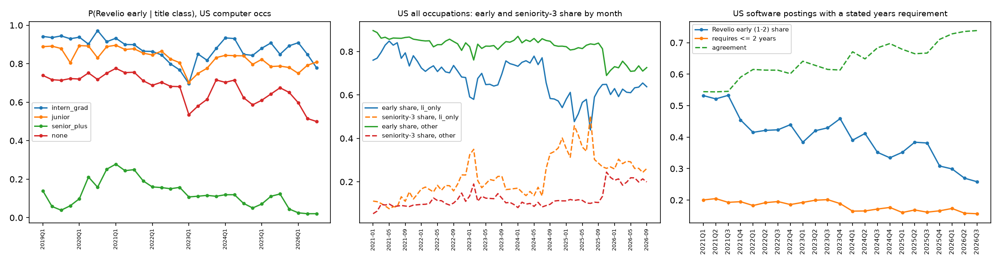
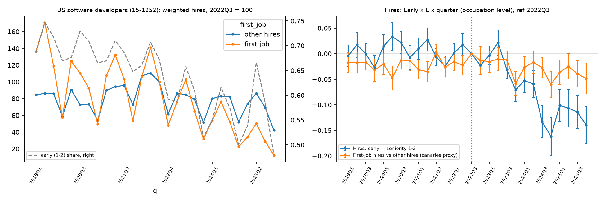

在[上一篇关于 AI 与长期增长的文章](/blog/ai-long-run-economic-development/)里，我讨论了一个问题：AI 如果接手部分初级任务，新人获得工作和积累经验的机会会不会减少？那是一条需要检验的推理。这篇文章回到招聘帖和履历记录，看看数据能支持到哪一步。

这份阶段性分析得到三个不同层次的结果。美国计算机职业招聘中，LLM 和生成式 AI 术语的提及明显增加；招聘帖中的初级占比也在下降，但来源构成和资历标签变化使它难以用于识别 AI 的影响；履历记录则显示，2023 年下半年以后，高 AI 暴露职业中的初级入职相对下降。**最后一项是值得继续检验的相关性证据，还不是 AI 导致新人失去工作的因果结论。**[^report]

## 观察的是什么

分析使用 WRDS 提供的 Revelio 招聘与履历数据。招聘主面板覆盖美国和中国的全部职业，时间为 2021 年 1 月至 2026 年 9 月，共约 11 亿条招聘帖。9 月只到 6 日，因此季度回归截至最后一个完整季度 2026Q2。招聘数据在 2021 年大幅扩张，不能把更早年份的计数直接接进来比较。

这里的“招聘帖”是 Revelio 跨来源统一、去重后的记录，**不等于独立岗位、实际空缺或最终录用人数**。一个岗位可以反复发布，一条帖子也未必对应一次录用。数据覆盖的变化，还会让记录数在招聘行为不变时发生变化。

履历分析使用美国公开职业档案中的任职记录，主要来自 LinkedIn。原始提取覆盖 2019–2026 年，约 1.63 亿条；用于结果估计的窗口是 2019Q1–2025Q4。报告把某季度开始的一段任职记作一次“入职”，按 Revelio 权重加总。它不是企业录用登记：是否包含同一公司内部的晋升或换岗，尚未确认；权重也不能消除所有在线档案的选择偏差。

还需要区分三个范围：

- **计算机职业**是 SOC 15-12xx，包括软件开发、测试、网络与数据库管理、信息安全和 IT 支持。下文技能统计和招聘描述都使用这个较宽口径。
- **初级**是 Revelio 模型预测资历的 1–2 级；回归中的资深对照组是 3–4 级，5–7 级不进入这项比较。初级不是按年龄定义，也不等同于应届生。
- **职业暴露度回归**跨多个职业比较，并非只研究软件工程师。只有图 3 左侧的描述序列专门对应软件开发者（15-1252）。

中国样本不包含 Boss 直聘和拉勾，且存在来源退出和标签断点。因此，下面的主要判断依据美国数据；中国序列仅用于说明所覆盖样本中的变化，不能代表中国整体招聘市场。

## 招聘文本中的 AI 提及增加，全栈标题没有持续上升

技能分析按招聘帖 ID 固定抽样：美国约取 1/50，中国约取 1/20，提取样本共约 221 万条。标题用于识别技术方向；职位描述用于识别语言、框架和 LLM 术语。描述标签的分母只包括描述长度超过 150 字符的帖子，标题标签的分母则是全部抽样帖子。[^skills]

| 美国计算机职业招聘中的提及比例 | 2021 | 2023 | 2024 | 2025 | 2026 年 1–8 月 |
|---|---:|---:|---:|---:|---:|
| 描述含 LLM / 生成式 AI 术语 | 0.03% | 0.56% | 3.15% | 4.68% | 7.27% |
| 标题含 ML / AI 方向词 | 0.53% | 0.71% | 2.51% | 3.07% | 4.91% |
| 标题含全栈 | 3.21% | 2.64% | 3.86% | 2.44% | 2.74% |
| 标题含前端 | 2.14% | 1.26% | 1.30% | 1.41% | 1.11% |
| 标题含移动端 | 2.31% | 1.46% | 1.37% | 1.22% | 1.43% |

表中 2026 年不是全年。技能汇总脚本剔除了不完整的 9 月，图 1 的最后一个季度也只有 7–8 月。LLM 标签包括 large language model、ChatGPT、GPT、RAG、大模型等词，反映的是文本提及，不证明雇主实际使用了工具，也不能全部理解为硬性技能门槛。

[查看图 1 原尺寸](stack_4_llm_genai_mentions.png)。图中的 early、mid、senior、lead 分别对应资历 1–2、3、4、5–7 级。

美国样本支持“AI 相关措辞更常见”，却不支持“招聘普遍转向全栈”。全栈标题占比在各年之间波动，2026 年还低于 2021 年。前端和移动端标题占比下降，也不能直接换算成这些方向的就业减少：多数美国标题只是泛称 Software Engineer，标题写法本身就限制了识别。

中国样本的 LLM 提及由 0.05% 升至 6.95%，但描述清洗、缺失和来源变化都会影响分母。例如 2024 年只有约 54% 的抽样帖子具备描述。这个数值可以报告，不能据此判断中美谁采用 AI 更快。标签还只经过每类 6–12 条命中样本的人工检查，未建立全面的精度与召回率评估。

## 初级占比下降，包含多少测量变化

美国计算机职业招聘中，初级占比从 2021 年的 52.8% 降至 2026 年已观测月份的 31.0%。但这条序列不是一个稳定不变的测量尺。

首先，占比上升也未必意味着初级机会增加。2023Q1 到 Q4，初级占比由 37.0% 回升至 47.5%，同期初级招聘帖却从约 96.6 万条降到 80.6 万条，下降 17%。原因是分母中的其他资历记录降得更多：3 级帖子从 91.6 万条降至 39.6 万条，下降 57%。这次反弹不能写成初级招聘复苏。

其次，模型标签与直接写出的经验要求并不一致。研究从美国计算机职业抽取 292,346 条帖子，约 51% 能解析出经验年限。在资历 1–4 级、且能解析年限的子样本里，Revelio 初级占比从 2021Q1 的 53.2% 降到 2026Q2 的 27.0%；同一子样本中，“要求不超过两年经验”的比例仅从 20.0% 降到 15.8%。两种指标的季度变化相关系数只有 0.04。[^measure]

[查看图 2 原尺寸](diag_measure_1_seniority.png)。正文采用完整的 2026Q2 作比较，没有把右图最后一点当成完整季度。

经验年限也不是无误差的标准。解析规则取描述中首次出现的经验数字，可能取到某项技能或加分项的要求；未写年限的帖子则不在比较中。这里能得出的结论是：**资历标签的下降不能全部解释为雇主提高了经验门槛**，而非另一种口径已经测出了真实变化。

最后，来源构成会改变回归方向。美国公司面板中，LinkedIn-only 帖子的比例从 2022Q1 的 45% 降到 2025Q3 的 7%。这里的 LinkedIn-only 指只有 LinkedIn 来源标记的帖子，不包括同时出现在其他网站的记录。即使固定为同一批 11,029 家公司，2025Q3 起的追加变化系数也会因来源选择而变号：只看 LinkedIn-only 是 +0.070，纳入全部来源则是 −0.113。两者都是初级相对资深、每标准差暴露度对应的对数计数变化，不能读成公司总体招聘增长率。[^panel]

## 怎样比较 AI 暴露不同的职业

只比较 ChatGPT 前后，没有办法排除同期的行业调整。报告进一步做三重差分：比较初级与资深的变化，再比较这种差异是否在高 AI 暴露职业里更大。

主暴露指标来自 Eloundou 等人的职业任务评分，用来描述 LLM 及配套软件可能帮助完成多少任务。它衡量潜在技术暴露，**不衡量企业实际采用了多少 AI**。原始分数按职业聚合后，在有评分的六位职业之间做不加权标准化；“高一个标准差”是职业分数的差距，不是 AI 使用量增加一个单位。

模型以职业、资历组、季度为单元，结果变量为 $\log(1+n)$，控制职业×季度、资历组×季度和职业×资历组固定效应，标准误按职业聚类。2023Q1 起设为第一段事后期，2025Q3 起另加一个增量。后一个系数不是第二阶段的总变化，也不是某个编程工具的独立效果。

招聘帖主回归包括 729 个美国职业，使用 2021Q1–2026Q2 的 LinkedIn-only 记录。问题在于，初级相对下降的暴露梯度在 2021–2022 年已经形成。把事件时间提前，仍能估到下降；加入趋势或改用同比，结果又会明显改变。增加公司固定效应也没有解决这一问题。

因此，招聘帖结果目前无法识别 AI 的因果影响。这也不等于识别出了“AI 没有效果”：除了强前趋势，标签噪声和统计功效也限制了这套设计能够排除的效应范围。

## 履历入职中的下降更清楚，但仍依赖假设

将结果变量换为加权任职开始数后，职业层面的回归包括 660 个美国职业，时间为 2019Q1–2025Q4，初级仍为资历 1–2 级，对照仍为 3–4 级。估计结果如下。[^hires]

| 比较 | 系数 | 标准误 |
|---|---:|---:|
| 2023Q1 起，初级×暴露度的变化 | −0.073 | 0.009 |
| 2025Q3 起的追加变化 | −0.057 | 0.011 |
| 改用同比结果变量，2023Q1 起的变化 | −0.051 | 0.007 |

第一项表示，在控制上述固定效应后，暴露度高一个标准差的职业，初级相对资深的 $\log(1+\text{加权入职})$ 多下降 0.073。它不是“软件工程师减少了 7.3%”，也不是“AI 使全部新人录用减少了 7.3%”。

按季度估计时，2023Q1 的系数接近零，2024Q1 为 −0.053，2025Q1 为 −0.101。图 3 右侧的蓝线展示这一路径。换成“履历中的第一段任职”与其他任职比较，第一段事后期系数只有 −0.009（标准误 0.006），也说明结果对初级定义敏感。履历第一段可能是实习、兼职或学生工作，不能直接替代应届毕业生或 22–25 岁劳动者。

[查看图 3 原尺寸](diag_hires_1.png)。左图的首段任职、初级资历和右图的职业暴露梯度，是三个不同指标。

履历数据的处理前系数比招聘帖平稳，但并没有通过“所有前期系数为零”的联合检验：χ² 为 35.9，p=0.0011。不能把“图上较平”写成平行趋势已经成立。

报告还使用 HonestDiD 检查结论对前趋势偏离的敏感性。对 2023Q1–2025Q4 平均系数，假设事前趋势严格线性延续时，95% 稳健区间为 [−0.103, −0.065]；若允许事后趋势偏离的季度变化达到事前最大季度变化的一半，区间扩大为 [−0.301, 0.144]，包含零。下降的统计证据依赖于对未观测趋势的约束，不能称为在宽松假设下仍然稳健。

履历更新滞后也是实质问题。样本的加权入职总量从 2025Q3 的 433 万降到 Q4 的 240 万，报告没有做更新滞后的 nowcasting 修正。不能把末期下降都当成真实流量下降，也不能假定不同职业和资历组的更新速度相同。

## 目前能说到哪一步

这份分析支持的是几个范围明确的观察：在所覆盖的计算机职业招聘中，AI 相关术语越来越常见；招聘帖里的初级标签占比下降，但这一指标存在明显测量问题；在美国履历记录中，2023 年以后出现了随职业暴露度增加的初级相对入职下降。

这些观察还不足以回答“其中多少由 AI 造成”。职业暴露度与其他白领职业特征相关，科技行业调整、融资条件和其他同期冲击，也可能对初级与资深产生不同影响。当前分析尚未把这些竞争性解释排除。履历记录也不能直接回答就业存量、失业率、工资或长期职业发展发生了什么。

下一步最有价值的工作，是检查不同数据快照下的履历滞后，采用更直接的经验年限定义，并在更可比的公司与职业之间检验其他冲击。对上一篇文章提出的新人学习机会问题，这份数据提供了一个需要认真追踪的变化；它还没有说明新人实际少做了哪些任务、少获得了多少培训，或今后的晋升路径会怎样。

## 数据与版本说明

本文依据侯雨昕《生成式 AI 与软件工程初级岗位：基于 Revelio 招聘与履历数据的阶段性报告》（2026-10-18），研究仓库 `software-job-postings`，版本 `d41dda0317f16844b084f08977c1c33cc56266eb`。数值来自已有报告、汇总表和诊断文档，本文没有重新运行研究分析。三张图均为该版本原图，未改绘；原始 WRDS 记录未附在本文中。

[^report]: `docs/REPORT.md`，第 3 节（数据与变量定义）、第 4 节（方法与结果）及第 5 节（限制）。本文保留其阶段性性质，不把报告中的待检验假设当作研究发现。

[^skills]: `docs/stack_tags.md`、`data/summary/tags_yearly.csv`；生成脚本 `04_stack_figures.py` 的 `LAST_FULL = "2026-08"` 同时约束图和年度表。抽样提取窗口到 9 月，与图表实际使用窗口不同；2026 年的 7.27% 等数值按后者标注。

[^measure]: `docs/diag_measure.md` 的经验年限比较表。正文使用 2021Q1 与 2026Q2 两行；图中还有不完整的 2026Q3。年限由描述首次匹配解析，不能视为人工确认的岗位要求。

[^panel]: `docs/diag_panel.md`，固定公司样本的 LinkedIn-only 与全部来源两行，采用公司×季度固定效应。LinkedIn-only 不是所有 LinkedIn 帖子。

[^hires]: `docs/diag_hires.md` 的回归、前趋势和 HonestDiD 表；图由 `14_diagnostics.py hires` 生成。暴露指标、固定效应及入职定义另见 `docs/REPORT.md` 第 3.4 与 4.7 节。这里的稳健区间直接引用已有计算，未增加新的敏感性分析。
