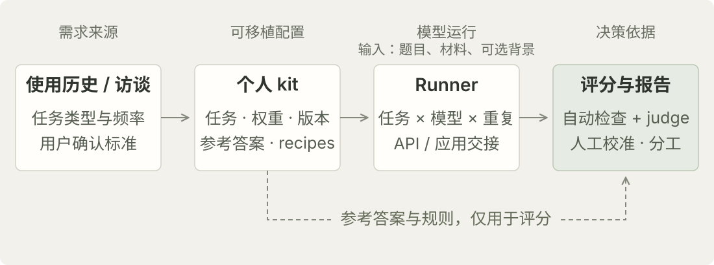

今天（10 月 13 日），[Gemini Argon 终于开放使用了](https://blog.google/innovation-and-ai/models-and-research/gemini-models/introducing-gemini-4-argon/)。

其实不知不觉之间，模型的发布、模型的评分已经彻底变成了新闻，谁是第一谁是第二成为了有趣的话题，尽管我们谁也不知道这些分数转化到自己的任务中来会怎么样——我们倾向于认为自己的任务对模型来说是很简单的（虽然不得不承认，很有可能真的是这样），更何况我们也没有办法改参数，也只能自己叠各种 skill、限定的 buff。

所以某种程度上来说，比起模型的能力表现，我们更在乎模型的价格、availability、活动、营销，或者去网上看看别人如何用它来画鹈鹕骑自行车。

而真正与用户需求相关的那一部分测评，很多时候就留给内部 agent 团队、后训练团队，在优化的时候再开始绞尽脑汁想一番，构造数据，进行训练和评测。至于具体到我这个用户，哪些进步是我能用上的，就靠自己慢慢感受。

从这个角度来说，现状倒是也没什么问题。

---

不过我就是有点好奇，以及有点烦躁——每个模型出来我都想尝试一下，但又觉得大众化的做个游戏、几秒出个网页、做个 SVG 非常没意思，对我来说没用。

最好的路径还是根据我的使用习惯，构造一套定制化的考试——宛如公司招聘，需要进行的是与岗位需求高度相关的面试。招一个人来读论文，总不能因为他画的自行车很好，就觉得他读论文也一定不错。

而且这件事似乎很适合让 AI 帮忙。我最常用的 AI 应用，在它能够访问的历史和记忆里，已经积累了不少关于“我到底用 AI 干什么”的信息。与其每次新模型出来都从头想几个 prompt，不如先把这些信息整理一下，做成我自己的题库。

这个想法做成了 [Personal AI Scorer Kit](https://github.com/houx15/toy-bench-for-everyone)。核心是把个人使用需求保存成一套可复用的评测配置：任务来自自己的历史，权重反映自己的使用习惯，评分规则在模型运行前确定。新模型发布后，可以在相同条件下比较它，而不必每次重新组织一次体验。

## 技术结构

实现由一个负责个性化配置的 skill 和一套 Python 评测工具组成。Skill 借助宿主应用能访问的历史、记忆或用户访谈整理任务；评测工具读取保存下来的 kit，运行模型、评分并生成报告。两部分通过普通文件衔接，因此个人 benchmark 可以脱离最初配置它的应用，继续使用和更新。

<figure>

<figcaption>个人 kit 将任务输入和评分依据分开保存；被测模型只接收题目、材料及可选的个人背景。手机上可横向滑动查看。</figcaption>
</figure>

### 任务与个人使用分布

Kit 用 YAML 保存任务类别、使用权重、原始 prompt、附件和评分所需的参考材料，并记录版本。这里有两个不同的目标：选题尽量覆盖不同种类的使用，汇总则按照使用频率和用户确认的重要程度加权。否则，最容易收集到的任务会占据大部分题目，最后得到的分数未必对应实际需求。

个性化也不意味着所有功能都要重新测。读论文、改写、brainstorming 适合围绕自己的材料定义标准；代码任务可以参考公开测评，再补自己项目里的样例；依赖搜索、记忆、文件连接的工作，则需要单独考虑产品和工具条件。当前初版实际支持的是论文阅读与 brainstorming，其他任务类型仍是扩展方向。

### Measurement recipes

我觉得最值得积累的是这一层。每类任务的 recipe 定义评价维度、评分尺度、参照样例、自动检查和 judge 提示词，让“回答得好不好”至少能够拆成几个可以复查的问题。

论文阅读的依据是用户确认的关键论点，以及预先写好的理解和局限性问题。评分检查内容覆盖、解释质量和原文支持程度。Brainstorming 则把新颖度、多样性与有用性分开考虑：偏离常见答案不一定有用，符合目标也不一定有新意。

当前 brainstorming 的前两个维度仍用粗糙的文本相似度近似，中文处理也不完善，不能把它当作成熟的创造力测量。更一般地说，事实正确性、任务完成质量和个人偏好应该分开记录；这也是后续需要完善的部分。个性化可以改变我对风格的偏好，但不应该让事实错误因为“我喜欢这个回答”就被抵消。

### 运行、校准与报告

Runner 按任务、模型和重复次数组织运行，默认每题三次。目前支持 OpenRouter、百炼，以及聊天应用的手动交接。它从 kit 导出不含参考答案的 `EXAM.md`，也支持给模型提供同一份 context pack，以控制个人背景的差异。任务或评分标准发生变化时，更新 kit 版本，避免把不同条件下的结果直接放在一起比较。

评分结合自动检查与独立 judge，工具提供匿名人工评分表，用来比较 judge 和用户的判断，并在报告中标记尚未校准的评分项。自动生成分数和分数值得信任，是需要分别处理的事情。

HTML 报告按个人使用权重汇总结果，同时保留任务级输出、评分依据，以及可获取的成本、耗时和重复运行波动。模型角色和任务分工表，是这些结果的一种呈现：它更适合处理哪些工作，哪些场景值得换过去。这里的目标是支持具体的使用决策，因此一个总分之外，还需要知道差异来自哪里。

## 讨论：个体效用与验证路径

目前这个项目仍是一个可以运行的 toy，其核心假设——个人评测能否改善后续模型选择——尚未得到验证。以下文献为这一假设提供了研究背景，也界定了需要检验的问题。

能力前沿与个人需求，可以理解为两种评测目标：前者考察模型在给定任务和条件下的能力表现，后者估计模型在特定用户的任务分布与评价标准下的效用。这一区分并不对应公共 benchmark 与个人 benchmark 的严格划分。HELM 已将使用场景和评价指标分别建模，同时考察准确性、鲁棒性、效率等多个维度，体现了通用评测对应用条件及指标权衡的关注。[^helm]

个人评测的动机主要来自任务分布与偏好的异质性。PRISM 将 75 个国家、1,500 名参与者的背景和偏好，与其同 21 个模型进行的 8,011 次对话相联系；研究发现，模型排名对参与者构成和讨论内容敏感。[^prism] 这为保留用户层面的信息提供了经验依据。不过，该研究重点涉及主观、价值相关及争议性议题，其结果不能直接推广为“所有任务都需要个人 benchmark”，也不能证明少量私人题目比公共排名更能预测日常体验。

对本项目而言，可以提出一个更具体的假设：当个人任务分布或评价权重与通用评测存在差异时，基于个人历史构建的评测，可能对后续模型选择提供额外的预测信息。这里需要区分任务抽样和评分标准两个来源。即使评价标准相同，任务权重不同也可能改变汇总排序；即使任务相同，用户对解释深度、表达方式或成本的权重不同，也可能改变选择。两者在本项目中同时存在，后续实验应分别估计其贡献。

其成立还取决于测量效度。Bean 等对 445 项 LLM benchmark 的系统性审查指出，目标概念的定义、任务选择、评分指标与结果解释之间经常存在不充分的对应关系。[^validity] 将数据来源改为个人历史，并不会自动消除这些问题。例如，关键论点覆盖率只能测量论文阅读质量的一部分，文本差异也不能直接等同于创意的新颖性。因此，本项目的 recipe 更适合作为测量方案的初始操作化，而非已经验证的能力指标。

评分器的可靠性是另一项独立条件。Zheng 等在 MT-Bench 和 Chatbot Arena 的研究中观察到较强 LLM judge 与人类偏好的一致性，同时报告了位置、冗长和自我偏好等偏差。[^judge] 这些结果支持将自动评分作为降低评测成本的方法，但其特定实验条件下的一致性，不能直接替代针对本项目任务和用户的校准；judge 与用户判断一致，也不等于评分能够预测真实任务收益。

据此，后续验证可以在时间上分离建题与测试：用历史任务构建并冻结 kit，在随后一周收集的新任务上，比较依据公共排名、相同题目下的统一权重、个性化权重三种策略选择模型的结果。评价指标包括任务完成质量、用户修改成本及匿名成对偏好，并单独记录实际模型选择，避免将使用频率直接视为质量指标。对任务样本和重复运行的波动报告不确定性；当前默认的三次重复本身并不保证排名稳定。

实验还需区分模型与使用环境的作用。主比较可以固定上下文、提示方式和工具条件，再分别改变 context pack 或提示方式，估计这些因素对结果的影响；若保留各应用的记忆和工具，则将结果解释为完整产品组合的比较。该设计检验的是：个性化配置能否在未参与建题的任务上，相对基线提供稳定的增量预测价值，而不仅是更好地拟合已有样本。

[^helm]: Liang, P., et al. (2023). [Holistic Evaluation of Language Models](https://arxiv.org/abs/2211.09110). *Transactions on Machine Learning Research*.

[^prism]: Kirk, H. R., et al. (2024). [The PRISM Alignment Dataset: What Participatory, Representative and Individualised Human Feedback Reveals About the Subjective and Multicultural Alignment of Large Language Models](https://arxiv.org/abs/2404.16019). *NeurIPS, Datasets and Benchmarks Track*. 参见 §3.2 关于样本构成与模型排名的分析。

[^validity]: Bean, A. M., et al. (2025). [Measuring what Matters: Construct Validity in Large Language Model Benchmarks](https://arxiv.org/abs/2511.04703). *NeurIPS, Datasets and Benchmarks Track*.

[^judge]: Zheng, L., et al. (2023). [Judging LLM-as-a-Judge with MT-Bench and Chatbot Arena](https://arxiv.org/abs/2306.05685). *NeurIPS, Datasets and Benchmarks Track*.
