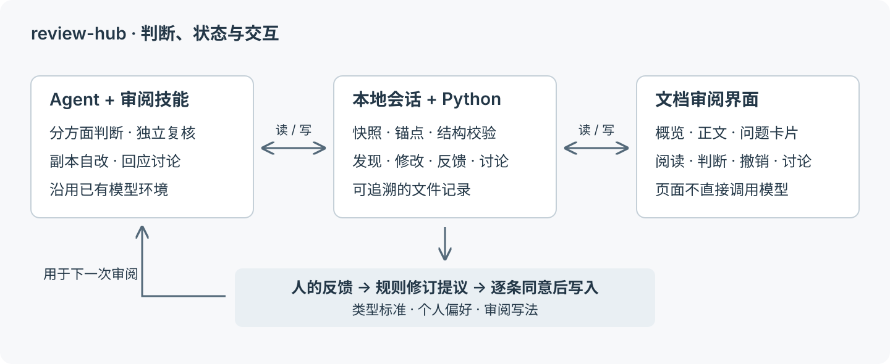
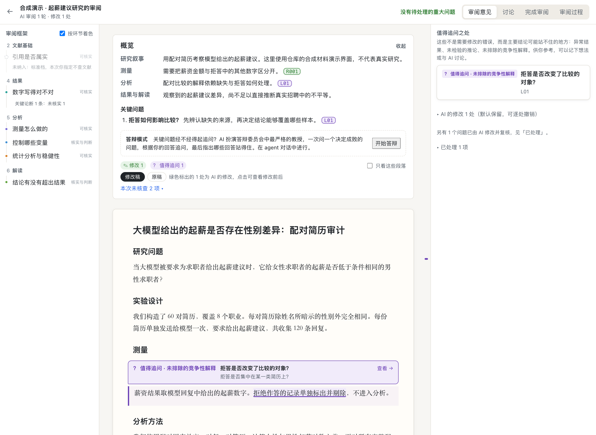
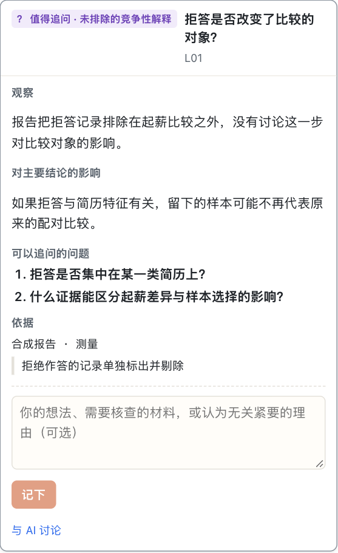
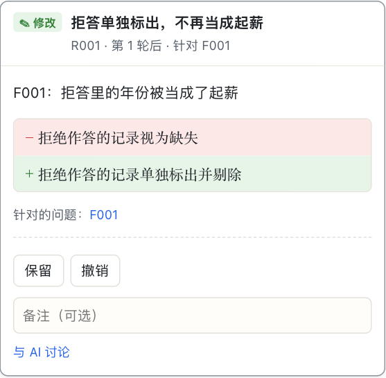

## 摘要

review-hub 是我最近发布的一套 AI 辅助审阅工具，由运行在现有 agent 中的技能、保存审阅状态的本地文件协议，以及一个文档审阅界面组成。它面向研究报告、研究计划、产品想法、文章等没有单一标准答案的产出，尝试解决一个问题：当 AI 能够快速完成大量工作时，人怎样理解这些工作的关键判断，并以可承受的成本承担审核责任？

系统将审阅组织为四个相连的过程：根据作品与使用情境确定标准；由 AI 分方面评审、独立复核并修改副本；通过概览、正文批注与问题帮助人理解和判断；从人的回应中提出审阅框架的修订。本文介绍这一设计的缘起、从最初方案到当前实现的变化、底层工作机制和实际界面。它是一篇系统设计与实践反思文章，不是效果评测报告：现有合成测试与开发记录可以说明机制如何运作，尚不能证明它在真实任务中稳定节省时间或提高质量。

**版本范围。** 本文以公开仓库的 [`5abd6f9`](https://github.com/houx15/review-hub/tree/5abd6f9) 为依据。最初的设计快照形成于 2026 年 10 月 21 日，后续决定记录到 10 月 28 日；下文把这些不同阶段分开讨论。界面截图使用人工配置的合成演示会话，不包含真实研究材料，也不作为模型审阅能力的证据。

## 1. 缘起：产出之后，理解工作仍然留给人

我做 review-hub 的出发点，是 AI 协作中的审核问题。研究报告、产品方案和文章可以很快生成，但“有了一份完整文本”和“我知道这份文本为什么成立”之间，还有相当长的一段距离。我需要知道它在回答什么问题，哪些选择决定了结果，哪些内容来自已有证据，哪些只是合理但未经检验的推断。换到另一个项目时，这套理解又需要重新建立。

最初的设计把目标写成四件事：AI 先自审，帮助人建立心智模型，让反馈更容易表达，再把反馈积累成以后可用的规则。[^design] 这四件事彼此依赖。只有自审而没有可理解的呈现，人仍要重新读一遍所有材料；只有漂亮的批注而没有依据，界面只是让不可靠的意见更容易被接受；如果每次纠正都留在聊天记录里，下一次又会重新解释同一个标准。

代码审查提供了一个有用的参照。Bacchelli 与 Bird 对现代代码审查的研究发现，找缺陷是重要动机，但审查也承担知识传递、团队理解和探索替代方案的作用；理解代码及其变化，是审查的关键困难。[^code-review] 我把这一观察带到开放产出上：审阅的成果应当包括对作品结构与理由的理解，而不只是错误清单。这里是设计上的借鉴，并不意味着代码审查的研究结果能够直接推广到科研写作。

开放产出还有一个特殊困难：评价标准本身往往没有完全定下来。研究设计是否回答了问题，产品最不确定的假设是什么，一篇文章的立意是否表达出来，都不能靠同一张检查表决定。审阅者需要先理解作品的目标、阶段，以及用户与作品的关系，再判断什么值得提出。

因此，我希望 review-hub 能回答三个相互关联的问题：这份作品整体上在做什么？其中哪些问题已有充分依据，可以直接处理？哪些地方仍然需要人作出判断、补充事实或继续调查？

## 2. 从最初设想到实际系统

### 2.1 从全面核查转向专家判断

最初的 Review Engine 设计覆盖了相当宽的范围：连接数据、代码和日志，按环节查找问题，再由独立审核者验证；对重要分析选择进行敏感度分析，必要时重跑计算。这些设想试图让审阅意见拥有更扎实的依据。

实际试用暴露了这条路线的代价。设计记录中有一次很具体的经历：审阅把约 1.5 GB 的运行日志复制进会话，多个审核 agent 同时重跑分析，耗尽了 16 GB 机器的内存；加入排队和资源检查之后，问题仍然出现。[^decisions] 这首先是资源问题，也促使我重新界定审阅工作的对象。

我需要的核心能力，是一个领域内的审稿人能够提出的判断：研究问题是否成立，方法能否回答它，分析选择是否合理，结论有没有超出证据，竞争性解释是否被处理。重新执行计算能够回答其中一部分问题，但不能替代这些判断。

当前技能因此明确规定：不运行被审项目的代码，不读入原始数据或大体量日志，不重新计算研究结果。它可以阅读设计文档、代码和已保存的结果文件，对主结论依赖的少量关键数字做对照；必须依靠重算才能解决的问题，留下具体的问题或核实要求。自改也不能产生新的研究数字。[^run]

这是一项能力边界，而非可靠性的保证。例如，系统可以指出“文本声称做了某项控制，但代码看起来没有相应处理”，却不能仅凭这点宣布修正后的效应有多大。文章中的论断可以先收窄到现有证据支持的范围，计算上的疑问仍然需要独立解决。

### 2.2 从发现错误，走向追问证据

另一次转折来自我对 Freedman《Statistical Models and Shoe Leather》的阅读。该文以科学推理与经验调查讨论统计建模的作用。[^freedman] 对 review-hub 而言，它促成的问题很直接：审阅是否只在检查“报告说的和结果文件是否一致”，却没有问“这些结果是否真的确立了结论”？

这两种问题不能混在一起。一句话与结果表矛盾，可以构成明确的错误；一个结果存在尚未排除的替代解释，则通常不能直接判定作者错了。把后者也当作错误交给 AI 修改，可能只是把一种未经证实的判断换成另一种。

系统因此引入了“值得追问”的线索：记录看到了什么、为什么可能影响主要结论，以及什么证据能够推进判断。研究类线索包括反常结果、未检验的推论、竞争性解释、模型替代研究设计，以及前后不一致。AI 可以整理和核实问题的出发点，但不替用户回答尚无证据的问题。

### 2.3 从强制介入，转向可选择的思考支持

最初设计中还有预测闸门：在关键结果揭晓之前，先让人写下预期。这来自一个严肃的交互问题——怎样防止用户只是顺着 AI 的结论点头。Buçinca 等人的实验表明，认知强制设计可以减少对 AI 的过度依赖，但降低过度依赖最有效的设计也得到较低的主观评价。[^forcing]

当前 review-hub 的选择是让材料保持可读，用户可以回应、讨论或跳过，不再要求先回答预测问题才能继续阅读，也不把逐项回应作为页面完成操作的前提。这个选择在当前技能和浏览器测试中都有体现。[^implementation]

我保留了引导思考的目标，但把它落实到问题的质量、所在位置和前后文上。这里存在一个尚未解决的权衡：取消强制步骤可能降低使用负担，也可能削弱促使人独立判断的效果。哪一种设计更好，需要结合真实任务检验。

## 3. 架构：把判断、状态与交互分开

review-hub 的运行结构很小：agent 负责理解和判断，Python 脚本负责确定性操作，本地网页负责呈现与记录人的动作。页面本身不调用模型。人的讨论写入会话文件，再由正在运行的 agent 读取和回复；如果没有 agent 接续处理，网页不会自行产生回答。

[查看图 1原图](review-architecture.svg)

### 3.1 模型负责判断，脚本负责可重复的操作

`review-start`、`review-run`、`review-apply` 和 `review-learn` 等技能规定审阅的步骤和标准。它们利用用户已有的 agent 环境工作，不需要再为网页配置一个独立的模型服务。当前安装脚本提供 Claude Code、Codex 和自定义技能目录入口；具体运行体验仍取决于宿主对技能、文件访问和子 agent 的支持。

确定性的部分集中在 `scripts/rh.py`：创建会话、生成编号、保存快照、计算哈希、校验结构、追加记录，以及生成摘要。这种划分的理由很实际：模型应当解释为什么一个批评成立，编号和文件格式则应当由程序保证一致。

界面服务使用 Python 标准库，前端使用随仓库提供的 Preact 与 htm，不需要前端构建步骤。服务只监听 `127.0.0.1`，检查请求的 Host 和写入请求的 Origin，并限制可读取文件的范围。[^implementation] 这些措施保护的是本地界面的访问边界。审阅文本是否发送给云端模型，仍取决于用户使用的 agent；“文件保存在本地”不等于“模型推理完全离线”。

### 3.2 一次审阅是一个可以检查的会话

工作区默认与工具仓库分开。长期类型规则、个人偏好、会话和学习记录留在工作区内，工具升级不必把审阅记录一起搬动。一次会话中，主要文件的职责如下。

| 文件或目录 | 记录什么 | 对审阅有什么用 |
| --- | --- | --- |
| `plan.json` | 作品类型、用户角色、修改范围和审核方面 | 先确定这次审阅的标准与边界 |
| `baseline/`、`artifact/` | 初始版本与正在审阅的副本 | 区分原文和 AI 的修改 |
| `map.json` | 关键主张、决策、方面评价、概览与线索 | 表示整份作品的结构与未决问题 |
| `findings.jsonl`、`changes.jsonl` | 经复核的问题与逐处修改记录 | 追溯为什么改、改了哪里 |
| `feedback.jsonl`、`threads.jsonl` | 人的回应与讨论 | 将反馈挂到具体对象上 |
| `certificate.md`、`metrics.json` | 核查范围、未查内容和过程记录 | 说明审阅实际覆盖了什么 |

这里的“验证清单”是审阅范围的说明，不能理解为对整份作品正确性的认证。对照了几个核心数字，并不能推出所有数字都已核实；引用位置存在，也不能推出它支持当前推论。

发现与反馈采用追加记录的方式保存。发现的状态变化会写入同一编号、更高修订号的完整记录，最新记录表示当前状态，之前的版本保留。文本位置则通过原文摘录、前后文和位置提示共同定位，避免只靠修改后容易失效的行号。

写入发现时，脚本还会机械检查原文锚点和文件证据摘录是否存在。这可以挡住一部分不存在的引用，却不能判断论证是否公允。机械校验与语义复核处理的是不同问题，两者都需要保留。

## 4. 审阅如何运行

### 4.1 先确定情境，再确定标准

一次审阅从 `review-start` 开始。AI 判断作品属于什么情境，为这份作品提出审核方面、覆盖内容和关键标准，交给人确认。类型库中的 `TYPE.md` 提供参考，而不是要求每份作品套用同一个模板。

当前学术报告框架按六个层次展开：研究问题与定位、文献基础、研究设计、结果、分析、解读。每个层次都有核心问题、评价标准、专家会追问的问题，以及常见缺陷。例如，“研究设计”不只是问有没有方法章节，还要问处理与对照之间是否存在额外差异，最有力的竞争性解释是什么，研究结论能够覆盖哪些情境。

类型差异会改变审阅结果的含义。技术设计关注目标与方案、风险点、性能与资源；产品想法关注核心点、最不确定的假设、核心挑战和最短检验路径。对尚未完成的产品或课程方案，评价使用“想清楚了／有方向，未想透／尚未涉及”，并给出建议的推进路径。把早期想法逐项评成“不合格”，通常既没有考虑作品阶段，也没有增加有用信息。

系统还显式记录用户是作者还是评价者。评价别人的作品时，不应让用户替原作者选择研究方案，也不改写作品。作者自己的文本则按修改范围处理：一般文本可在副本中修改；第一人称文章、申请文书等使用较窄的修改范围，避免替作者添加论断；创意写作类型当前采用只提问与建议、不改写的策略。类型库已经覆盖多种情境，但不能由此推断所有类型都经过了同等充分的验证。[^decisions]

### 4.2 分方面评审，再由新上下文复核

计划确认后，AI 先拆出关键主张与真正存在备选方案的决策。决策记录包含问题、选项、标准和证据，并描述依赖关系。没有备选、只能核实真假的前提，则作为主张处理。例如，“两份简历除姓名之外完全相同”是需要证据支持的事实，不应该为了凑成一个决策卡片而编造选项。

随后按审核方面分组评审。在支持子 agent 的环境里，不同审核者可以并行工作；不支持时依次执行。每组读整份作品，但集中判断一到两个方面，提出候选问题、方面评价和线索。

下一步由新上下文中的验证者复核候选。它需要打开证据所在的位置，检查作者是否在其他段落或局限中已经处理了问题，判断批评是否公允，统一严重度并去重。没有依据或不成立的候选不会直接交给用户。多个问题如果来自同一个根源，也应保留它们的关系，而不是让人重复处理同一件事。

独立上下文的意义，是增加一个重新检查批评的环节。它不保证错误独立：不同角色可能仍使用同一个模型，共享知识缺口，也可能共同误解材料。CriticGPT 的工作说明专门的模型批评可以帮助人发现代码问题，同时明确指出批评自身也会产生幻觉。[^critic] 这为“批评也需要审核”提供了依据，但不是 review-hub 当前流程有效性的直接证明。

### 4.3 分清可以修的问题与值得追问的问题

当前系统至少区分三种重要对象。

| 对象 | 需要什么依据 | 后续动作 |
| --- | --- | --- |
| 已成立的问题 | 具体原文或事实依据，加上批评为什么成立的理由 | 在允许范围内修改，或明确交接原因 |
| 值得追问的线索 | 真实的观察、对结论的潜在影响、可推进判断的问题 | 留给人回答、讨论或进一步调查 |
| 关键决策 | 实际可行的备选、选择标准及相关证据 | 由有权作出选择的人决定 |

例如，一份报告把仅覆盖某个模型与若干职业的观察写成“大模型普遍如此”，可以提出推广范围过大的批评。若报告剔除了拒答，但没有说明拒答是否集中在某类简历，则更合适的处理是问：这种缺失会不会改变比较对象？什么证据可以区分薪资差异与样本选择？在材料不足时，不应替作者宣布存在或不存在选择偏差。

这种区分决定了系统怎样修改作品。只有已经足以支持修改的判断，才进入自改流程；仍需调查的疑问以问题形式保留。写出一个像专家的问题，并不等于已经获得专家的答案。

### 4.4 在副本上自改，再把剩余判断交给人

AI 的自审自改最多进行三轮，具体是否继续由未处理问题和当前状态决定。它在副本上修改，并记录每一处修改的原文、新文和理由。后续轮次需要检查这些改动，避免修正一个问题时引入另一个问题。

这项设计把人的时间留给 AI 尚不能解决的部分，同时要求所有自动修改都能被检查。用户可以查看原稿与修改稿、撤销具体修改、对意见表示不成立或无关紧要，也可以继续讨论。撤销反馈会记录下来，由后续 agent 流程处理；不能把网页上的反馈标记理解为所有修改都已即时写回。

最终写回原文件需要人的同意，并展示相对初始版本的完整差异。原文件如果在会话期间被其他工作修改，写回检查会拒绝直接覆盖冲突。页面上的“定稿”、对副本的认可与真正写回源文件，是需要区分的动作。

## 5. 界面：在整篇理解与局部判断之间移动

### 5.1 概览先交代作品结构

早期界面主要展示问题与决策点，但细碎批注并不能自动合成为整体理解。开发记录里，一个很明确的反馈是：审阅文字充满内部术语，反而增加了阅读负担。后续界面采用两层结构：上方概览解释整份作品的结构与关键问题，正文批注处理具体位置；同一问题尽量只写一次，其他位置用引用连接过去。

[查看图 2原图](review-overview.png)

图 2 展示的重点是阅读顺序：先知道这份作品在做什么，再进入那些会改变判断的具体位置。概览中的引用可以打开相应批注，从整体问题回到原文；正文中的标记又可以让人返回证据和讨论。

### 5.2 问题紧贴相关段落

界面把需要关注的区域直接标在正文里，并在区域开头写出相关问题。修改、建议、值得追问、待核实和讨论采用一致的视觉类别，严重程度另外以文字呈现。这使“这里是什么性质的问题”与“它有多重要”不必挤在同一种颜色里。

[查看图 3原图](review-lead.png)

图 3 中的疑问没有被伪装成已确定的错误。用户能同时看到原文、问题的依据和为什么值得追下去。它希望减少的是在报告、聊天记录和证据之间来回寻找上下文的成本；是否真的降低认知负担，仍需要实际观察。

### 5.3 修改需要可以解释和拒绝

[查看图 4原图](review-change.png)

图 4 展示了与正文相连的修改记录。审阅的可控性不只来自最后一句“是否同意”，还来自用户能够辨认具体改动、理解理由，并拒绝某个不合适的修改。对开放文本尤其如此：更流畅的句子可能改变原作者的立场，删除一句话也可能删掉重要限定。

页面还提供讨论、审阅过程和完成审阅入口。讨论保留对象关系，审阅过程从已有记录重建各轮发现与修改，避免最后只剩一个无法解释来历的“修订后版本”。

## 6. 从反馈中修订审阅标准

review-hub 的长期机制是 `review-learn`。一次审阅完成后，agent 汇总用户的回应：哪些批评不成立，哪些无关紧要，哪些修改被撤销，AI 遗漏了哪些问题，以及用户对审阅提出了什么建议。系统据此提出对类型框架、规则和写法的具体修订，经用户逐条同意后写入，并保留接受或拒绝的记录。[^learn]

这不是模型权重训练。变化发生在可读、可修改的规则和技能文本中。一个提议需要说清楚修改哪一处、改成什么、依据哪些反馈，以及预期下一次多发现什么或少打扰什么。正确性要求与个人偏好也要分开：一个人喜欢简短措辞，不应成为省略关键证据的理由。

这种做法与 EvalGen 讨论的“标准漂移”有关：人需要标准来评价输出，但看到具体输出的过程又帮助人形成标准。[^evalgen] 对 review-hub，我不希望把标准当作安装时就已经完成的静态配置，也不希望每一条临时意见立即变成永久规则。具体反馈、适用范围和人的确认构成了规则更新的依据。

系统还保存本地阅读活动，例如批注是否被打开、停留多久、是否从概览点入。它们只能被解释为需要进一步理解的信号。长时间停留可能是困惑，也可能是认真思考；没有打开可能是噪声，也可能是时间不足。不能仅凭行为记录自动删除某类检查，更不能把“用户同意率上升”当作审阅质量提高的充分证据。

一个更危险的优化方向，是为了获得更多同意而减少挑战。当前 `review-learn` 的规则明确要求，不为了提高同意比例而取消检查；误报应通过收紧适用条件来减少。这个原则最终是否得到贯彻，仍然需要对更新后的规则进行回看。

## 7. 答辩模式：检验作者能否解释关键选择

除了文档审阅，review-hub 还提供独立的 `review-devil`。它根据作品类型扮演严格的内行听众：论文的审稿人、研究计划的评审委员、产品方案的投资人，或技术设计的资深工程师。

流程选择五到七个可能改变整体判断的问题，一次问一个，根据回答追问，最后说明哪些回答站得住、哪些仍有缺口，并保存记录。[^devil] 它适合检验作者能否解释关键选择，而不只是确认文本中存在相应章节。例如，“为什么这项对照足以排除另一种解释”，比“你是否已经写了局限性”更接近真正的辩护任务。

这一模式在 agent 对话中运行。网页可以发出请求，但没有在浏览器内另建一个自动答辩模型。它的判断仍是模拟反馈，不能等同于真实评审结果。

## 8. 现有证据、局限与下一步验证

### 8.1 目前可以从仓库确认什么

仓库包含文件协议、确定性脚本、本地界面、技能文本、单元测试、浏览器测试和早期合成试跑记录。测试覆盖了多类具体行为，例如证据锚点校验、原稿与修改稿切换、讨论写入、线索高亮、界面更新、反馈记录及访问边界。这些材料使实现可以被检查，但程序测试通过与审阅意见有价值是两件事。

2026 年 10 月 22 日的早期试跑使用了一份人为埋错的简历审计报告。记录报告了六类预设错误被识别，以及候选去重、错误传播和多轮修改中暴露的问题。该记录也明确说明：合成试跑不满足以真实产出验收的要求。[^trial]

更重要的是，早期试跑采用了后来已经取消的重算与预测流程。因此，它可以解释证据校验、根源关联等设计为什么出现，却不能直接作为当前“专家判断、不重算”版本的准确率或节时结果。本文截图同样只证明当前界面的呈现方式，不证明模型自行生成了这些判断。

### 8.2 仍然存在的主要限制

首先，专家角色提示不能保证专业能力。即使分组评审、增加复核，系统仍可能遗漏整个领域的重要前提，也可能给出理由完整但实际上错误的批评。

其次，标准与反馈都有选择性。用户回应的往往是自己能判断、且当时愿意处理的问题，最难发现的缺陷可能没有进入反馈记录。对“同意／不成立”的统计主要反映已经被看见和处理的意见，不能直接当作总体精确率；未被发现的错误更不会自动出现在分母里。

再次，当前流程主动放弃重算，因此不承担完整的计算复现职责。它可以要求更好的证据，却无法只靠文本阅读解决数据与执行环境中的所有问题。将来若连接独立的验证工具，应当保留这一区分，让“对方法的判断”和“计算核验的结果”分别说明依据。

最后，多轮自改存在改变作者意图的风险。较窄的修改策略、原稿保存、逐处记录和写回确认能够让风险可见，但不能保证人一定会察觉语义上的细微变化。

### 8.3 应当怎样检验这套设计

下一步更有意义的评估，是在可比的真实任务上比较三种方式：用户原有的审阅流程、只有 AI 文字意见的流程，以及包含文档交互与反馈积累的完整流程。任务应按体裁、长度和难度分层，避免把熟悉程度或作品质量差异误认为工具效果。

至少需要同时观察三类结果：人的主动审核时间；经独立复核的问题质量与修改质量；交付后延迟发现的遗漏。再加一个理解任务——请使用者解释作品的核心假设与推广边界——才能更接近“是否建立了心智模型”，而不只是“是否点完了批注”。

长期规则更新还需要在未参与规则形成的新任务上检验。否则，系统可能只越来越熟悉已经见过的文本。如果审核时间下降，应同时检查遗漏是否增加、作者意图是否被改变、用户是否更少提出异议。最初设计中的目标是让同类任务所需的时间和反馈逐渐减少，同时不增加事后发现的问题；这仍然是目标，而不是现有结论。

## 9. 使用与后续方向

项目已公开在 [GitHub](https://github.com/houx15/review-hub)。安装说明见 [INSTALL.md](https://github.com/houx15/review-hub/blob/5abd6f9/INSTALL.md)，仓库 README 给出了 Claude Code、Codex 和自定义技能目录的入口。典型使用顺序是初始化工作区、提交产出并确认审阅计划、运行自审、打开页面处理剩余问题，再根据反馈修改和决定是否写回。完成后可以回顾本次审阅，决定哪些经验值得成为后续规则。

我目前最想继续改进的，是问题的质量与组织方式：让概览真正说明作品的结构，让批评有可追溯的依据，让不确定的地方成为可以继续调查的问题，并让每一次反馈都能修订下一次审阅的标准。review-hub 为这些工作提供了一套可以运行、检查和修改的机制；它能否成为日常工作中可靠的审阅支持，需要在更长时间、更多真实任务中继续验证。

## 参考资料

[^design]: Yuxin. [Review Engine：人机协同审核系统设计](https://github.com/houx15/review-hub/blob/5abd6f9/docs/spec/review-engine-design.md)，2026-10-21 设计快照。该文描述最初方案；当前行为以之后的设计决定、技能和实现为准。
[^decisions]: Yuxin. [设计决定记录](https://github.com/houx15/review-hub/blob/5abd6f9/docs/spec/DECISIONS.md)，2026-10-21 至 2026-10-28。本文关于设计演变与试用反馈的依据。
[^code-review]: Alberto Bacchelli and Christian Bird. [Expectations, Outcomes, and Challenges of Modern Code Review](https://www.microsoft.com/en-us/research/publication/expectations-outcomes-and-challenges-of-modern-code-review/). ICSE, 2013.
[^freedman]: David A. Freedman. *Statistical Models and Shoe Leather*. Sociological Methodology, 21, 291–313, 1991。[UC Berkeley 图书馆保存的技术报告版本与书目信息](https://digicoll.lib.berkeley.edu/record/85889)；该版本形成于 1989 年，书目注明之后的期刊发表及讨论。本文仅说明它对本项目问题意识的影响。
[^forcing]: Zana Buçinca, Maja Barbara Malaya, and Krzysztof Z. Gajos. [To Trust or to Think: Cognitive Forcing Functions Can Reduce Overreliance on AI in AI-Assisted Decision-Making](https://www.eecs.harvard.edu/~kgajos/papers/2021/bucinca2021trust.shtml). Proceedings of the ACM on Human-Computer Interaction, 5(CSCW1), 2021.
[^critic]: Nat McAleese et al. [LLM Critics Help Catch LLM Bugs](https://arxiv.org/abs/2407.00215). arXiv:2407.00215, 2024.
[^evalgen]: Shreya Shankar, J.D. Zamfrescu-Pereira, Björn Hartmann, Aditya G. Parameswaran, and Ian Arawjo. [Who Validates the Validators? Aligning LLM-Assisted Evaluation of LLM Outputs with Human Preferences](https://people.eecs.berkeley.edu/~bjoern/papers/shankar-validators-uist2024.pdf). UIST, 2024.
[^run]: review-hub. [review-run 技能](https://github.com/houx15/review-hub/blob/5abd6f9/skills/review-run/SKILL.md)。当前专家判断、自改、独立复核与线索处理的流程定义。
[^implementation]: review-hub. [确定性辅助脚本](https://github.com/houx15/review-hub/blob/5abd6f9/scripts/rh.py)、[本地界面服务](https://github.com/houx15/review-hub/blob/5abd6f9/scripts/rh_ui.py)、[浏览器与 API 测试](https://github.com/houx15/review-hub/blob/5abd6f9/tests/test_ui.py)。
[^learn]: review-hub. [review-learn 技能](https://github.com/houx15/review-hub/blob/5abd6f9/skills/review-learn/SKILL.md)。
[^devil]: review-hub. [review-devil 技能](https://github.com/houx15/review-hub/blob/5abd6f9/skills/review-devil/SKILL.md)。
[^trial]: review-hub. [合成产出上的端到端试跑记录](https://github.com/houx15/review-hub/blob/5abd6f9/docs/trial/README.md)，2026-10-22。记录属于早期流程，不能视为当前版本的真实任务评测。
