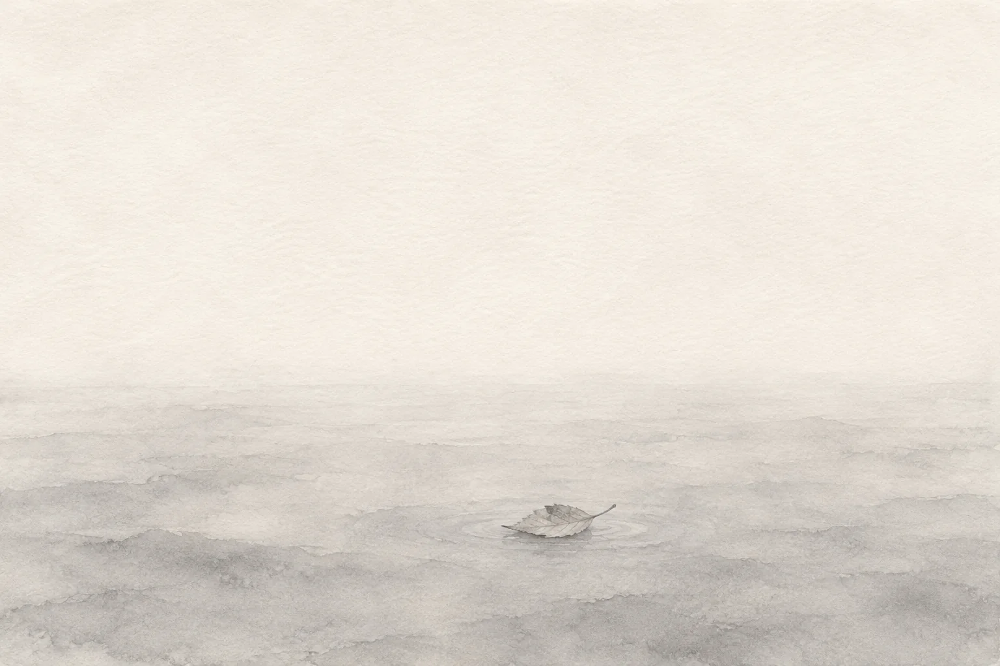

If I were allowed to write, then I write\
Write in a way that pushes every opportunity and every bit of luck away\
If I were allowed to read, then I read\
Read in a way that makes me feel more separated from the whole world

I stood near the sea. I gaze, the wind gazes, the blue sea flows quickly. And the next second I feel like I’m drowning in the sea. I’m drowning in a sea, not a lonely sea, but a crowded sea, with many people playing, swimming, laughing, only everything is far away from me because only I, only I, am drowning.\
Is there a thing called luck in the world?\
To bring the darkness to an end, to give you some relief, to ask for a suspension of such drowning.\
Words are useless.\
You told me that my value would not be defined by a single thing. Then I thought my value had never been defined by anything. What is value? Value is to be seen by someone, and this is the truth.\
You told me that this was someone’s fault. But what I end up with is this: I can only change my own mind and actions. What is fault? Fault is something to work on, and I can only look for fault in myself.

Days end. Nights start. Yellow light, yellow leaves. Call it fall, with leaves falling. Empty trees. Empty winters.\
I try to stay curious, like on the first day I arrived, to delight in every building and every tree, every squirrel. No, this is way too difficult for me.\
Stop talking.\
That talking is worth doing doesn’t mean that one is able to talk, about her endless sadness, about her darkness, about her regret.\
Sunshine arrives. New day. I sit on the bed, where sunshine cannot reach. Sunshine is away.

Ridiculous.\
Means that the one who hates herself and believes only that she is working hard enough finally encounters someone who denies her endeavour.\
Means that the one who has so many regrets about herself and is so sad about time flying is finally told that her youth has died away and there are no more possibilities.\
Means that the one who always thinks of the worst situation finally encounters something worse than the worst.\
Means that the one who cannot stop writing is accused of writing pretty badly.\
Means that the one who lives in total contradiction has to keep living actively.\
Show your energy, show your endeavour, show your mindfulness, show your strength. Or else you are not strong. You can be so easily defeated.\
Or, just, you are so weak.\
You are fragile.\
You are fragile because you cannot bear such criticism. Then you must regret being born.\
Why do I have to regret it?\
Or how do you know that I don’t regret it? For any single second in my whole life? Living in such a deep hole of sadness, drowning, with a little bit of sunshine, a little bit of happiness, a little bit of sweetness. Not so much, just enough to go on living painfully and still make a living.\
And drowning in a sadness so huge that others cannot understand it, a sadness that cannot be spoken out loud.

Leaves grow, leaves pass away, leaves fall down, one by one, green to yellow to none. This is how I learn about time.\
Opportunities pass away, no more possibilities. This is how I learn about time.\
Peers become strong, competitive, far away. This is how I learn about time.\
I realize that, oh, on those days when I thought I was bad, it was actually that same depressed mood, again, and again, and again. This is how I learn about time.

But I learned to know the truth.\
The truth is that life can be hard, can be unequal, can be bitter, can leave you without support. When you feel the worst, you may find nobody to talk to, you may not want to speak to anyone, and life still carries on, time still carries on.\
This is the truth.\
The truth is also that, in any kind of situation, I am still responsible for figuring it out.\
To take action on my tasks, and to take action for myself.\
I am both the friend and the enemy of my sadness. I protect it, hide it, and fight against it, and then hug it.\
This is the way of life.
