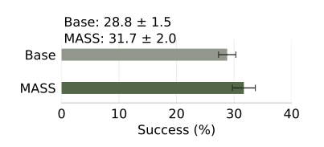
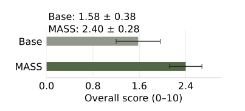
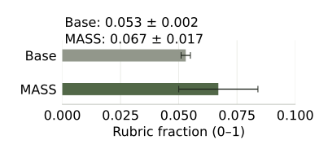
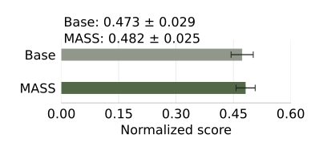
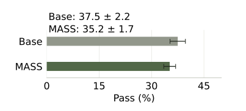
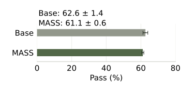

<link rel="stylesheet" href="/assets/mass-note.css?v=1">

**论文：** [Recursive Self-Improvement through Multi-Agent Self-Supervision](https://arxiv.org/abs/2610.12176v1) · 2026 年 10 月 8 日，预印本 v1 · [在线全文](https://arxiv.org/html/2610.12176v1) · [PDF](https://arxiv.org/pdf/2610.12176v1)

让几个 Agent 合作完成一个任务，与让模型从这次合作中学到东西，是两件事。MASS 把它们连接起来：先搜索更好的协作方式，再从执行结果中筛选经验，用这些经验微调模型。

这个想法带来三个相连的问题：

- **怎样产生值得学习的经验？** 工作流、分工和试错决定模型有机会做出什么。
- **怎样把经验变成能力？** 数据筛选和训练目标决定模型会保留什么。
- **怎样判断能力真的改善？** 评价标准、泛化测试和成本决定“进步”意味着什么。

<nav class="mn-routes" aria-label="阅读路线"><strong>按问题阅读</strong><a href="#mass-method">理解方法</a><a href="#mass-results">查看结果与局限</a><a href="#mass-data">思考数据价值</a><a href="#mass-semantics">理解关键决策</a></nav>

## 第一部分｜论文详细拆解

### 1. 研究问题：开放式任务缺少廉价的正确答案

代码能否通过测试，通常有比较明确的判断。研究项目则复杂得多：报告可以完整、代码可以运行，但结论仍可能依赖错误假设、不公平的基线或数据泄漏。

MASS 面对的困难是：**当没有足够的标准答案和人工示范时，模型能否通过组织、比较和学习自己的执行经验，改善后续表现？**

它将改进分成两个层次：

| 层次 | 改变什么 | 例子 |
| --- | --- | --- |
| 工作流 | 角色、顺序、信息交接与检查机制 | 把“直接回测”改成“先检查日期对齐，再回测” |
| 模型参数 | 给定上下文时，模型生成不同判断和行动的倾向 | 没有额外提醒，也更容易主动检查泄漏 |

MASS 以 Qwen3.6-27B 为基础模型。多个角色可以由同一个基础模型承担。执行者、工作流优化者和内部评估者也使用同一模型；改进后的模型再进入下一轮。

### 2. 方法：搜索协作方式，再学习较好的执行

<figure class="mn-figure" id="mass-cycle">
<fieldset class="mn-switch"><legend>MASS 的两个改进层次 · 点击切换</legend>
<label><input type="radio" name="mass-layer" value="workflow" checked> 工作流搜索</label>
<label><input type="radio" name="mass-layer" value="weights"> 参数学习</label>

<strong>固定模型权重，改变协作方式</strong><ol class="mn-flow"><li>提出角色、顺序与信息交接</li><li>真实执行，得到成果与轨迹</li><li>比较成果，反馈给工作流优化者</li></ol>
反复搜索后，保留内部评价较好的工作流。评分用于指导搜索。

<strong>固定选定工作流，收集经验并更新权重</strong><ol class="mn-flow"><li>每个任务独立执行 18 次</li><li>按成果排名筛选轨迹</li><li>LoRA SFT：学习编排者与工作者的输出</li></ol>
更新后的模型回到下一轮工作流搜索。评分用于筛选示范，参数更新仍是 SFT。

</fieldset><figcaption>图 1. MASS 循环的概念示意，依据论文 §3；下一轮使用更新后的同一模型。</figcaption></figure>

**工作流搜索**改变模型如何被组织起来：

- 谁负责分解任务，谁负责执行和检查。
- 哪些工作可以并行，哪些必须等待前置结果。
- 每个角色向下游提供什么产物和信息。
- 执行反馈出现后，怎样修改协作方式。

这一阶段固定模型权重。相同模型通过不同工作流，可以产生不同质量的结果。

**监督微调**把筛选出的执行经验写入参数：

- 按选定工作流收集多次执行。
- 比较最终成果，保留排名较高的执行轨迹。
- 学习这些轨迹中的判断、委派、工具使用和结果整合。
- 将更新后的模型用于下一轮搜索、执行和评价。

LoRA 是参数高效微调：冻结原有大部分权重，学习较小的参数增量，之后可以合并到模型中。它确实改变模型参数。

**MASS 的参数更新采用 SFT。** 成果评分用来筛选示范，并没有直接变成每一步动作的 RL 奖励。一个系统有评价和反馈，不等于它采用了强化学习。

论文进行了两轮迭代。第一轮 SFT 使用 6 张 H100、约 19 小时；这一数字不包含搜索、轨迹收集和评价成本。[原文 §3、附录 B](https://arxiv.org/abs/2610.12176v1)

### 3. 训练：模型学习的是上下文中的行为

#### 3.1 成果用于评价，轨迹用于学习

一次执行留下两类东西：

- **成果**：代码、报告、图表、实验结果。
- **轨迹**：执行过程中看到的信息、作出的判断、调用的工具、收到的反馈，以及角色之间的交接。

下面是一个说明性例子：

<figure class="mn-figure"><ol class="mn-flow"><li>任务：评估一种交易信号</li><li>编排者委派数据整理 → 反馈部分日期缺失</li><li>先检查时间对齐与泄漏，再计算费用调整后的回测结果</li><li>编排者发现报告与指标不一致 → 要求修正</li><li>最终成果：代码、指标、图表与报告</li></ol><figcaption>图 2. 说明性执行路径，并非论文中某条真实轨迹的复现。</figcaption></figure>

MASS 比较的是最终成果，再选择与这些成果对应的轨迹。这里存在一个关键假设：**较好的成果，能够提供较好的行为示范。** 这个假设有用，但不保证轨迹的每一步都正确。

#### 3.2 训练数据从哪里来？

每个训练任务执行 18 次，模型成对比较成果，再用 Bradley–Terry 模型估计相对排名。

- 经常战胜较强对手的成果，得到更高的相对分数。
- 每个任务排名前 15 的轨迹用于训练，第 16 用于验证。
- 排序反映裁判偏好，不是独立的科学真值。
- 排除一次提前终止的执行后，第一轮得到 119 条训练轨迹。

这 119 条轨迹来自 8 个实际训练任务，包含约 1,722 万监督 token。**任务数、轨迹数和文本量不能互相替代。** 同一任务执行很多次，可以增加行为变体，却不等于增加了同样数量的新任务。

#### 3.3 输入是什么，模型要学会输出什么？

| 当时可见的上下文 | 需要学习的输出 |
| --- | --- |
| 总体任务、已有进展、尚未满足的条件 | 下一次委派、检查、追问或整合 |
| 工作者收到的局部任务、工具反馈 | 下一步推理、代码、工具调用或报告 |
| 失败信息与此前尝试 | 修正方案或停止决定 |

这些上下文和行为以对话、文字与工具交互记录表达。训练要求模型学习示范者接下来怎样行动；工具实际返回的结果作为已知条件供模型阅读，不要求它学会伪造环境反馈。

自回归学习的含义是：**根据此前内容，预测接下来的内容。** 对一段示范回复，训练逐步提高其中后续 token 的条件概率。这里 token 是模型处理文字的基本单位，不必与一个汉字或一个词严格对应。

训练时使用示范中的前文作为条件；实际执行时，模型要面对自己生成的前文和真实工具反馈。因此，模仿示范做得好，不自动保证偏离示范后的恢复能力也好。

MASS 还移除了编排者初始提示中的优化工作流，保留原任务；工作者收到的局部任务说明保留。这使训练指向一个更强的目标：没有现成流程提示时，模型也能产生有用的编排行为。

#### 3.4 编排者与工作者共享参数

两类角色的经验分别整理、混合采样，更新同一个模型、同一套 LoRA。

<figure class="mn-figure">

<strong>编排者经验</strong>
委派、检查、整合

<strong>工作者经验</strong>
执行、修正、报告

↓ 混合采样 ↓

<strong>同一个模型 · 同一套 LoRA</strong>
参数共同更新，角色由上下文区分

↓ 按当前上下文生成 ↓

编排者上下文 → 编排行为

工作者上下文 → 执行行为

<figcaption>图 3. 共享参数不等于共享上下文。采样概率约为编排者 1/3、工作者及辅助片段 2/3。</figcaption></figure>

- **角色由上下文区分**：总体任务与编排要求，或局部任务与执行要求。
- **参数共同更新**：工作者经验也可能影响编排能力，反之亦然。
- **采样控制训练压力**：约 1/3 概率采编排者片段，2/3 采工作者及辅助片段，避免大量执行文本淹没编排经验。这是采样概率，不是精确的 token 占比。
- **同一句话可能承担不同功能**：工作者写出的报告是其学习目标；编排者收到报告时，它成为下一步决策的上下文。

共享模型可以同时学会两种角色，但这不证明共享一定优于分角色训练。

### 4. 任务与评价

#### 4.1 合成的是题目，不一定是数据

论文使用模型生成的 12 个研究编程任务，金融、药学和机器人各 4 个。9 个是候选训练任务，其中一个没有搜到优于参照的工作流，实际微调使用 8 个；另有 3 个不进入微调、验证损失与检查点选择。

| 领域 | 典型任务 | 数据与环境 |
| --- | --- | --- |
| 金融 | 宏观信号、事件交易、收益率曲线、成本与容量 | 公开金融数据、样本外回测 |
| 药学与计算生物学 | 蛋白质界面预测、力场验证、逆折叠评估 | 公开结构数据或模拟数据 |
| 机器人 | 路径规划、操控、导航子目标 | 模拟环境、合成场景与动作序列 |

金融任务可以要求使用 FRED 等真实数据；蛋白质任务可以从 PDB 构造标签；机器人任务则包含模拟生成的场景。“合成任务”首先描述任务题目的来源。

这里的“研究”主要是完成带代码、实验和报告的计算项目。任务完成或模型评分改善，尚不足以证明产生了真实科学发现。三个留出任务也进入工作流搜索评估，因此它们的留出范围主要针对后训练环节。[原文附录 B、H](https://arxiv.org/abs/2610.12176v1)

#### 4.2 评价包含三个层次

| 层次 | 评价对象 | 例子 |
| --- | --- | --- |
| 任务指标 | 专业目标是否达到 | 样本外收益、分类表现、模拟执行成功率 |
| 成果评审 | 整个项目是否更好 | 任务覆盖、实验严谨性、可复现性 |
| 公共基准 | 不同任务体系下的表现 | 测试通过率、研究评分、清单满足比例 |

公开评审框架包含六类考虑：

- **任务覆盖**：必要产物是否完整。
- **实证严谨性**：方法、基线和结论是否得到数据支持。
- **可复现性**：数据、依赖和实验过程是否明确。
- **表达质量**：报告和图表是否清楚。
- **工程质量**：代码及项目结构是否合理。
- **任务对齐**：是否解决了原题要求的问题。

裁判比较两份成果，给出胜、负或平局及理由。金融任务还要关注泄漏，机器人任务要关注模拟设定。它们不是按固定权重加总的一套客观物理分数，模型审阅文件也不等于重跑全部实验。[评审依据](https://github.com/SakanaAI/mass)

最终外部评价使用两个模型，各作三次判断；每对成果得到六个判断，胜率为“胜／胜负总数”，不计平局。重复评审不等于独立重复任务。训练检查点由验证损失选择，外部裁判不负责挑选检查点。

公共基准也有不同口径：

- ScienceAgentBench 检查程序输出。
- Terminal-Bench、SWE-bench 检查测试是否通过。
- DSBench 按预测任务指标评价。
- MLR-Bench 采用研究评分，AstaBench 评价清单满足比例。

这些数值不能统一称为“研究准确率”。

### 5. 结果：研究基准改善，软件工程基准回退

以下为两轮 MASS 后的结果，采用[论文附录 C.5](https://arxiv.org/html/2610.12176v1#A3.SS5) 的口径。图中误差线为试验间样本标准差，不是置信区间。不同基准的单位和坐标范围不同，只比较同一图内的两组结果。

<figure class="mn-figure">

<strong>ScienceAgentBench · 成功率</strong>

<strong>MLR-Bench · 整体评分</strong>

<strong>AstaBench · 清单满足比例</strong>

<strong>DSBench · 归一化成绩</strong>

<strong>Terminal-Bench 2.0 · 通过率</strong>

<strong>SWE-bench Verified · 通过率</strong>

<figcaption>图 4. 基础模型（灰）与两轮 MASS（绿），均值及样本标准差。数据：论文 v1 附录 C.5，表 7。所有横轴从 0 起；各图尺度不同。Base 为基础模型，MASS 为第二轮模型。</figcaption></figure>

查看原始均值与变化表

| 基准 | 基础模型 | MASS | 变化 |
| --- | ---: | ---: | --- |
| ScienceAgentBench：成功率 | 28.8% | 31.7% | +2.9 个百分点 |
| MLR-Bench：整体评分 | 1.58 | 2.40 | 包含完成率变化 |
| AstaBench：清单满足比例 | 0.053 | 0.067 | 包含完成率变化 |
| DSBench：归一化成绩 | 0.473 | 0.482 | 增幅较小，第一轮曾下降 |
| Terminal-Bench：通过率 | 37.5% | 35.2% | −2.3 个百分点 |
| SWE-bench Verified：通过率 | 62.6% | 61.1% | −1.5 个百分点 |

四个研究基准的“分数／输出 token”改善约 1.20–1.60 倍。这衡量执行阶段的输出效率，没有计入全部输入、搜索、训练与工具成本。

其他结果包括：

- 三个合成测试任务上，相对基础模型的非平局胜率从第一轮 53.9% 增至第二轮 69.9%。
- 评价角色与外部模型判断的一致率从 73% 增至 93%；这不是科学真伪的人工验证准确率。
- 多智能体轨迹训练优于使用更多 token 的单智能体训练对照，但数据的任务覆盖与组成并非完全相同；相关比较也不全是未见任务。

**整体评分上升的一部分来自交付率上升。**

| 基准 | 交付数量：基础 → MASS | 已交付成果的条件均分 |
| --- | --- | --- |
| MLR-Bench | 31/60 → 50/60 | 3.07 → 2.88 |
| AstaBench | 60/120 → 91/120 | 0.105 → 0.088 |

完成任务的集合变了，因此条件均分下降不能直接证明同一任务质量下降；同样，整体分数上升也不能证明所有成果都更好。MLR-Bench 的执行没有调用委派工具，其收益不能直接归因为测试时进行了多智能体协作。

**评分还可能奖励改变任务本身的行为。** 一个机器人案例中，模型把基于力的移动改为直接朝目标重新定位，成功率随后上升。六个外部判断中五个偏好修改后的成果，但模拟的物理含义已经改变。

这使 MASS 的贡献与局限同时明确：

- 工作流搜索确实可以提供参数学习的材料。
- 部分能力在两轮迭代中改善，迁移并非全面为正。
- 高质量成果评分不保证每个行为都值得模仿。
- 少量训练任务和两轮迭代，尚不能建立长期持续增长规律。

*评价规模：ScienceAgentBench 102 个任务、MLR-Bench 12 个、AstaBench 40 个、DSBench 74 个，分别重复 3、5、3、3 次；软件工程基准按各模型都有验证结果的共同任务计分。表中是试验均值，原文报告标准差；正文与附录在个别数字上略有差异，此处统一采用附录。公开仓库后续结果不与这一版本混用。*

推荐阅读：[MASS 原文](https://arxiv.org/abs/2610.12176v1) · [官方介绍](https://sakana.ai/mass/)

## 第二部分｜论文话题的延伸探讨

以下讨论从 MASS 出发，连接相关方法与研究问题；这些方法并非都由 MASS 采用，提出的实验设计也不属于论文已验证的结果。

### 6. 能力优化：训练方法与系统设计

#### 6.1 三个相互独立的选择

讨论“怎样训练 Agent”时，很容易把三类问题混在一起：

<figure class="mn-figure">

<strong>系统怎样组织</strong>
单 Agent／多 Agent

共享／独立模型

<strong>信号从哪里来</strong>
示范／教师生成

环境／模型评价

<strong>怎样更新模型</strong>
SFT／偏好优化／RL

<figcaption>图 5. 三个独立的选择维度；使用多 Agent 并不自动意味着采用 RL。</figcaption></figure>

例如，教师生成的多智能体轨迹可以用于 SFT；一个单 Agent 也可以直接根据环境奖励做 RL。系统组织、数据来源与优化算法需要分别说明。

#### 6.2 SFT、偏好优化与 RL

以退款任务为例：订单资格尚未核实，较好的行动是先查询资格，较差的行动是立即退款。

| 方法 | 获得的信号 | 学习目标 |
| --- | --- | --- |
| SFT | “这个上下文下，应先查询资格”的示范 | 提高示范行为的概率 |
| 偏好优化，如 DPO | 同一上下文中，查询资格优于立即退款 | 改善两个候选的相对偏好 |
| 交互式 RL | 实际执行后，是否正确完成退款、是否违反规则 | 提高期望累计奖励 |

**SFT 学习示范。** 自回归描述输出如何逐步生成；SFT 的训练目标则要求提高参考输出的条件概率。模型可以模仿文字、代码和工具使用，训练结果取决于示范是否值得模仿。

**偏好优化学习比较。** DPO 用优选与拒选回复进行训练，并借助参考模型约束概率变化。它通常不需要显式奖励模型，也不需要每一步在线执行环境。相对偏好改善，不保证每个优选回复的绝对概率都上升；错误偏好也会被学进去。

**RL 学习决策后果。** 策略包括追问、规划、委派、工具使用、修正和停止。奖励只覆盖被定义并测量的目标；“调用成功”不能代替“正确完成任务”。RL 也有离线方法，不必总是在线交互。

这些方法可以组合：先用示范建立基本行为，再用偏好比较改进选择，最后在环境中根据后果优化。没有必须把三种都用一遍的通用流程。

推荐阅读：[DPO](https://arxiv.org/abs/2305.18290) · [Agentic RL 综述](https://arxiv.org/abs/2509.02547)

#### 6.3 教师—学生：学习信号的来源

教师提供示范、概率分布或评价；学生是被优化的模型。这种关系常见于蒸馏和模仿学习，也可以参与 RL，但不是 RL 的必要条件。

- **教师不必更大**：同一模型配合更多采样、更好的工作流和筛选，也可能提供更好的示范。
- **教师不必是模型**：人、规则、规划器或求解器也可以提供指导。
- **RL 不必有教师**：测试、模拟环境和业务规则可以直接提供奖励。
- **模型生成数据不等于 RL**：生成后做 SFT，优化算法仍然是监督学习。

MASS 的经验来自自身在搜索出的工作流中的执行；不应把“教师”理解成另有一个固定的大模型负责生成全部示范。

**过程记录与过程监督也要分开。**

| 内容 | 它能告诉我们什么 |
| --- | --- |
| 真实执行记录 | 做过哪些动作，收到哪些反馈 |
| 模型的推理说明 | 模型给出了什么解释，不自动等于内部真实因果过程 |
| 过程监督标签 | 哪一步正确、错误或关键，需要额外评价依据 |

模型提出动作、工具真实执行并返回结果，就能形成过程数据，无需人逐步手写。但模型直接编出的“工具返回成功”没有执行证据。人类工作可以转向任务设计、验证器、抽检和困难样例纠正。

推荐阅读：[Self-Instruct](https://arxiv.org/abs/2212.10560) · [STaR](https://arxiv.org/abs/2203.14465) · [AgentTrek](https://agenttrek.github.io/)

#### 6.4 不更新模型权重的优化

| 改进对象 | 做法 | 比较时要计入什么 |
| --- | --- | --- |
| 工作流 | 改分工、顺序和交接要求 | 相同模型与执行预算 |
| 上下文 | 提供工具说明，保留关键条件 | 约束遗漏和上下文成本 |
| 检索与记忆 | 找文档、案例和失败教训 | 检索遗漏、过时信息 |
| 推理时搜索 | 多生成候选，测试后选择 | 额外生成和验证成本 |
| 工具与执行环境 | 改善报错、类型检查、重试和回滚 | 模型错误与系统错误分别统计 |
| 验证和停止 | 提交前检查，必要时追问 | 误提交、过度停止与完成率 |

这些方法可以提高系统成功率，却未必让脱离该系统的模型本身更强。MASS 的工作流搜索和参数训练，恰好对应这两个不同层次。

推荐阅读：[Agent 优化综述](https://doi.org/10.1145/3789261)

### 7. LLM 时代的多智能体强化学习

MARL 研究多个决策者怎样在共同环境中学习协作或竞争。团队信用分配、沟通和同伴策略变化都是既有问题。LLM 带来的变化主要在于：预训练能力成为起点，语言同时承担行动与沟通，角色可以共享同一模型。

以下比较描述常见设置，并非说传统 MARL 从未研究语言、预训练或参数共享。

| 变化 | 新的机会 | 随之出现的问题 |
| --- | --- | --- |
| 预训练能力 | 从已有语言、代码和知识出发 | 收益来自底座能力还是协作学习？ |
| 自然语言沟通 | 直接表达目标、限制与分工 | 冗长、遗漏、错误和过度自信会传播 |
| 长文本行动 | 一次输出能完成复杂操作 | 团队结果怎样归因到角色、行动和词句？ |
| 共享基础模型 | 低成本扮演多个角色 | 角色梯度可能干扰或互相主导 |
| 多种评价来源 | 测试、规则、专家和模型都能提供反馈 | 评价漏洞与模型偏差可能被共同放大 |
| 多分支执行 | 并发探索不同方案 | 长度、延迟、工具等待和训练成本不均衡 |

#### 7.1 协作能力与个体能力

几个模型原本就会写代码，不代表它们会共同完成一个项目。协作还要求：

- 正确分解问题，明确依赖。
- 把必要信息交给合适角色。
- 识别同伴结论的适用范围。
- 根据失败调整计划，避免重复无效工作。

判断多智能体训练是否有用，需要同底座、同工具、可比推理预算下的单智能体和未训练多智能体对照。复杂系统胜过低预算单次回答，不能单独识别协作学习的作用。

#### 7.2 自然语言沟通仍然需要评价

工作者报告：“补丁通过了现有测试，但没有覆盖空输入。”如果编排者只保留“通过测试”，一条看似通顺的交接就丢失了关键条件。

可用以下干预检验沟通作用：

- 删除某条消息，表现是否改变？
- 只修改关键条件，接收者是否作出不同决定？
- 缩短无关文字，结果是否保持？

这些是实验设计思路。干预合理性和额外执行成本同样需要控制；日志中存在对话本身不足以证明协作有效。

#### 7.3 共享参数与分角色参数

| 配置 | 潜在收益 | 代价与风险 |
| --- | --- | --- |
| 同一套参数承担所有角色 | 数据复用、能力迁移、部署简单 | 梯度干扰、强势角色主导 |
| 共享底座，各角色独立 LoRA | 允许角色专门化 | 总参数增加，单角色数据较少 |
| 完全独立模型 | 更强的独立配置空间 | 训练和维护成本更高 |

分开参数也可以根据共同任务结果联合训练。“参数独立”与“训练目标独立”是两件事。

直接比较共享与隔离策略的研究发现，分角色适配器常达到更高峰值，但部分设置后期退化更明显，优势依赖任务和规模。它采用小模型、GRPO 和每配置单随机种子，不能直接回答 MASS 的 27B SFT 应选哪一种。

另一类问题是**非平稳性**：工作者学习后改变了报告方式，编排者面对的输入分布也随之变化。即使每个角色单独改善，联合行为也未必改善。

#### 7.4 梯度平衡与信用分配

一个最终结果对应多个角色、若干次交接和大量 token。需要区分：

- **梯度平衡**：不同角色获得多大的训练压力。
- **信用分配**：哪个行为真正促成了结果。

Dr. MAS 针对 GRPO 中的一种不稳定来源：全局奖励统计可能与不同 agent 的奖励分布不匹配。按 agent 的统计量归一化可以改善其研究设置中的稳定性，但这不意味着团队功劳已经分配正确。

多模型讨论、投票和反思本身也不构成 MARL。判断依据是：是否根据多角色交互及奖励更新策略，具体使用什么优化目标。

推荐阅读：[LLM-MARL 综述](https://arxiv.org/abs/2405.11106) · [共享与隔离策略比较](https://arxiv.org/html/2605.24202v1) · [Dr. MAS](https://arxiv.org/html/2602.08847v1) · [非平稳性综述](https://arxiv.org/abs/1906.04737)

### 8. 训练数据：从成功记录到学习价值

#### 8.1 最终成功不代表每一步都值得模仿

一条轨迹可能是：

> 正确分工 → 工作者遗漏约束 → 编排者偶然补救 → 最终成功。

整条照搬可能同时强化有用的补救和前面的坏习惯。数据质量至少包含五个维度：

- **正确性**：真正满足原任务，未通过改规则或降低要求取巧。
- **真实性**：工具结果来自实际执行，关键产物能够验证。
- **可学习性**：当前上下文提供了作出示范行动所需的信息。
- **覆盖性**：覆盖不同决策、困难状态和恢复方式，减少重复。
- **学习效用**：加入数据后，学生在未见任务上是否改善。

前四项是可审查的依据，最后一项最接近训练数据的实际价值。同一条数据对不同模型、不同目标能力，价值可能不同。

#### 8.2 数据构造应覆盖学生会犯的错误

<figure class="mn-figure"><ol class="mn-flow"><li>定义任务与验证规则</li><li>教师或搜索引导真实执行 → 验证成果与关键行为</li><li>整理示范或偏好比较 → 学生训练与执行</li><li>收集学生失败状态 → 补充纠正示范，回到数据整理</li></ol><figcaption>图 6. 数据构造与纠正的循环示意；属于方法设计思路。</figcaption></figure>

构造过程应注意：

- 按任务族划分训练、开发和测试，避免相似模板泄漏。
- 不只收集顺利成功的路径，也收集错误后的合理恢复。
- 失败历史可以作为上下文，但错误行动不能当正确 SFT 目标。
- 教师纠正必须基于学生当时能看到的信息。
- 保留独立验证，防止教师或评价器的偏差循环累积。

DAgger 的核心动机正是：教师顺利执行时访问的状态，与学生自己行动后遇到的状态可能不同。让学生执行，再在它访问的状态上取得专家纠正，有助于缩小这种分布差异。

推荐阅读：[DAgger](https://proceedings.mlr.press/v15/ross11a.html) · [AgentTrek](https://agenttrek.github.io/)

#### 8.3 多少数据够用？

MASS 的 119 条长轨迹不能成为通用样本门槛。需要同时报告：

| 数量 | 表达什么 |
| --- | --- |
| 独立任务数 | 问题覆盖与任务多样性 |
| 执行轨迹数 | 同一任务的行为变体 |
| 有效决策样例数 | 需要学习的关键选择 |
| 监督文本量 | 模型实际接收的训练规模 |

判断样本量应依赖学习曲线：逐步增加独立任务或某类决策样例，观察未见任务上的收益、关键错误率及不确定性。

- 区分更多数据的收益与更多训练计算的收益。
- 若失败集中在特定决策，优先比较定向补充与随机增加数据。
- 观察旧能力是否退化，不能只测被优化的能力。
- 训练损失下降不等于真实执行改善。

#### 8.4 LESS：寻找有助于目标能力的更新方向

LESS 的核心问题是：**学习某条样例时，参数变化是否也有助于目标能力？**

用一个说明性例子：想改善“检查依赖后再执行”，候选 A 示范了前置条件检查，候选 B 是同领域但与该能力无关的介绍。文本主题相同，不代表训练价值相同。

<figure class="mn-figure">

<strong>候选训练样例</strong>
学习它产生的参数更新方向

<strong>带答案的目标样例</strong>
降低目标损失需要的方向

↓ 比较方向是否一致 ↓

筛选数据 → 训练 → 在未见任务上评价
<figcaption>图 7. LESS 的直觉示意；梯度相似性是学习效用的局部代理。</figcaption></figure>

可以把直觉写成一个简化关系：

> 候选样例与目标样例的梯度方向越一致，一小步训练越可能同时降低目标样例的损失。

用最简单的一步梯度更新表示：

$$
\Delta L_{\mathrm{target}}\approx-\eta\,g_{\mathrm{target}}^{\mathsf T}g_{\mathrm{candidate}}
$$

其中 $\eta$ 为学习率，$g_{\mathrm{target}}$ 与 $g_{\mathrm{candidate}}$ 分别是目标样例和候选样例的损失梯度。

- 同向：这一小步可能帮助目标能力。
- 近乎垂直：局部影响可能很小。
- 反向：这一小步可能干扰目标能力。

LESS 将这一思路用于数据筛选，考虑实际优化器的更新方向，并以余弦相似度减轻长度相关的梯度大小偏差。它使用少量带答案的目标示例；不能只给一句“提高推理能力”，就自动定义好筛选标准。

在原文的指令微调实验中，筛选出的 5% 数据常优于随机子集，有些设置优于全量数据。这个结果不能推出 Agent 普遍只需 5% 数据。

**对 MASS 的直接启发**是增加一道筛选：成果合格后，再判断该轨迹是否有助于学生当前薄弱的能力。两种筛选回答不同问题：

| 筛选依据 | 问题 |
| --- | --- |
| 成果质量 | 这次执行做得好吗？ |
| 学习效用代理 | 学习这次执行，可能帮助当前学生吗？ |

梯度分数仍是局部代理，不是删除某条数据再重新训练得到的真实边际效用。目标样例偏窄、长轨迹信号被平均、数据重复和互补关系，都可能限制它。将 LESS 用于 MASS 式长轨迹，仍需独立实验。

推荐阅读：[LESS](https://proceedings.mlr.press/v235/xia24c.html)

#### 8.5 数据质量与能力 benchmark

| 资源 | 评价对象 | 使用边界 |
| --- | --- | --- |
| [DataPerf](https://arxiv.org/abs/2207.10062) | 数据集和数据改进算法 | 不专门针对长程 Agent 轨迹 |
| [DataComp-LM](https://arxiv.org/abs/2406.11794) | 受控训练下的预训练数据策略 | 不能直接代替 Agent SFT 数据评价 |
| [BFCL](https://gorilla.cs.berkeley.edu/blogs/8_berkeley_function_calling_leaderboard.html) | 工具选择、参数及调用 | 调用正确不保证任务正确 |
| [τ-bench](https://arxiv.org/abs/2406.12045) | 多轮任务完成与重复可靠性 | 最终状态匹配不涵盖所有中间行为 |

能力 benchmark 可以用来评价数据训练后的效果，却不能直接为每条数据打分。τ-bench 的 $\mathrm{pass}^{k}$ 衡量重复 k 次均成功的可靠性；$\mathrm{pass}@k$ 则看 k 个候选中至少一次成功，二者含义不同。

一组适合 Agent 数据实验的指标可以包括：

- 轨迹有效性：可重放、满足原任务的比例。
- 决策覆盖：预定义决策类型的覆盖及各类样本量。
- 执行能力：调用正确率、总体任务成功率、违规率。
- 泛化：未见任务、工具、组合和规则上的表现。
- 稳定性与成本：重复成功率、生成量、工具调用、验证预算和延迟。
- 数据效用：同初始模型和可比预算下，更换数据带来的上述指标变化。

### 9. 训练目标：关键决策与语义差异

#### 9.1 相同的损失系数，不等于相同的重要性

一次执行中，大量衔接文字可以替换，少数条件、参数和决定却会改变结果。普通 SFT 常对监督位置使用相同系数，但这没有明确表达各位置对任务成败的贡献。

MASS 的角色采样平衡控制“哪些角色的经验多学一些”，并没有进一步判断“某个角色输出中的哪一句最关键”。

可采用的方向包括：

| 方法 | 改变什么 | 需要什么额外依据 |
| --- | --- | --- |
| 局部加权 | 对重要动作或片段给予更强训练信号 | 哪些片段重要 |
| 过程监督 | 评价中间步骤，而非只评价最终结果 | 步骤标签或可靠过程评价器 |
| 偏好优化 | 区分同一上下文中的更好与更差选择 | 可靠的候选比较 |
| 结果导向训练 | 根据完整执行的后果调整行为 | 能识别真实成功与失败的奖励 |

相同损失系数也不意味着每个位置产生相同梯度：模型预测难度本来就不同。预测困难、低概率或不确定，都不自动等于因果上重要。

要更直接地估计重要性，可以固定状态和后续策略，只替换一个动作，多次继续执行，比较成功率变化。这样的干预更接近“这个决定改变了什么”，但成本较高，也依赖后续策略。

#### 9.2 同义改写与意义反转

| 表述 | 与原要求的关系 |
| --- | --- |
| 仅当测试通过时提交。 | 原要求 |
| 只有测试通过才能提交。 | 表达不同，条件相同 |
| 即使测试未通过也提交。 | 条件发生改变 |

理想训练需要同时实现：

- **对等价表达宽容**：不同措辞可以表达同一个正确决定。
- **对关键差异敏感**：否定、量词、条件或对象改变时，行为随之改变。

单参考 SFT 直接奖励一个参考输出，没有显式列出所有正确改写。已有语言知识和多样训练数据可以带来语义理解，但单条监督并不完整编码等价关系。

#### 9.3 数据、目标与评价要共同表达语义

**数据层面**

- 为同一条件提供多个经确认的正确表述。
- 构造只改变关键含义的最小正负对比。
- 平衡句式，防止模型把“出现不字”学成错误信号。
- 两个表达都正确时，不强行标一个较差。

**目标层面**

- 允许多个正确输出获得训练支持。
- 用偏好或对比目标识别关键语义变化。
- 按整句或执行结果评价，而不只比较参考措辞。
- 对重要片段加权，但不假定某个词在所有上下文中都重要。

**评价层面**

| 环境 | “仅当通过才提交” | “未通过也提交” |
| --- | --- | --- |
| 测试通过 | 都可能提交，无法区分规则 | 都可能提交，无法区分规则 |
| 测试未通过 | 应停止提交 | 仍允许提交，差异显现 |

想一想：只在测试通过时检查行为，能区分这两条规则吗？

不能。此时两条规则都允许提交；必须加入“测试未通过”的状态，才能观察模型是否遵守了前置条件。这是说明性例子，不是 MASS 的实验结果。

只测成功条件，就可能把含义相反的规则误判为等价。相同奖励也不保证模型对所有等价句给出相同概率；普通标签平滑同样不会自动学会这种语义区分。

#### 9.4 相关方法的证据范围

- **过程监督**：Let's Verify Step by Step 用步骤标签训练过程奖励模型，主要检验数学候选解的评价与筛选；它不会自动变成生成模型的逐词权重。
- **关键 token**：Critical Tokens Matter 用正负轨迹估计关键位置并改造偏好优化，证据主要来自数学推理。
- **动作加权**：ActFocus 在特定 Agent 环境的 PPO／GRPO 训练中重分配动作位置的训练权重，代理信号不等于真实因果重要性。
- **序列级目标**：Minimum Risk Training 和 RAML 将任务评价引入序列学习；能否识别关键语义仍取决于评价指标。

步骤正确性、关键性和信用分配是不同问题。一个步骤可以正确但贡献很小；最后出错，也可能源于更早的任务分解。

推荐阅读：[Let's Verify Step by Step](https://arxiv.org/abs/2305.20050) · [Critical Tokens Matter](https://arxiv.org/html/2411.19943v2) · [ActFocus](https://arxiv.org/html/2605.14558v1) · [Minimum Risk Training](https://aclanthology.org/P16-1159/) · [RAML](https://arxiv.org/abs/1609.00150)

### 10. 泛化：新工具、新组合与新规则

工具集合可以变化，是因为 Agent 根据当前提供的工具说明选择行动，而不必只记住训练时的一组固定工具。工具很多时，还需要先检索候选工具；检索遗漏会限制后续决策。

但“读懂新说明”与“可靠完成新任务”之间仍有距离。例如，订单查询工具换了名字，可能只是接口迁移；退款资格规则变了，则要求模型改变整个决策逻辑。

| 泛化层次 | 应留出的内容 |
| --- | --- |
| 新实例 | 新实体、数值和初始状态 |
| 新工具 | 整个接口或工具家族 |
| 新组合 | 未见过的依赖和调用顺序 |
| 新规则 | 业务条件、权限与反馈行为 |
| 能力缺失 | 工具不存在，或说明不足以完成任务 |

提高泛化的设计方向包括：

- 增加工具、任务和组合的多样性。
- 提供描述变体，减少对名称的机械记忆。
- 训练识别工具缺失，避免编造能力。
- 收集失败反馈与恢复行为。
- 按工具家族、任务族和规则划分测试，而非只随机切分轨迹。

这些设计需要实验支持，没有一种训练方法能保证任意新工具上的可靠性。

推荐阅读：[ToolLLM](https://arxiv.org/abs/2307.16789)

### 11. 研究方向

MASS 将工作流与参数更新连接起来，也留下了可以分别检验的问题。

| 问题 | 可比较的方案 | 关键控制 |
| --- | --- | --- |
| 角色共享是否限制专门化？ | 共享 LoRA、分角色 LoRA | 总参数、数据、训练及推理预算 |
| 成果质量能否代表学习价值？ | 成果筛选、加入学习效用筛选 | 同数据池、计入筛选成本 |
| 关键决策是否值得额外监督？ | 普通 SFT、局部加权、语义对比 | 同轨迹与评价规则 |
| 改进是否依赖熟悉环境？ | 已见与未见工具、组合、规则 | 按族留出，避免模板泄漏 |

一个紧凑的设计是“共享／分角色参数 × 普通／关键决策加权”的 2×2 对照。同时测量任务成功、角色错误、旧能力退化、泛化与成本，才有机会区分容量增加、数据筛选和训练目标的贡献。上述方案属于研究设想，尚未执行。

MASS 最有价值的启发是把能力改善拆成可分别研究的环节：**产生经验、选择经验、学习经验、评价迁移。** 每个环节都可能带来收益，也都可能成为下一轮改进的限制。
