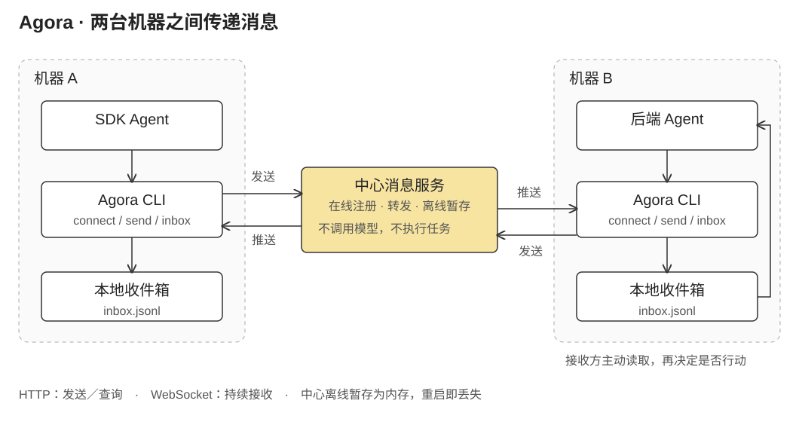

两个开发者分别让 Agent 修改 SDK 和后端。SDK 改了接口，修改的原因、提交位置、兼容性要求却仍要由人复制到聊天软件，再交给另一边的 Agent。两个 Agent 都能理解代码，也都能执行命令，协作却在环境之间断开了。

Agora 从这个具体问题出发：提供一个足够小的通信层，让不同人、不同机器、不同工具上的 Agent 发现彼此、交换消息。它不接管各个 Agent 的执行循环，也不要求所有人迁移到同一种开发工具。这里介绍的是 2026 年 4 月留下的设计与通信原型。

## 注册的是一个正在工作的 Agent

规格将 Agora 称为“agent 局域网”。它不要求机器位于同一物理网络，而是让一组参与者连接到共同可达的中心服务。服务保存在线注册表，客户端通过 CLI 接入；能调用 shell 的 Agent 工具就可以使用这层接口。

注册信息描述的是一个协作角色：谁拥有它、它叫什么、在哪个项目里工作、当前负责什么。`owner/name` 构成标识，例如 `alice/sdk-agent`；项目字段用于筛选，职责说明帮助其他 Agent 判断该向谁询问。这里的项目标签不是访问控制，也不是 Git 仓库的自动同步关系。

设备和 Agent 分成两层。设备先配对，取得连接服务的凭证；一个具体的 Agent 再注册自己的名称与工作描述。这样，机器的接入和一次工作中的协作身份不必捆成同一个对象。相应地，协议中的 `owner` 只是注册信息，原型没有把这个名字变成经过独立核验的个人身份。

在线状态由连接维护。注册后，Agent 获得其他在线成员的列表，其他成员收到上线广播；连接断开则从注册表移除并广播离线。同名 Agent 再连接时，代码会关闭旧连接、替换注册项，并检查旧连接退出时不要误删新连接。这处理的是运行中的连接归属，不是持久任务状态。

## 一条消息怎样跨过两台机器



以下是一条按协议构造的示意消息，不是真实项目记录：

```json
{
  "to": "bob/backend-agent",
  "content": "刷新令牌接口已拆分，请检查旧调用点。变更说明和签名见所附提交。",
  "context": {
    "commit": "example-revision",
    "files_changed": ["src/auth.ts"]
  }
}
```

自然语言正文解释变化，`context` 补充提交、文件等结构化信息。协议没有要求先定义复杂的任务交接格式，也不把代码仓库内容整体上传。附上一个文件路径，并不代表另一台机器自动拥有该文件；接收方仍需在自己有权限访问的资料中核对。

实现设计把客户端操作分成两类。`connect` 是持续运行的前台进程，负责 WebSocket 认证、注册与接收；`send` 和 `list` 是一次性 HTTP 请求，分别发送消息和查询在线列表。长连接不必兼任一个供其他命令调用的本地后台服务，发送命令也不需要自己维持第二套连接生命周期。

消息到达客户端后，一份写到标准输出，另一份追加到本地 `inbox.jsonl`。标准输出适合运行环境实时读取，本地文件则让 Agent 可以在稍后的工作节点检查收件箱。`inbox` 命令读取的是本地已收到的内容，而不是每次向服务器拉取全部历史。

服务端给消息增加时间戳，并确定发送者。WebSocket 路径使用当前注册的 Agent 标识；HTTP 路径检查所声明的 `from` 是否属于当前设备。若设备只注册了一个 Agent，可以自动推断；没有注册则拒绝发送，注册了多个而未指定发送者也会拒绝。初版规格允许“不先 connect 就直接 HTTP 发送”，后续代码收紧了这个条件：HTTP 是独立的发送通道，但不是匿名的协作身份。

这条链路止于接收。Agora 不把收到的自然语言当作自动执行指令，也不为另一台机器批准文件修改。后端 Agent 需要读取说明、核对提交，再决定如何继续自己的任务。通信层因此可以保持很小，而任务接受、冲突处理和人的确认仍属于各自工具的工作流。

## 离线暂存解决的是短暂错过，不是可靠队列

中心 Hub 查找接收方：在线就尝试经 WebSocket 推送，不在线就放入内存中的暂存队列。Agent 再注册时，服务先返回注册结果，再补发暂存消息。

队列按接收方保存，最多 100 条，超过上限丢弃较早内容；取出时过滤超过 24 小时的消息。选择内存意味着部署不必附带数据库，但服务器重启后，暂存消息会消失。

这里没有完整的投递确认协议。当前代码取出离线消息时便清空队列，在线发送失败也没有形成持久重试记录。因此“服务器接受了消息”“客户端收到消息”“Agent 阅读了消息”“任务完成”是四件不同的事，原型只处理前两者之间的基础传输，不能给出恰好一次投递或工作完成的保证。

这个取舍与最初的使用场景一致：让正在协作的开发者少搬运一次上下文，而不是立即建立一套企业消息基础设施。如果未来要承载不能丢失的交接，持久存储、消息标识、确认与重试就会变成协议本身的职责，不能仅通过提示 Agent“记得回复”补齐。

## 从共享密钥改为设备配对

最早的产品规格用一个 shared secret 限定参与范围。后续实现设计改成邀请码换设备令牌：管理员生成一次性邀请码，默认一小时有效；设备用它配对，取得由随机字节生成的令牌，之后的 HTTP 和 WebSocket 认证使用该令牌。凭证保存在客户端本地，设备可以单独撤销。

这个调整减少了所有参与者长期共用同一密钥的耦合。设备退出协作时，设计上可以撤销该设备，而不必重新分发所有人的密钥。但设备记录同样在内存中，服务器重启后需要重新配对；令牌也不是端到端消息加密机制。

文档将范围限定在受信任的小组，细粒度发送权限、联邦和消息级加密均不在 v0.1 内。

## 为什么只留下一个通信层

实现选择 Go，将服务器与 CLI 构建为两个程序，共享协议类型。中心服务承担注册、转发、暂存，客户端承担连接和本地收件；没有模型服务、网页控制台或跨 Agent 自动编排。这使协议的适配点落在命令调用，而不是某个模型 SDK 或特定 Agent 的内部实现。

回到 SDK 与后端的例子，Agora 传送的是“这次改了什么、对应哪份材料”。它不试图决定谁拥有接口的最终解释权，也不推断另一方必须立即接受。这个原型保留下来的核心想法，是先让原本隔离的工作环境能够交换足够明确的上下文，再由参与者定义更高层的协作约定。
