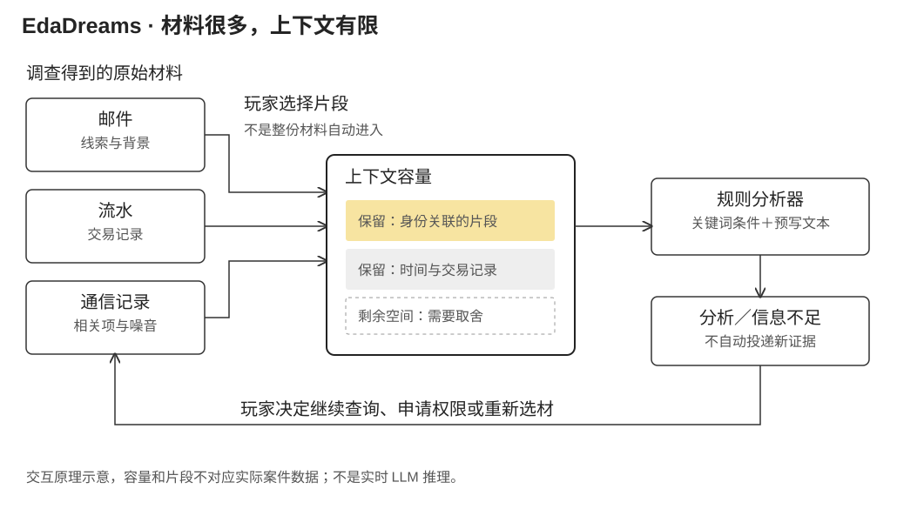

EdaDreams 的主界面是一款虚构的网络安全分析软件。玩家从开机自检进入工作，接收案件说明，阅读邮件与记录，在模拟工具中调查，再把选出的材料交给名为 Eda 的分析器。

这项设计把 Agent 工作中的上下文管理变成了游戏机制。玩家不是只向 AI 提问，而是决定它可以看到什么：哪些原始材料值得保留、怎样在有限空间里组织信息、什么结论还缺证据，以及什么时候愿意把手工操作交出去。2026 年 4 月留下的剧本、交互规格、案件数据与前端原型，围绕这些决定展开。

## 第一场交互先建立角色，而不讲操作说明

开场没有独立的教程画面。软件窗口出现，逐行输出自检日志；到分词器等待信号时停住，中央只有一个初始化按钮。点击后，乱码被扫描线逐步替换成可读文字。玩家的第一次操作同时完成系统启动与叙事中的语言建立。

随后的文字以逐 token 选择的方式出现：灰色候选短暂闪现，其中一个定格，光标继续前进。它是一种预设的视觉叙事，不是实时展示模型概率。设计意图是让玩家感到自己正在从机器内部接收世界，而不是先观看一段介绍“这是一台 AI”的过场。

界面随后展开为三个工作区域：左侧导航与材料列表，中间完整文档，右侧上方是上下文输入、下方是分析输出。第一次案件材料也以真实可读的邮件进入文档区。玩家通过阅读、选择和拖动开始工作，没有箭头逐项指示“下一步请点击这里”。

这种叙事方式要求界面里的东西真的可读。日志不是装饰线条，邮件不是代表“线索”的图标，客户名单也不是一句“这里有一份名单”。如果信息本身被抽象掉，玩家就没有可以选择和误判的对象，上下文管理也会退化为拖几个道具。

## 有限容量改变了阅读的目的

文档里的选中文字可以作为独立 block 放进上下文。每个 block 占用容量，玩家可以展开、删除，在交互设计中还可以调整顺序。放入新片段会改变容量显示，超出上限则不能继续无差别添加。

这使“已经找到一份证据”和“这次分析器看到了这份证据”成为不同状态。材料可以仍在文档区，但被从上下文移除；某个名字可以已经出现过，却没有被保留到当前分析中。玩家因此不仅要寻找信息，还要维持一份足以支持当前判断的工作材料。

容量是游戏规则。原型用简化的字符计数估算占用：中日韩字符范围按较高权重计算，其他字符按较低权重计算，再除以容量上限。它不对应某个真实模型的 tokenizer。设计需要的是可感知的资源压力，而不是借一个百分比声称模拟了真实语言模型的全部上下文行为。

较长记录占用空间，压缩后又可能丢掉身份、时间或来源等细节。这个取舍没有一个始终正确的答案：调查刚开始时有用的背景，可能在核对资金流向时需要让位；过早删去的材料，又可能在后来发现矛盾时重新变得重要。游戏希望让玩家在操作中经历这种变化。

## 为什么取消“分析一次，就送来下一份文件”

最早的案件方案采用线性投递：一次推理触发下一份证据出现。设计记录随后明确指出，这会让玩家像在接收整理好的材料，只需顺着系统走。于是案件从“推理后解锁文件”改为主动探索。

新版只先交给玩家案件概述和邮件样本。第一条线索藏在邮件内容里；调查工具通过搜索与工作备忘被发现；进一步资料需要到相应工具查询，或向对接人申请。获得新材料依赖玩家的操作，不依赖分析器是否说出了某个正确句子。

不同工具也承担不同信息边界。通用搜索可能返回旧新闻、同名人物和无关结果；域名工具返回注册资料；工商工具允许按企业或法人查找；号码查询只给公开归属信息，详细通信记录则需要另行授权。一个输入没有匹配结果时，可以得到空结果，而不是由系统自动纠正成剧情需要的查询。

路线因此可以分叉。同一家企业可能由登记人姓名查到，也可能由一个公开联系电话追踪到。玩家不必复现唯一的点击顺序，但需要自己理解不同来源之间的关系。这里的“非线性”不是所有信息随时可见，而是若干可选择的查询路径与必要的证据条件共同构成调查图。

## 原始材料和分析结果不能混在一起

另一次修订是去掉证据文本中预先写好的判断。例如，银行流水不应附上“这是过水账户”的分析，客户名单不应标出“此人可疑”，通信记录也不应替玩家解释流量异常。那些结论需要由材料之间的比较产生。

因此，资料被区分为原始来源返回的文本与分析器生成的报告。判断一个内容应该留在哪里的标准很具体：它是否真的是这个系统本身会提供的字段？交易时间与金额属于流水；多笔交易之间的模式属于分析。将模式预先塞进原始材料，玩家虽然能得到正确答案，却跳过了设计希望保留的判断过程。

这个分工也作用于案件反转。玩家先从若干相互吻合的记录形成解释，后续资料再迫使其修正。新版本并不是简单多加几份文件，而是让“身份登记在某人名下”与“实际执行操作的人是谁”不再自动相等。具体剧情可以隐藏，但这种证据角色的变化是游戏结构的一部分。

## 授权状态与推理状态是两套机制

案件数据把工具查询、电话对话、授权条件和推理映射分别描述。`tools_query_map` 规定输入对应什么返回内容，`search_engine` 提供搜索与噪音结果，电话对话表处理请求与回复，`state_machine` 保存哪些访问已经开放，`inference_map` 处理当前上下文怎样形成分析。

例如，玩家可以通过电话申请银行系统访问，但查询新的通信号码需要针对具体对象提出请求。更强的调查动作还有硬前置：在剧本中，要申请手机取证，必须先取得能够说明实际操作者存在疑问的服务器登录记录；缺少依据时，对接人会拒绝，而不是只要输入“取证”就开放所有资料。

电话采用文字化对话，规则匹配请求内容与条件，不调用大模型扮演一个无边界 NPC。对接人的角色也被限制为协作接口：提供权限、协调材料、确认结果，不持续替玩家规划下一步。

两套状态分开后，分析器可以指出矛盾，却不能因为“分析得对”就自动调取资料。反过来，玩家即使没有按预期使用推理按钮，也可能沿查询路径发现证据。行动改变可用材料，材料选择改变当前分析；二者互相影响，但不是同一个关卡计数器。

## 推理为何使用规则与预写内容

Eda 的分析输出不是实时 LLM 生成。新版映射把案件拆成若干分析阶段，每个阶段描述必需关键词组、应当缺席的词组、可选信息和输出文本。原型对上下文中的所有片段进行匹配，选择符合条件的阶段，再组合分析与提示。

“应当缺席的词”用于区分知道了什么和还不知道什么。例如，只看过概述时可以形成初步判断；已有具体注册信息后，就不应继续返回仅基于概述的分析。可选信息用于补充条件性判断，最终报告则根据已提供的关键要素决定哪些部分可以写出、哪些仍不足。

这不是完整的语义理解。相同含义换一种措辞可能无法命中，命中词组也不必然意味着玩家已经理解了它。采用规则的好处，是可以精确控制案件节奏、信息缺口和输出，不让随机生成改变虚构世界的事实；代价是需要为同义表达、错误组合和过早输入设计足够合理的响应。

提示系统也不一直告诉玩家去哪找。新版数据规定，同一阶段前两次推理只分析已有材料，第三次增加隐晦暗示，第四次及之后才给明确建议。上下文发生实质变化后，重复计数重置。玩家持续用同一组材料请求分析，才逐步得到更强提示；一旦主动调整材料，系统就重新给其判断空间。

这比每次分析都附一份任务清单更符合探索目标。但重复推理也不能成为绕过调查的按钮：提示可以指出方向，工具操作与必要授权仍由玩家完成。

## 委托应发生在理解工作之后

长期设计在状态栏放置 CTX、CMP、WEB、MEM、TOOL、EXEC、CODE 七类能力。第一阶段以手工上下文管理为主；后续才逐步涉及压缩、搜索、记忆、工具执行和代码等能力。

解锁不是通关后自动得到的奖励。设计希望玩家先亲手做过某种工作，遇到它的重复与负担，再主动选择交给 Eda。例如，手动筛选和压缩之后，才理解自动压缩省去了什么；自己搜索过工具与线索，才知道授权自动搜索意味着哪些操作会离开直接控制。

这样，委托就不只是让按钮变少。它改变玩家与系统的分工，也为后续叙事留下问题：效率提高之后，玩家是否仍知道系统看过哪些资料、为何作出某个判断。这一设计先围绕开场与首个调查案件展开。

关于玩家身份与退出命令的叙事设计（含概念剧透）

总纲设想的身份转折是：玩家开始以为自己就是 Eda，最后意识到自己始终是坐在电脑前操作它的人。因此，底部命令行从第一帧便存在，隐藏的 `/exit` 也必须一直有效，而不是到了结尾才临时开放。

这条规则使退出成为对既有界面的重新理解。没有新出现的神秘按钮，玩家只是发现自己早已有一种行动能力。设计中的效果是关闭程序、露出桌面；保存的 Web 原型以退出覆盖层处理，不能等同于完整的桌面版本效果。

## 让操作决定可见

EdaDreams 最具体的尝试，是让 AI 的输入范围与人的操作决定在界面上可见。材料不会因为已经存在就自动进入推理，系统不会因为得出结论就自动获得权限，自动化能力也不会仅因关卡结束就出现。正是这些分开的边界，让上下文管理与委托可以成为玩家真正参与的事情。
