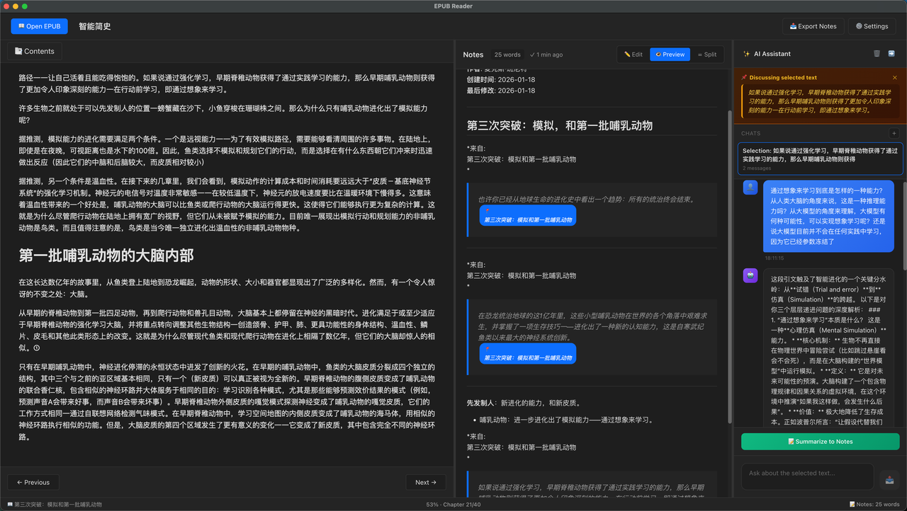

这是一个桌面阅读器练习。设计从已有的 Electron 阅读器重新开始，把第一版的范围收拢到阅读本身：打开书、调整排版、记住位置，以及留下高亮和笔记。AI 问答、语义搜索和云同步没有放进这一版。

首页只保留最近阅读的书和简洁的阅读统计。进入书籍后，正文占据主要空间，笔记与设置按需展开。字体、字号、行距、页边距和主题可以按书保存，同一本书再次打开时恢复阅读位置。笔记使用富文本编辑，并保留 Markdown 表达，便于将阅读记录带出应用。

技术上，Tauri 提供桌面外壳，React 负责界面，Foliate 渲染阅读内容；文件访问和 SQLite 数据持久化统一经过 Rust 命令。渲染器通过消息桥报告选区、位置变化和加载状态。后续修订专门区分了“桥接已经就绪”和“书籍实际加载成功”，让打开失败能够显示错误，而不是留下空白页。

*作者提供的历史阅读器界面，包含阅读、笔记与 AI 对话。截图版本尚未核定，不代表这个 Tauri 仓库已经包含图中的 AI 功能。*
