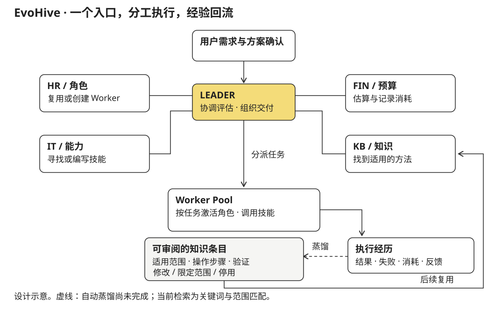

EvoHive 设想的是这样一种工作方式：用户把需求交给一个 AI 入口，拿到可以确认的执行计划，随后查看进度、接收结果；而这次任务用到的角色、工具与有效方法，能够留给下一次任务。

2026 年 2 月的设计文档把它称作一个 AI 外包组织。这里吸引人的问题不是能否同时启动许多个 Agent，而是任务结束之后还能留下什么。临时组装提示词与工具，可以完成一次工作；要持续接收不同需求，就需要知道已有的能力是什么、哪些角色适合复用、一次失败应该改变哪里，以及这些改变是否真的有效。

因此，EvoHive 将任务协调、实际执行和经验积累分别建模。下面展开这一构想中的角色分工与知识积累机制。

## 用户交给系统的是任务，不是一组 Agent

用户面对的是 LEADER。它负责把自然语言需求变成任务描述，组织内部评估，再提交方案供用户确认。计划中需要说清楚要交付什么、分成哪些步骤、由谁执行、依赖哪些技能，以及预算和时间估计。执行之后，用户仍通过同一个入口询问进度或反馈结果。

这层交互背后有一个重要的数据区分：原始请求、解析后的要求、执行计划与实际结果分别保存。文档中的任务模型还区分了预计消耗与实际消耗，以及执行状态和用户反馈。估计不是已经花掉的成本，步骤完成也不自动等于用户满意。

以一项文档分析任务为例，方案可以将它拆成解析文件、抽取信息、按条件整理、生成报告几个步骤。每一步记录 `action`、负责的 Worker 和 `skills_required`。前一步输出成为后一步的输入；用户最后接收的是交付物，同时能够回到任务记录查看过程。这个例子说明的是任务结构，不是已完成的客户案例。

确认计划的作用，是在执行前暴露系统对需求的理解。它也给能力不足与成本不确定性留下表达位置：缺少文件解析能力时，应先解决能力缺口，而不是让报告生成步骤假装已经读过材料。任务协调采用按步骤推进的方式：更新状态并保存结果，某一步失败时记录原因并停止后续执行。

## 为什么要分 HR、IT、FIN 与 KB

这四个名称对应的是不同的决策对象，而非四种聊天语气。

| 职责 | 管理的对象 | 在任务中需要回答的问题 |
|---|---|---|
| HR | Worker 的角色说明、指令、工具集合与状态 | 已有谁能做？需要新建角色，还是调整已有角色？ |
| IT | 可用技能、外部工具及其接口 | 任务缺什么能力？能否找到、安装或编写？ |
| FIN | 预算、时间与消耗记录 | 方案预计花多少？实际与预计相差在哪里？ |
| KB | 任务经历与可复用知识 | 过去遇到过什么？哪条方法适用于这一次？ |

LEADER 汇总这些判断，Worker 承担具体执行。在原型中，各角色由不同的提示与工具接口定义，共用模型客户端和状态管理器；内部消息由 `Orchestrator` 路由到相应角色。这不是几台独立服务器，也没有把角色之间的讨论本身当作成果。

区分 HR 与 IT 尤其有用。一个角色不会因为名字叫“分析师”就自然拥有 PDF 解析能力；安装了解析工具，也不等于知道何时使用它、如何检查输出。前者管理角色的执行习惯，后者管理能力的接口与可用性。能力可以供多个角色复用，角色也可以随着任务需要更换能力组合。

这种分工的代价是协调开销。原始方案有意把评估职责写全，但不意味着每个简单请求都值得启动完整的内部讨论。哪些评估可以由已有数据直接回答、哪些需要模型判断，是实现这层组织时需要控制的成本。

## Worker 保留的是配置与经历

Worker 在设计中是可持久化的角色配置。它包含 `profile`、执行指令、可用工具、当前状态、任务统计和调整历史。创建后，没有任务时进入 dormant 状态，领取任务时进入 active 状态；任务结束后仍保留配置，长期不用的角色可以归档。这里的“休眠”不是让一个模型进程一直等待。

执行一步任务时，系统将角色说明、工具接口、相关知识、当前步骤与前序输出组成上下文。模型请求某个工具时，执行器回传工具结果，再继续模型调用。这让一个 Worker 的工作方式同时受到角色指令与具体环境的约束，而不只依赖一个宽泛的人物设定。

任务后的反馈可能指向不同调整。如果报告结构不清楚，可以修订角色指令；如果问题在于缺少检索能力，应补充工具；如果错误来自一个重复出现的环境问题，则更适合写成知识条目。文档要求记录调整前后及原因，使“优化了 Worker”能够对应到具体变更。

技能也有独立描述：来源与版本、输入输出接口、使用示例、调用统计。设计中的能力获取路径是寻找候选、比较、安装、测试、登记后再供 Worker 使用，失败则回退或更换。这个顺序把“找到一个包”和“获得一种可靠能力”区分开。

## 从经历到知识，中间不能省略验证

知识设计文档进一步把“记住任务”拆成两件事。

第一件是保存经历，也就是 episode：任务背景、计划、输出、失败、消耗与反馈。它用于回看发生了什么。第二件是从经历中提取可以在其他任务复用的条目。经历不直接整体注入下一次上下文；要复用的内容需要经过压缩、分类，并注明适用条件。

四类知识承担不同用途：可执行 SOP 保存稳定操作；已知问题保存症状、原因、修复与验证；质量检查方法影响输出组织；效率提示约束重复探索与不必要的调用。它们共同的要求是短、明确、有范围，并能说明如何确认有效。

例如，原始文档用环境初始化说明 SOP：某个项目在某种 shell 中需要先载入初始化脚本，再激活环境，并通过检查当前环境确认成功。值得保存的不是一段“尝试了很多办法”的聊天记录，而是适用于这个环境的操作与验证条件。换到另一个环境时，范围不匹配的条目不应该直接被当作指令执行。

因此，规划中的条目既进入可阅读、可修改的结构化文档，也进入用于召回的向量索引。召回候选后，再按范围、置信度和知识类型筛选，在规划或执行阶段注入短片段。两种存储服务于不同问题：索引帮助找到内容，结构化条目让人知道找到的究竟是什么，以及能否继续使用。

## “演化”需要能指出改变了什么

EvoHive 把变化分在三个地方：角色指令可以调整，工具集合可以扩展，知识条目可以更新。将它们分开，使一次改善有机会被追溯：是执行顺序变了，工具更合适了，还是避免了之前的环境错误？

设计采用 YAML 保存组织、任务、角色和技能状态，优先让这些变化能够直接查看；内部协调先在同一进程中完成，而不是一开始引入消息队列与分布式基础设施。这适合探索机制，但并不自动提供多用户隔离、可靠并发或安全执行环境。FIN 的估计与消耗设计，也不能仅凭存在预算字段就被视作严格的费用封顶。

它具体提出的是一种可检查的持续性：任务可以结束，配置和方法可以留下；留下的内容有来源、有适用条件，也能被修改和停用。组织积累什么，以及下一次为什么采用它，应当能从这些记录中得到解释。
