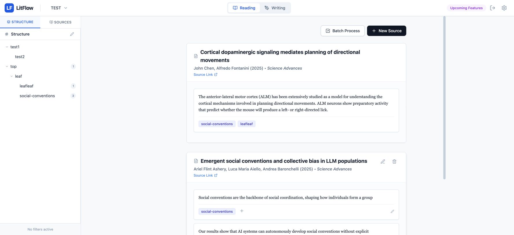
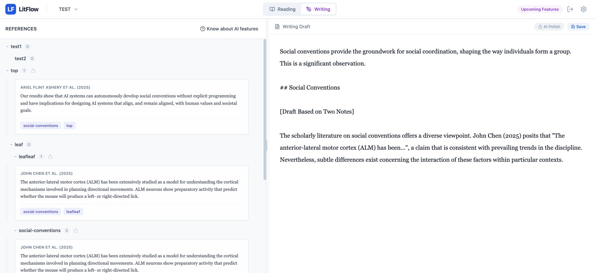

读文献时，笔记通常跟着论文走：这篇研究提出了什么，使用了什么方法，哪些结果值得记下来。但写文献综述时，组织单位变成了问题。一段讨论可能需要并置三篇研究，同一篇论文也可能分别出现在概念、方法和争议几个部分。材料已经读过，怎样重新组织，仍然是一项独立的工作。

LitFlow 把这个转换做成了一个网页工具。它保留文献来源和笔记之间的关系，同时允许一条笔记归入多个主题。阅读时按文献核对材料，写作时按主题调出材料；两种组织方式使用同一组笔记。

[打开 LitFlow](https://litflow-frontend.pages.dev/) · [项目代码](https://github.com/houx15/lit-flow)

## 笔记需要两种位置

在 LitFlow 中，文献、笔记和主题是三个不同的对象。文献保存标题、作者、年份、期刊和来源链接；笔记记录从文献中抽出的片段；主题则描述这些片段在当前写作中的位置。

这种区分允许一条笔记同时出现在两个主题下，而不必复制两份正文。例如，一项研究对某个概念的测量方式，既可以放在“概念界定”，也可以放在“测量方法”。这是组织方式的示例：两处引用的是同一条笔记，仍能追溯到同一篇文献。主题可以随着写作改变，来源关系则继续保留。

Reading 界面的侧栏有 Structure 与 Sources 两种入口。前者从主题进入，后者从文献进入；中间的文献卡片把元数据、Source Link 和笔记放在一起。笔记下方直接显示所属主题，因而读者能同时看到“它来自哪里”和“它被用来讨论什么”。多条笔记也可以通过批量操作添加已有主题。

*图 1：在线版本中已有 TEST 项目的阅读界面。截图展示实际布局和测试材料，标签分配不作为正式文献分类示例。*

## 用文本整理材料，也用文本调整结构

录入材料不要求逐张创建笔记卡片。来源编辑器接受一个文本块：前面填写文献元数据，后面用 `---` 分隔笔记，以 `>` 后的标签名标记所属主题。一段整理好的阅读摘录可以一次拆成多条笔记。对于支持的 DOI 和 arXiv 链接，元数据服务能够尝试补全文献信息；来源正文仍由使用者阅读和选择，系统没有把链接导入等同于全文理解。

主题树也采用文本编辑。缩进列表表达父子关系，修改列表就能调整层级。这适合大纲尚在变化的阶段：合并两个讨论方向，或把一个主题拆成几个子题，不必为每一项重复打开菜单。

文本编辑结构带来一个需要明确处理的问题：保存一棵新树后，旧笔记如何找到自己的位置？LitFlow 在重建主题结构前保存笔记与主题名称的对应关系，再按名称连接到新结构。移动一个同名主题可以保留其笔记关系；改名则不能简单视为同一个主题的移动。界面会检查正在被笔记使用的删除项并给出确认，避免把结构修改当成毫无后果的排版操作。

这里的取舍是让大纲容易整体编辑，同时保留显式的材料整理步骤。主题名称既是写作中的语义标签，也是当前重新连接笔记时使用的依据。

## 写作视图改变的是材料的排列方式

切换到 Writing 后，左侧变成按主题层级展开的参考笔记，右侧是草稿。中间的分隔线可以调整，便于在对照材料与连续写作之间分配空间。

这时文献不再是一篇一篇的阅读队列。同一主题下的笔记来自不同文章，作者和年份跟随卡片呈现。使用者可以先比较这些材料，再决定它们之间是支持、补充还是矛盾关系。双击笔记会把带有作者年份的引用文本追加到草稿，随后可以继续修改文字。当前交互是双击加入，不需要把卡片拖过编辑器，也不意味着生成了符合目标期刊格式的正式参考文献。

*图 2：同一 TEST 项目的写作界面。右侧为原有测试草稿，仅用于展示材料与编辑区的并置关系，不作为可信的文献综合结果；本次查看没有生成或修改正文。*

阅读与写作使用独立模式，而不是把所有操作同时铺满屏幕。阅读模式突出来源、筛选和材料整理；写作模式保留当前可用材料，并把主要空间交给正文。草稿由使用者编辑和保存，材料组织与最终表述之间仍有一个明确的人为判断环节。

## AI 的输入由当前工作决定

LitFlow 的两个 AI 操作分别附着在主题和正文上。

Compose 从选定主题出发。后端取出这个主题及其下级主题关联的笔记，去重后连同作者年份信息交给模型。提示要求围绕主题组织段落、综合不同材料并保留引用提示，而不是把每条笔记简单依次复述。生成结果追加到草稿，继续由使用者修改。

这个范围很具体：模型收到的是已整理的笔记，不是整个互联网，也不是所有文献的全文。因此，前面的选材和归类会直接影响可生成的内容。如果两个不相关的片段被放进同一主题，系统并不能仅凭标签保证它们能够构成一段有效论述；作者年份的出现也不能替代对原文与论断关系的核对。

Polish 则针对已有文字。选中文字时处理选区，否则处理整篇草稿；它的任务是保留原意并改善表达。一个操作帮助组织材料，一个操作帮助修改表述，两者都从使用者明确的工作对象出发。它们没有取代选题、检索、证据判断和最终写作责任。

主题树已经用于确定取材范围，但当前模型输入会把笔记展平成列表。也就是说，“取到了哪个子主题的笔记”和“把完整论述层级传给模型”是两件事。后者被单独列在后续设计中，不能因为界面上存在树形结构，就把模型描述为已经理解整棵写作大纲。

## 数据结构如何支撑这两种视图

前端使用 React 和 TypeScript，把后端返回的关系数据转换为文献列表与主题树。后端运行在 Cloudflare Workers 上，由 Hono 处理接口，D1 保存项目、文献、笔记、主题以及草稿；网页通过 Cloudflare Pages 提供。

其中最重要的关系是笔记与主题之间的多对多连接。文献负责出处，笔记保存内容，连接表决定内容在当前结构中的用途。因此，一个主题可以汇集多篇文章，一条笔记也可以服务多个讨论位置，阅读和写作不需要维护两套不同的材料副本。

主题层级使用 nested set 表达：每个节点记录左右边界与深度，某个主题的所有后代落在它的边界范围内。选定一个主题组织段落时，后端便能查询整个子树关联的笔记，而不必把取材局限于当前节点直接挂载的卡片。层级结构同时承担了界面导航和材料范围选择的作用。

LitFlow 的设计落在文献管理与正文写作之间那段具体工作上：把读过的材料拆成可追溯的笔记，围绕正在形成的问题重组，再将材料转化为需要自己判断和修改的文字。网页中的阅读与写作视图，围绕的始终是这一组共享材料。
