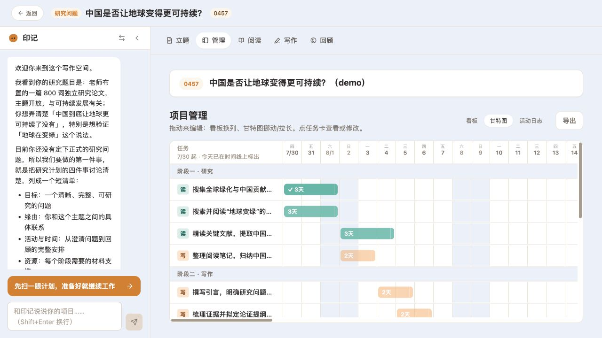
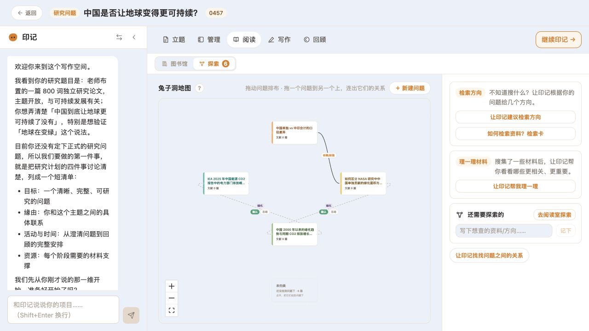
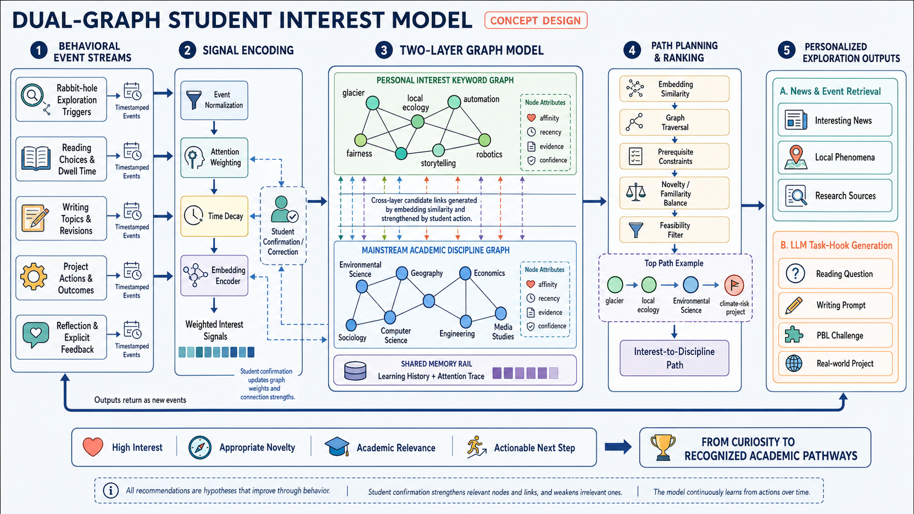
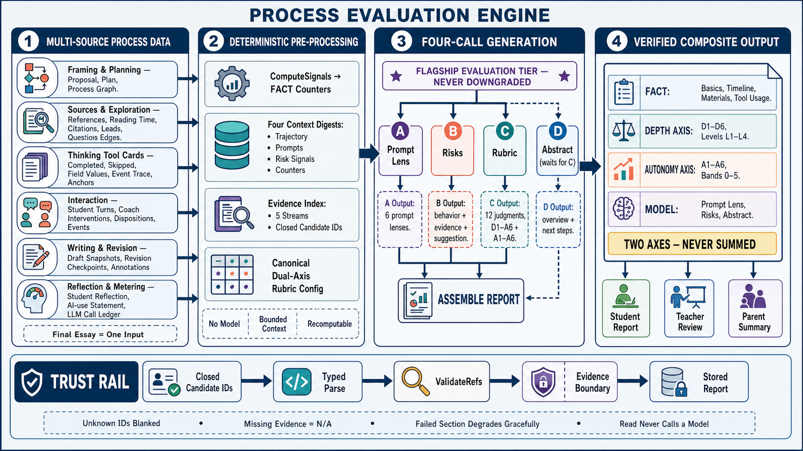
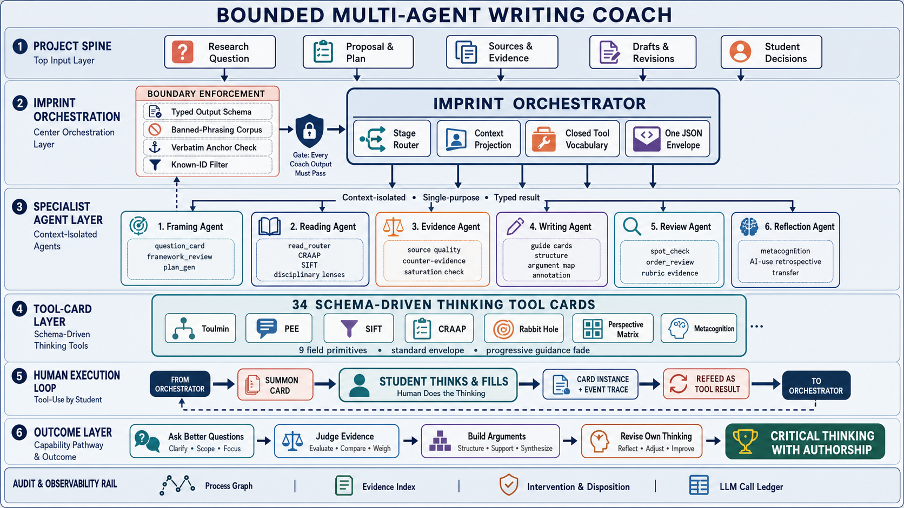

学生借助 AI，可以很快得到一篇文章、一个研究题目，或者一套看起来完整的方案。但这些成果没有回答另一个问题：学生自己做了哪些判断？为什么选择这个问题，凭什么相信这份材料，遇到反对意见后改变了什么，又有哪些建议是他明确不接受的？

思维印记围绕这些判断设计学习过程。学生带着兴趣或任务进入平台，和 AI 一起提出问题、阅读材料、组织论证、制作作品；系统保留选题、证据、修订和决策，帮助学生与老师回看成果是怎样形成的。AI 可以扩展学生能够完成的事情，而目标、取舍和对成果的解释，仍然需要学生参与。

这同时对应两类需求。一类是学校里的研究与写作任务，需要有结构的方法训练、持续指导和过程评价；另一类是在没有明确作业时，从个人兴趣出发，找到值得继续读、继续想、继续做的事情。思维印记用 Pro 和 Lite 两种产品形态承接它们。

[访问思维印记官网](https://mind.uni-robot.cn/)

## 同一种教育理念，两种进入方式

Pro 与 Lite 的区分依据是任务的深度、结构和持续节奏。它们并不简单对应年龄，也不是把完整产品删掉几个功能后得到一个轻量版。

| | Pro：系统研究与写作 | Lite：兴趣探索与项目 |
|---|---|---|
| 从哪里开始 | 学校任务、研究问题、论文要求 | 一条新闻、一个疑问、正在发生的事或个人兴趣 |
| 怎样推进 | 方法课程、立题、计划、阅读、写作、复盘 | 探索地图、兴趣树、阅读、表达、PBL |
| 留下什么 | 研究成果、材料关系、修订记录与过程报告 | 兴趣发展的路径、文章、项目与个人作品 |
| 老师怎样参与 | 查看进度与证据，提出反馈，结合课程要求评价 | 发现学生持续关心的问题，帮助兴趣进入更深入的探索 |

两条路径共享四个培养方向：思辨力、探索精神、AI 协作和元认知。它们需要落在具体活动里：学生能否追溯一条信息的原始来源，能否提出值得研究的问题，能否向 AI 说明边界，以及能否回顾自己的方法并在下一次调整。

## Pro：把一项研究任务真正做下去

Pro 从学生手头的任务出发。面对“中国是否让地球变得更可持续”这样宽泛的问题，第一步不是生成文章，而是逐步确定讨论的对象、尺度、证据和限制。讨论碳排放、绿化还是能源转型，会形成不同的研究路径；总量、人均量和历史累计量也不能直接互换。

产品把长期工作组织为相互连接的空间。项目管理保存问题、提案、计划、任务与活动记录；阅读空间积累来源、摘录和追问；写作空间连接论点、证据与修订；复盘空间帮助学生解释自己的判断和 AI 使用方式。学生可以从写作回到阅读，也可以在发现新材料后重新限定问题，工作不必沿着单向向导推进。

这里有一个区别于普通聊天的要求：已经确认的问题、计划和来源，需要成为稳定的项目记录。否则每次打开聊天都要重新讲述背景，模型也容易把尚未接受的建议当作既定结论。

### 阅读：除了收集资料，还要保存资料之间的关系

阅读空间包含材料库和“兔子洞”探索。问题之间可以有子问题、支持、反对、细化和依赖等关系；进入一个问题后，再组织与它相关的论文和材料。AI 可以提出候选线索，学生决定哪些值得纳入自己的研究。

这使两种操作可以分开：先保留一个有意思、但暂时偏离主线的问题；或者把材料正式采用为当前论证的证据。一个网页被找到，并不意味着它已经获得了可靠性或论证相关性的确认。

在方法上，SIFT 帮助学生离开单个页面，追溯来源并比较其他报道；来源评价工具帮助学生检查作者、时效、证据和用途。工具的价值体现在学生实际作出的判断里，而不是给每篇文章自动盖一个“可信”的章。

### 写作：把反馈指向具体论点和证据

写作指导围绕任务框架、提案、证据地图、论证段落与最终复查展开。不同阶段需要的帮助不同：尚未确定问题时，需要限定范围；已有主张但缺少依据时，需要找出证据缺口；进入修订时，需要分清文字润色与论证改变。

AI 可以提问、指出跳步、提出反例和标注需要核验的地方。学生仍然要选择观点、解释证据、决定如何表达，以及是否接受修改建议。版本记录因此不只保存最终文字，也让学生能够回顾一次建议带来了什么变化。

这个设计不把“学生输入了多少字”当作学习的充分证据。学生拒绝一条建议并说明理由，或者发现自己原来的论点不成立后主动收缩结论，都是需要被看见的活动。

## 思维工具卡：由学生执行的工具调用

很多 Agent 产品的工具调用是模型发出请求、程序完成操作、结果返回模型。思维印记为学习场景设计了另一种循环：AI 判断某个思考方法可能有帮助，向学生推荐工具卡；学生打开卡片，完成观察、比较或推理；系统记录这些输入，再把结果带回后续指导。

例如，面对论证不清楚的段落，可以调用 Toulmin 或 PEE 一类结构工具；面对来源问题，可以调用 SIFT 或来源评价卡；面对多个立场，可以用视角矩阵；项目结束后，则可以使用元认知与反思工具。

卡片不是换一种外观显示提示词。每张卡片有自己的字段、交互与完成状态，记录学生写了什么、跳过了什么，以及哪些输入对应原始材料。AI 只能建议使用，学生可以选择接受、稍后处理或拒绝。

工程上，卡片由结构化定义渲染，结果进入统一的事件记录。日常对话读取紧凑摘要，评价阶段则能够取回更完整的原始输入。这样既避免把所有表单内容反复塞入聊天，也保留了核对过程的可能。

## 方法课程：把可复用的方法教给学生

研究任务会反复需要相同的能力：判断来源、拆解问题、识别论证、理解不同立场，以及管理自己的注意力。思维印记把这些能力组织成可以单独学习、也可以在任务中调用的方法课程。学校合作版本的课程矩阵规划了 33 门方法课，并将课程与思维工具卡连接起来。

课程的产品设计考虑了一个实际问题：教师希望材料、讲述和反馈经过审核，学生的活动又需要有交互，不能只是播放一组幻灯片。

为此，课程系统区分三层数据：

- **课程蓝图**记录教学目标、材料、练习、答案依据和教学意图。
- **可执行课程包**记录页面布局、内容块、旁白、音频和交互流程，同一门课的学生共享这份定义。
- **学习会话**记录某个学生的答案、尝试、进度、交互和本次学习的开场与收束。

课程以一个屏幕大小的 Slice 作为学习步骤，组合文本、图片、PDF、视频和练习。流程可以显示或隐藏内容、播放旁白、等待回答，再根据结果给出反馈；课程整体按既定顺序推进，条件分支只发生在当前 Slice 内，由确定的流程控制。AI 参与制作与个性化开场、总结，核心教学材料则可以提前检查、预览和修订。

这一分层同时服务内容生产和运行可靠性。课程作者修改的是可检查的课程定义，学生交互形成独立会话；学生个人数据不会被写回所有人共享的课程包。

## Lite：从“喜欢什么”走到“可以研究什么”

兴趣探索的设计缘于一个具体例子：一位学生喜欢缝纫，但家长很难把这个兴趣与未来的发展联系起来。导师指出，缝纫背后有布料、设计和制造，材料又连接环境保护与可持续发展。一个看起来日常的爱好，其实可以进入很多值得研究的领域。

Lite 希望把这种连接变成学生可以持续使用的产品体验。学生从探索内容进入问题，通过地图看到邻近方向；阅读、写作和项目逐渐留下兴趣线索；兴趣树再帮助学生发现值得继续尝试的内容。它不要求学生一开始就知道自己“属于哪个学科”。

### 兴趣模型为什么需要两张图

只给学生贴“喜欢科技”或“喜欢艺术”的标签，仍然不足以生成下一步。设计中保留两种不同的组织方式：一张描述学生具体关注的关键词及其联系；另一张描述学科与探索领域。系统尝试在二者之间寻找路径。

学生的阅读、提问、写作、项目和反馈形成带来源与时间的行为线索。重复出现的兴趣、近期行为、学生的明确确认与修正，可以帮助更新连接。随后再结合相关性、适度新颖性和实际可行动性，提出阅读问题、写作题目或项目挑战。

这里的推荐应当允许学生纠正。一次点击可能出于偶然，一次长时间停留也可能只是页面没有关闭。兴趣模型需要保留依据，并给学生表达“这并不是我想继续做的方向”的机会，而不是把行为推断固定成个人身份。

### 阅读与表达承接探索

Lite 的阅读活动从理解材料内容开始，再进入段落、标注、学科视角和综合判断。写作则把主张、材料选择、段落作用和反馈放在同一条工作线上。学生可以把探索中形成的问题写下来，再用写作暴露新的材料缺口。

这样，探索地图、阅读和写作不只是三个并列入口。它们产生的选择与记录共同更新兴趣线索，而新的兴趣线索又可以成为下一次阅读或项目的起点。

## PBL：让 AI 多做事，让学生多作决定

项目学习与论文写作的协作边界不同。做一个真实作品时，AI 可以编程、生成图片、整理文档，帮助学生跨过原本很高的制作门槛。产品不必坚持所有操作都由学生手工完成，但需要明确哪些地方必须由学生思考和决定。

PBL 围绕一个目标展开。AI 提出步骤，学生讨论和调整，再逐步完成；遇到需要设计、审查或取舍的节点时，系统提出具体问题，学生可以展开新的讨论分支，深入处理这个决定。

例如，项目面向谁、什么才算成功、访谈需要了解什么、几种方案为何选这一种，以及最终作品是否真的回应了问题，都需要提出具体问题，请学生解释自己的选择。现场观察、访谈和调查也要求学生走出平台，带回 AI 无法代替获得的信息。

这与作者自己使用工作型 Agent 的习惯有关：先组织结构，反复调整叙述，对照脑中的图像描述要求，再逐字审查输出。PBL 希望学生能够练习这样的协作方式，有能力提出要求，也有能力判断结果。

完成的文章、项目与反思可以进入个人主页。它展示的是持续形成的作品与兴趣，而每项成果是否公开，仍由学生与学校决定。

## 评价：把“想得深”和“自己在想”分开

一篇完成度很高的文章，可能得到过密集提示；一名独立性很强的学生，也可能还没有掌握成熟的论证方法。思维印记因此将评价分成两条轴，分别描述，不把它们简单加成一个总分。

**认知深度 D 轴**关注任务理解、来源与证据、论证结构、视角与偏见、反馈修订、反思与元认知。

**智识自主 A 轴**关注方向自主、主动发起、对 AI 设置边界、质疑与检验、对判断负责，以及面对反证时是否愿意更新立场。

同一个行为可能同时提供两方面的线索。例如，学生主动寻找反对材料，可以体现证据处理，也可以体现自主检验；但只有在记录能够支持时，报告才应作出相应判断。

评价读取选题与计划、来源探索、工具卡、对话、写作版本和反思。最终文章是其中一个输入。报告需要把判断连回具体行为，使老师可以检查“为什么这样评价”，而不是只看到模型给出的性格描述或分数。

设计中先由程序计算事实计数、整理上下文摘要和候选证据编号，再交给不同的模型调用处理提示使用、风险、评价量规与总体摘要。摘要等待量规结果，最后组合成报告。生成后检查引用编号；没有充分证据的部分保留缺失，而不是补一段看起来完整的评语。

报告还呈现关键活动时间线、材料及其用途、工具使用和下一步建议。网页版适合浏览与展开证据，导出文件则采用文档式排版，两者不只是同一页面的打印。

这套结构让评价可核对，但并不自动证明量规已经具有测量效度。教师仍需结合任务要求和实际观察解释结果。

## Agent 架构：教学职责与上下文边界

整个产品需要处理一个持续数周的项目，而普通聊天窗口的上下文会不断增长。思维印记将长期状态、最近对话和具体任务的材料分开管理。

**Project Spine** 保存当前项目的研究问题、提案、计划、阅读清单、提纲、活动记录与学生决定。主 Agent 读取它的紧凑视图，需要细节时再取回；最近几轮对话保留即时协作语境，跨项目记忆则关注能够延续的学习线索。

阅读整篇材料和评价完整过程，会带来大量输入。这些任务适合放到独立上下文中，返回结构化的发现、原文依据与对项目的影响；一般的提案讨论、计划调整和写作反馈，则可以通过主 Agent 的技能继续完成。

这一点也解释了“界面有几个空间”和“后台有几个 Agent”之间的区别。项目、阅读、写作和复盘是学生组织工作的方式，不必各自拥有互不相通的聊天记忆。教学阶段可以切换，项目的主线仍然需要延续。

模型输出还需要受类型、工具词汇和证据锚点约束。前端渲染已知的卡片与交互，服务端负责模型调用、权限和记录。结果进入统一事件结构，供后续指导和评价使用，而不是让模型随意编造页面流程。

基础实现采用浏览器前端、Go 服务与 PostgreSQL 数据层；共享数据契约连接前后端，流式事件支持对话反馈。模型凭据保留在服务端。课程运行时、项目状态和评价记录有各自的数据边界，使教学内容可以持续更新，也让不同学习活动留下可以关联的过程证据。

## 学校合作：从学生体验到教师工作

学校需要的不只是把一个 AI 聊天工具发给学生。课程怎样安排、教师怎样发现需要干预的学生、研究过程怎样核对，以及成果怎样与原有教学要求衔接，都属于产品的一部分。

教师端围绕班级进度、学生的材料和过程证据、反馈与报告展开。Pro 的学校合作设计考虑了 IB TOK、EE、AP Seminar 和独立研究项目等任务情境；这些是课程与工作流的适配方向，具体要求与最终评价仍由学校和教师掌握。

商业设计采用按学生、产品版本和使用周期组合的学校合作方式，并预留学校品牌、课程、任务、材料与量规配置。短期活动或营地可以成为初次体验，Lite 则承接持续的兴趣探索。这样，合作对象购买的并非一次生成结果，而是一套能够进入教学节奏的学习产品。

思维印记希望形成的连续体验是：学生从自己关心的问题开始，学会处理材料，与 AI 合作完成真实成果，随后能够说清楚自己做了哪些决定。这也是课程、工具卡、项目空间、兴趣模型和过程评价需要共同服务的目标。
