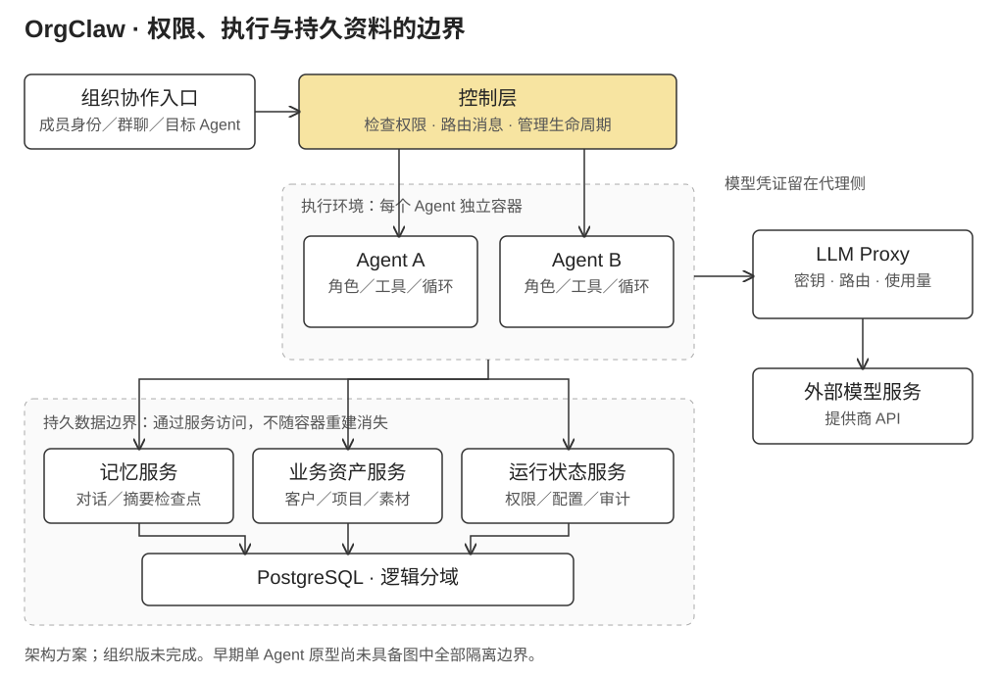

2026 年 3 月，我对 OpenClaw 的一个判断是：它不能满足我所考虑的企业级需求。企业需要更细的权限控制、可以持续运维的基础设施和公用知识库，因此会出现专门面向企业的 Agent 产品。OrgClaw 就是我沿着这个判断做的架构和产品设计。

问题很具体。企业里有不同部门和岗位，同一个人的请求不能天然取得所有资料；几个 Agent 需要共同使用公司的知识，却不能相互翻阅全部客户记录和工作记忆；增加一个 AI 员工，需要配置它的职责、工具、模型、数据权限和汇报关系；机器重启、人员离职或模型更换之后，企业的数据和工作记录仍要保留。

因此，这份设计从一开始就包含了运行基础设施、组织权限、共享业务资产和管理产品。下面按当时的方案展开这些设计。时间锚点是仓库最早提交 **2026 年 3 月 6 日**；这里的产品判断也应放回那个时间理解。

## 企业先配置岗位，员工继续在飞书里工作

OrgClaw 面向企业用户的基本单位是一个 AI 员工：一个机器人身份、一个岗位配置和一个独立 Agent 容器。企业用户从“行政助理”“内容策划”“销售经理”这样的岗位进入，而不必先理解模型循环和容器。

一个岗位模板由三个部分组成：**Soul** 定义沟通风格、行为规范和职责边界；**Memory** 提供公司背景、行业信息与工作流程等初始知识；**Skills** 定义可以调用的工具和工作方法。创建实例时，还需要为它指定模型、可读写的数据、可以服务的部门以及汇报方式。相同运行程序可以因此成为不同岗位，无须为每个岗位维护一套程序。

例如，内容策划岗位的设计包括文案、素材检索、多平台适配和内容日历；销售岗位围绕客户跟进、销售进展和汇报；入职培训岗位使用公司制度、流程说明与问答。这些岗位通过不同的模板配置。

员工侧则尽量保持现有工作习惯：在飞书群聊或私聊里向对应机器人发消息，收到文本、卡片、富文本或文件回复。飞书是首个计划接入的平台，钉钉作为后续适配。机器人仍是受企业配置和权限约束的软件，“AI 员工”在这里表达的是产品中的岗位与管理单位。

## 一条消息先经过组织身份和权限，再到 Agent

渠道网关承担平台相关的工作：校验飞书事件、解析发送者与目标机器人、区分群聊和私聊、保留文本与附件，再转换成内部统一消息。部门树、员工和角色信息则在初始化及后续同步时更新到运行状态服务，增量同步用于控制对平台接口的请求量。

这样，飞书或钉钉各自的事件格式停留在网关层。控制层 Orchestrator 面对的是同一种消息，并按如下顺序处理：

1. 由机器人 ID 找到目标 Agent。
2. 查询发送者是否有权使用这个 Agent。
3. 允许时才把消息送到对应容器的 Chat 接口；拒绝时直接经网关返回结果。
4. Agent 完成模型调用和工具执行后，经控制层、网关返回消息，并留下审计记录。

这里已经存在第一层权限：**哪些人可以使用哪个 Agent**。规则计划同时支持部门、角色和个人，不能仅凭“知道机器人的名字”就获得使用权。

原架构为 IM 选择了完整消息回复：等推理和工具执行结束，再发送一条或多条消息。这个取舍针对当时的 IM 接口及接入复杂度。后续运行时计划又加入 HTTP 和 CLI 流式输出，两者服务的入口不同，不应把它们合并成“整个产品都支持流式”的描述。

## 权限有两个方向：人访问 Agent，Agent 访问数据

企业的权限问题不会在消息入口结束。一个员工获准使用销售 Agent，并不意味着该 Agent 就应该读取所有业务表。第二层权限由数据服务逐次执行：**某个 Agent 可以对哪些表或数据域做读、写操作**。

原设计给出了明确分工：销售 Agent 可以读写 CRM；内容策划 Agent 可以读写内容日历和素材库。二者不会因为都属于同一家公司，就自动拥有彼此的数据权限。规则保存在 Runtime State Service，实际的业务读写由 Asset Service 检查，不能让模型自行决定是否放行。

| 访问关系 | 设计中的检查位置 | 具体约束 |
| --- | --- | --- |
| 员工 → AI 员工 | 控制层查询运行状态服务 | 部门、角色、个人与目标 Agent 的对应关系 |
| Agent → 业务资产 | Asset Service 每次请求 | 按 Agent、表或数据域分别配置读写权限 |
| Agent → 工作记忆 | Memory Service | 普通 Agent 访问自己的记忆；Manager 有跨 Agent 读取权限 |
| 管理员 → 管理功能 | 管理端与控制层 | 认证、内网或 VPN 访问、管理操作审计 |

这也决定了“自我改进”的边界。Agent 可以在允许范围内调整沟通方式、工作策略和技能，但不能自行扩大数据权限，也不能改变容器级配置。新技能的描述中包含工具、所需数据权限和输出格式；装上技能不等于获得它希望访问的所有资料。

## 公共知识库、工作记忆与系统状态，各自有归属

多个 Agent 共同工作，需要共享资料，但共享并不意味着把全部信息塞进一个公共记忆。OrgClaw 把持久数据划成三个域。

**Memory Service 保存 Agent 的认知和工作状态。** 包括按会话追加的历史消息、压缩后的上下文检查点、当前任务和待跟进事项、长期经验，以及行为定义的修改记录。活跃对话会产生频繁写入；拼装模型上下文时读取相关记忆。长期记忆计划结合 pgvector 做语义检索。普通 Agent 的记忆相互隔离，Manager 和管理员按设计拥有更大的查看范围。

**Asset Service 保存企业共同拥有的业务资料。** 公共知识库在这一层：公司制度、FAQ、产品信息和入职文档。它还包括客户记录、项目任务与里程碑、营销素材、品牌资产、内容日历，以及行业模板带来的业务表。文件本体存入对象存储，元数据和结构化记录存入 PostgreSQL。共享资料由同一组接口管理，各岗位按授权读取或维护。

例如，客服和入职培训 Agent 可以使用公司知识库，销售岗位维护 CRM，内容岗位维护素材与排期。这是设计可以支持的分工方式；具体哪些资料共享给谁，由部署配置决定。

**Runtime State Service 保存系统怎样运转。** 包括 Agent 规格、模型配置、容器健康状态、组织结构缓存、权限规则、定时任务、审计和备份配置。控制层依赖它决定消息送到哪里、容器何时启动、任务是否有权执行。

三类数据早期可以共用一个 PostgreSQL 实例，通过 schema 或表前缀划分；服务接口也可以先放在同一个 FastAPI 进程内。设计先明确归属和访问边界，再决定是否拆成独立部署，避免在第一步就为所有逻辑模块承担独立服务的运维成本。

## 执行环境可以重建，企业资料必须留下

每个 AI 员工计划运行在独立 Docker 容器里。容器负责接收任务、拼装上下文、调用模型、执行工具并返回结果；正式数据保存在容器外，最终架构不允许 Agent 直接连接数据库。

控制层通过 Docker API 管理生命周期。创建岗位时，加载同一份基础镜像，注入角色、初始知识、技能和模型配置，设置网络及资源约束，再启动实例。运行期间检查 Health 接口，故障时重启并通知管理员；移除岗位时停止容器、归档记忆、清理资源。岗位差异来自配置，而非不同镜像，运行时升级因此可以围绕一份镜像进行。

Agent 的内部循环仍然是模型与工具的交替：加载记忆，组合角色说明、技能指令和用户消息，调用模型，执行返回的工具调用，再把工具结果送回模型，直到获得最终回答或触及轮次上限。同一会话计划串行处理，以减少并发写入造成的状态冲突。

容器对控制层暴露四类接口，各有用途：Chat 处理工作请求，Report 返回已完成事项、阻塞和计划，Config 接收岗位与技能配置更新，Health 提供运行状态。把工作汇报单独设计成接口，是后续 Manager 协作能够成立的基础。

网络规则同样有明确对象：Agent 可以访问模型代理、记忆与资产服务，并使用互联网工具；不能访问其他 Agent 容器、控制层的管理接口或 PostgreSQL。Docker 是隔离方案的一部分，仍需正确落实网络策略、挂载限制和资源限制，不能仅凭“用了容器”就宣称安全。

## 模型统一接入，密钥和费用统一管理

LLM Proxy 是独立的模型访问层。Agent 向内部 OpenAI 兼容接口发请求，代理确认 Agent 身份，查询分配给它的模型和服务商，注入真实密钥，转发响应，并按 Agent、模型和时间记录用量与费用。不同岗位可以使用不同模型，管理端据此展示费用分解和预算告警。

代理的价值也体现在维护上：更换服务商或轮换密钥时，更新代理配置即可，Agent 容器不需要各自保存、修改密钥。方案建议以 LiteLLM Proxy 为基础，再补上 OrgClaw 的身份校验、配置集成和敏感信息扫描。

但早期实现采取了更短的路径：先把密钥注入运行环境，直接调用模型，等多 Agent 部署稳定后再引入代理。

## 跨岗位协作由 Manager 协调，必要时等待人批准

多个 Agent 在场，并不意味着它们应当自由互相调用。OrgClaw 为跨岗位协作设计了一个 Manager Agent。它使用相同的运行架构，但可以经控制层收集其他 Agent 的 Report，并读取它们的工作记忆。

定期汇报由调度器发起。控制层并行向各岗位请求结构化报告，再把已完成工作、阻塞和下一步计划交给 Manager 汇总，最终经飞书发送给人类管理员。Manager 也可以生成工作方式的调整建议，经控制层分发到对应岗位。

临时协作则从一个明确请求开始：Agent A 发现自己需要另一个岗位的信息，通过工具向控制层提交协作请求；Manager 判断应该找谁。如果打开 **Ask the Boss**，请求先发给管理员，批准后再交换信息；关闭时则由 Manager 协调并记录决定。这个开关计划可以全局或按 Agent 配置。

信息交换有两种设计路径：在双方都有权限的共享业务表中读写，或者由控制层转发另一个岗位的 Report，再提供相关部分。Agent 不直接连接彼此的容器，协作过程进入审计。

## 管理端把架构变成企业能配置的产品

底层服务之外，原方案明确设计了初始化向导。企业先选择业务场景，获得相应的业务表、岗位模板和推荐技能；再配置数据与备份、注册并测试模型、接入 IM 和同步组织结构，最后创建 AI 员工。飞书开放平台仍有需要人工完成的机器人创建步骤，向导负责引导这些操作。

创建岗位时，管理员集中配置机器人身份、模型、技能、数据权限、服务部门、汇报风格和是否允许自我调整；Manager 另有汇报频率、会议触发条件与审批开关。部署完成后的界面则覆盖：

- **运行管理**：各岗位状态、近期活动、资源消耗，以及增加和移除岗位。
- **权限和审计**：调整部门、角色与个人访问规则，检索对话和管理操作记录。
- **资料和技能**：管理技能、导入导出数据、查看存储使用情况、手动发起备份。
- **成本管理**：按岗位查看 API 使用量、token 消耗、费用及预算告警。

这些功能共同对应企业的日常维护，而不是部署时的一次性配置。管理端计划仅通过内网或 VPN 访问，提供管理员认证；界面与系统消息支持中英文切换。

## 部署和交付也属于产品设计

方案考虑了本地 Mac mini、云 ECS 和已有 Kubernetes 环境。基础设施容器由 Docker Compose 等部署工具管理，AI 员工容器由控制层动态创建；PostgreSQL 保存三类数据，对象存储可以使用自建 MinIO 或云端 OSS、S3。

备份设计包括数据库的每日增量备份、对象文件复制，以及在新机器上恢复数据库和文件的流程。

商业交付也按投入程度区分：远程指导部署与预置岗位、现场部署和岗位定制、深度定制与专属技能开发。模型调用费用由企业另行承担。

代码组织选择 monorepo，是因为早期网关、控制层和运行时会频繁一起调整接口。网关和控制层计划使用 TypeScript，运行时和数据服务使用 Python，公共消息协议与类型由共享包维护。逻辑模块分开，并不要求一开始就拆成多个仓库。
