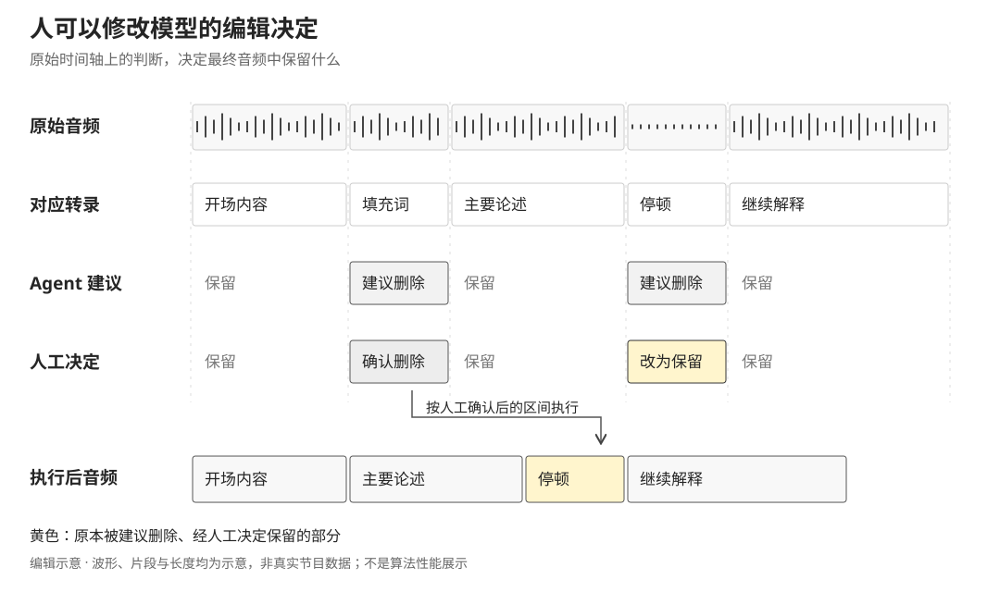

Podcast Cutter Skills 的编辑原则是保留真实的谈话：可以删除录前调试、明显口误、密集填充和重复表达，但情感停顿、自然思考、短促的回应与有意强调，不应因为它们看起来“不够流畅”就被一并清除。

这使问题比识别“嗯”“啊”复杂得多。同一个词可能只是填充，也可能是回应；一个停顿可能拖慢节奏，也可能是表达的一部分。项目因此没有把最终决定交给一套自动删除规则，而是把识别候选、理解内容、人工试听和音频执行分成不同职责。

它的形态是一套由编程 agent 调用的 skills 与 Python 脚本。人用自然语言交代一期录音，agent 组织各阶段工作；需要编辑判断时进入本地浏览器复核，确认后的决定再交给音频工具。

## 从模型三轮分析到机械扫描与内容判断

早期规格把分析分为粗剪、精剪和模型自审，分别生成删除建议；后续计划尝试将语义分析移交给外层 agent，避免每个脚本单独绑定模型服务。当前 skill 又进一步明确了分工：可用固定模式发现的问题由脚本扫描，依赖上下文的取舍由 agent 提议。

机械扫描关注字符级模式，例如同字连续重复、多个连续语气词、自我纠正短语，以及短时间内密集出现的“就是”“这个”“那个”。这些候选使用 `stutter`、`filler-run`、`marker`、`habit` 分类。分类的作用是说明它为什么被找出来，不等于它一定应该删除。

agent 则同时读取句子、词时间戳、编辑原则和用户偏好，寻找两类更大范围的问题：`region` 对应录前录后闲聊、设备故障重录等片段，`editorial` 对应同一观点的重复解释、过长铺垫等编辑判断。两类候选进入相同的审查界面，保留来源、理由、说话人和状态。这样，人能区分“规则命中了某种模式”和“agent 认为这段内容可以缩减”。

文档采用保守原则，模型自报置信度较低的候选不进入提案。但这个数值只是筛选约定，并不是经过校准的误删概率；重要的判断仍要通过试听。

## 时间必须来自词，而不能从文字长度猜

音频先被准备成工作文件，语音识别为每条音轨生成转录。双轨录音使用音轨来源区分说话人，并需要处理两路开始时间的偏移。设计提供拍手定位、手动给定两轨对应时刻和转录推断等对齐方式；多轨词流按时间合并后再分句。审查界面使用预混合的原始音频，让候选片段可以被直接试听。

分析读取句子是为了理解意思，剪辑定位却必须回到词级时间戳。当前 skill 特别禁止用一句话的字符比例估计开始与结束时间：展示的句子文本可能被截断，也不一定与词索引范围等比例对应。设计要求在拼接后的词文本里定位目标片段，再反查所覆盖词的真实时间边界。

这条约束决定了提案数据的含义。每条候选不仅是一句“这里可以剪掉”，还包含 `start_ms`、`end_ms`、类别、理由和状态。最终执行不需要再次猜测 agent 指的是哪几个字。

## 两次审查，使用两份不同的音频

第一轮是粗审。浏览器读取机械扫描和 agent 内容提案；每条候选可以播放前后约 1.5 秒的上下文，接受、拒绝或添加备注。选择保存回提案状态，并据已接受的条目重建删除清单。刷新页面后仍能继续审，而不是从头再作一次决定。

粗剪根据这份清单作用于原始工作音频。重叠删除区间先合并，再得到保留片段；双轨录音还要按偏移混合到同一坐标。剪辑结果随后重新转录，得到属于粗剪音频的词与句子时间戳。

第二轮精修基于这份新转录，再做机械扫描和内容判断。用户在另一个复核界面试听粗剪版本，接受或拒绝精修候选，也可以用键盘标记起止位置，自己加入删除区间。第二轮的决定作用于粗剪音频，生成进一步编辑后的版本。

两轮的区别不只是“第二次剪得更细”。第一次剪完后，后面所有片段的位置都可能改变。若把精修区间翻译回原始时间，再与旧删除清单合并，一旦前一轮决定发生变化，原来的换算就可能指向错误内容。

因此，当前 skill 将时间轴隔离列为首要规则：原始音频上的粗剪决定只作用于原始音频；粗剪版本上的精修决定保留在粗剪坐标中，直接作用于该版本。每一轮都应知道自己编辑的是哪份音频，而不是把所有修改挤进一个不断累积的“全局删除列表”。这是项目演化中比增加一个剪辑按钮更重要的架构约束。

## 规则、提案与执行结果分别留下来

每一期有独立工作目录，转录、分析、审查、音频和节目说明分别保存。编辑规则是可读的 Markdown，用户偏好独立配置；agent 产生结构化提案，浏览器负责人的选择，脚本执行明确区间。中间结果因此既是各工具之间的接口，也是再次修改的入口。

这种结构允许只重做一段工作，例如保留转录，重新讨论内容删减；或者保持审查决定，调整音频处理。不过，下游资料必须对应新音频版本，不能只因文件存在就认定它仍有效。尤其精修后的金句切片与节目时间轴，需要使用与最终音频一致的时间依据。

当前 skill 还设计了两个后续出口：agent 按说话人选择金句，脚本输出独立音频片段与清单；再依据剪后转录和用户提供的节目说明样本，生成章节时间、摘要与名词说明。

## 让剪辑决定可以回看与修改

这里最明确的产品决定，是让剪辑意图成为可以检查和修改的数据。用户可以推翻模型的建议，修改边界，回听上下文；执行层只应处理这份已经确认、且属于明确音频版本的编辑决定。
