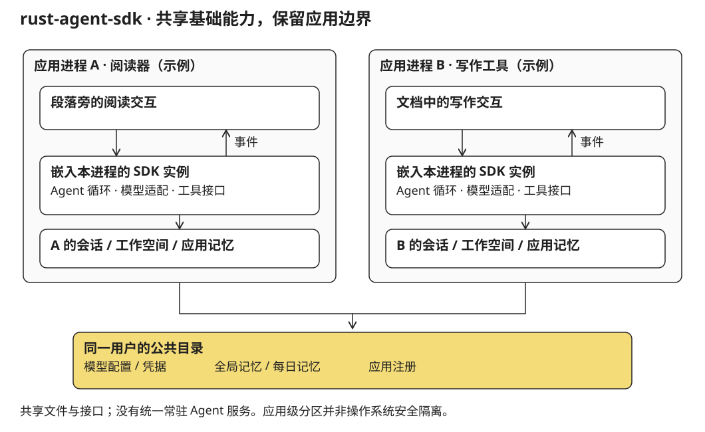

2026 年 4 月设计 rust-agent-sdk 时，问题来自一组 AI 桌面应用共有的底层工作。阅读器要调用模型解释书中的内容，写作工具要读取草稿、检索资料、组织修改；它们的界面不同，却都需要处理 API key、流式输出、工具调用、记忆与会话。每个应用各自实现一遍，重复的不只是代码，还有用户反复配置模型、向不同助手交代同样背景的过程。

rust-agent-sdk 的产品定义是“同一用户、一套凭据、一份可共享记忆，多个应用”。它选择将这些能力放进 Rust 库，供桌面应用在进程内调用。要共享的是配置、协议和状态，应用仍然保留自己的主循环、界面与工作方式。

## 为什么把它做成库

一个统一的 Agent 应用可以集中管理能力，但阅读和写作就需要进入它规定的界面；一个常驻后台服务也可以统一管理状态，却会增加进程启动、通信、版本配套与分发问题。这个项目选择另一种边界：每个应用嵌入 SDK，直接调用它，持久化内容放在约定的用户目录中。

对阅读器来说，Agent 可以在选中的段落旁工作。对写作工具来说，它可以围绕草稿和大纲操作。SDK 不要求二者都变成一个聊天产品，也不决定何时应该显示工具结果。它只给应用可消费的事件与可组合的能力。

这种选择并没有消除所有协调问题。多个应用仍可能同时读写共享文件，需要约定数据位置、写入规则与权限；SDK 升级也仍需要各应用接入。它减少的是额外服务带来的运行时依赖，而不是让共享状态变得没有成本。

## 一次阅读请求，怎样进入应用

产品文档用阅读器和 WriteRight 说明接入方式。它们是设计场景，不是此处确认已经接入的应用。以“概括这一章，并与我的相关笔记比较”为例，应用需要做两类准备。

一类是公共能力：选择模型供应商，提供记忆与会话存储，配置工具注册表。另一类是领域接口：阅读器注册 `read_current_chapter`、`get_book_metadata`、`search_book_content` 这样的工具，让 Agent 能取得真实的当前内容。SDK 不需要知道 EPUB 的内部结构；`read_current_chapter` 如何定位章节，由阅读器负责。

构造 Agent 时，应用提供角色说明、skills、模型及工具。`agent.chat(message)` 返回 `Stream<AgentEvent>`：文本增量用于显示回答，工具开始与结果用于呈现操作过程，完成事件携带用量，错误事件交给应用决定如何提示。一个写作应用可以将同样的事件接口接到文档工作区，而不照搬阅读器的交互。

工具本身以 `name`、`description`、参数 JSON schema 和异步 `execute` 接口定义。模型提出调用，SDK 依据名称分派，工具返回结果，结果再进入下一次模型请求。应用特有的行为与通用循环因此通过工具接口相接，而不是写进供应商适配代码里。

多个角色也可以在一个应用中存在，例如 brainstorm、writer、reviewer。原始场景由应用中的标签页决定使用哪个角色；这与多 Agent 自动相互委派不同。SDK 提供不同角色的配置入口，并没有因此变成一个组织编排框架。

## 模型协议统一在事件层

跨供应商不只是把请求地址换掉。不同接口用不同方式表示 system 内容、工具调用、工具结果和流式片段，工具参数还可能分多次到达。若这些差异直接进入应用，阅读器和写作工具都会重复实现同样的解析逻辑。

SDK 因此在 `LlmProvider` 边界上统一 `ChatRequest` 与 `LlmStreamEvent`。供应商模块内部区分请求转换和流解析：前者把内部消息变成供应商要求的格式，后者把返回片段还原为统一事件。OpenAI-compatible 适配以可配置的 endpoint 工作；Anthropic 和 Google 使用各自的原生接口格式。

这个抽象需要保留流的结构，而不是只拼出最终字符串。例如，OpenAI 的工具参数可能按调用索引交错到达，需要追踪每个调用的参数片段；当时的 Gemini 适配收到完整的函数调用，则将它转换为统一的开始、参数和结束事件。上层 Agent 循环能够以同一套逻辑重新组装调用，不要求应用理解这些区别。

设计为不同供应商使用共同的行为检查：消息开始与结束的顺序、文本增量、工具参数、使用量以及错误映射应有一致的含义。这支持“替换 provider 时应用接口不变”的目标，但不意味着各模型有相同能力、成本或输出质量。适配器解决协议问题，模型选择仍属于应用配置。

## 共享记忆，不共享所有上下文

SDK 把持久状态放在 `~/.agent-sdk/` 下。公共层包含模型配置、凭据、应用注册和全局记忆；应用层分别保存自己的记忆、会话、Agent 定义与工作空间。一次对话的完整历史使用 SQLite 保存，适合逐条追加和按会话读取；长期事实保留为 Markdown，便于查看和修改。

| 内容 | 作用 | 进入上下文的方式 |
|---|---|---|
| 角色说明与 skills | 说明当前 Agent 的职责及领域方法 | 构建 Agent 时提供，在系统提示中组合 |
| 全局记忆 | 同一用户跨应用可复用的背景与偏好 | 每轮开始重新读取 |
| 应用记忆 | 当前应用的项目状态与专用事实 | 每轮开始读取该应用的文件 |
| 每日记录 | 按日期保留活动记录 | 不默认全部注入，按需通过工具访问 |
| 会话历史 | 当前对话已发生的消息与工具结果 | 从配置的 SessionStore 读取 |

这使跨应用的衔接可以很具体：阅读器将一条值得跨场景使用的事实写入全局记忆，写作工具在后续一轮读取同一文件。它不需要同步服务，也不会因此自动读取整本书或阅读器的所有会话。应用自己注册的工具决定它可以怎样接触领域内容；共享工作空间的访问控制另列为后续范围。

并发写入也按数据性质处理。全局记忆和每日记录使用文件锁追加；配置、凭据和应用记忆采用临时文件再替换的方式，避免写出半个文件；注册表更新也有锁。它们解决的是具体写入过程，不等同于完整的跨应用事务系统。

凭据共享同样需要用户入口。设计中的检测函数返回已有配置的候选信息，应用展示并取得用户同意后再保存，不把“能检测到”当作“可以自动导入”。文件权限限制其他本机用户读取，但凭据仍以文件形式保存；加密存储并不是已完成能力。

## 长任务中的上下文如何缩减

工具返回内容可能比用户消息长得多，因此上下文控制分两步进行。

第一步限制旧工具结果占用。在默认预算下，工具结果合计超过阈值时，从较早的消息开始把可清理内容替换为占位标记，同时保留最近十条消息。第二步在估计上下文接近配置窗口的八成时，将较早对话提交给模型总结，保留最近十条原消息，再把摘要与近期内容一起送入下一轮。

这两步只改变发给模型的工作副本，不覆盖数据库中的完整历史。用户需要回看原始工具结果时，历史仍然可以存在；模型当前看到什么，与系统保存了什么，不必完全相同。压缩请求也不提供工具，避免“总结历史”继续触发任务执行。

这个实现有实际边界：token 数使用粗略估算，窗口大小由应用配置，压缩后的摘要也可能丢失信息。当前代码按字符串字节长度近似换算，不能当作跨语言精确 tokenizer。它提供的是控制上下文增长的机制，而非无损记忆。压缩连续失败三次后，本轮停止重复尝试，以免把失败本身变成持续消耗。

同样，工具错误与模型错误采用不同处理。工具返回失败可以作为观察结果交回模型，使它选择其他行动；模型请求失败则产生错误事件结束本轮。工具循环有迭代上限，防止一次请求无限重复执行。

## 显式组装，是这个 SDK 的一部分

当前代码的 `Sdk` facade 提供路径、注册表、凭据和模型工厂，并为 `AgentBuilder` 预填应用身份与工作目录。它不会因为调用了初始化，就自动安装所有工具、读取所有 skills 或启用持久记忆。模型之外的工具、MemoryStore 和 SessionStore 仍需要接入者明确装配。

还需要保留一个清楚的安全边界：文件工具的工作目录约束和命令工具的检查，并不构成操作系统沙箱。命令仍经 `sh -c` 执行，简单白名单与路径扫描不能支持“可安全运行任意不可信代码”的承诺。

这个项目最终落在一个相对具体的选择上：可以共享模型与记忆基础设施，但不必共享产品的主循环。阅读、写作和研究操作如何出现在界面上，仍由应用决定。SDK 的职责是把这类决定之外的协议和状态工作组织好。
