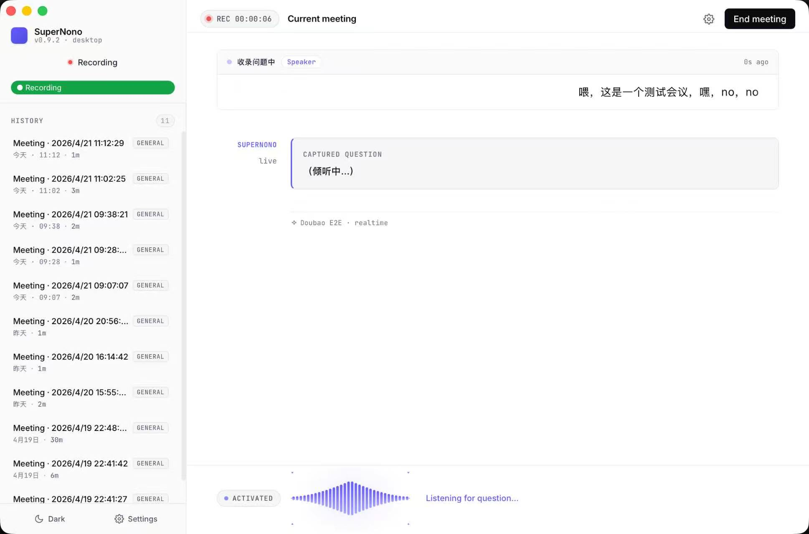

在会议里临时问 AI 一个问题，往往需要有人停下讨论，打开聊天窗口，把刚才的背景重新打一遍，再把回答念给其他人听。这个动作打断的不只是操作流程，还有会议本身的节奏。SuperNono 的出发点很直接：如果 AI 已经在听，能不能需要它的时候直接喊一声？

SuperNono 是一个面向线下会议的桌面助手。开始会议后，它持续转写讨论，按时间整理主题摘要；听到唤醒词后进入语音问答，使用已有会议上下文回答；问答结束再回到记录状态。结束会议时，内容被整理成 Markdown 纪要，也保留在本机的历史记录中。

## 大多数时候安静，需要时才加入

它的界面围绕一场正在发生的会议组织。左侧保留历史会议，主区域呈现当前讨论的摘要与 AI 问答，声音状态让人知道它在记录、等待提问还是发言。进入过去的会议则以回顾为主，不要求用户重新启动一次对话才能找回记录。

持续转写和 AI 发言是不同的模式。日常讨论时，语音识别提供增量文本，系统保留原始转写，并周期性整理主题摘要。摘要不是机械地每隔几分钟新建一个同样大小的块：整理逻辑会结合前一张摘要判断当前话题是延续还是切换。这样，长会议可以保留主题结构，而不必一直盯着逐字稿。

当用户说出“嘿 Nono”一类唤醒词，系统把声音交给实时语音问答。这里不是把一个按钮换成语音命令：用户仍在原来的会议里，提问可以依赖刚刚讨论过的内容。提供给问答的上下文包含已有摘要和近期原始发言，前者保留较早讨论的轮廓，后者补充当前话题的细节。

唤醒后也不只允许一问一答。当前实现保留同一次语音会话以支持追问，一轮回答播完后留下短暂等待窗口；用户继续说话就继续对话，沉默、明确的退出语或取消操作则把控制权交还给会议记录。等待窗口与会话上限都是可调整的交互参数，不是对人类停顿习惯的普遍判断。

## 两条语音路径，共用一支麦克风

SuperNono 使用 Tauri，将桌面界面与本机能力连接起来。界面侧负责麦克风采集、产品状态和展示，Rust 侧处理需要特定请求头与二进制协议的语音 WebSocket、系统凭据存储及其他桌面能力。

音频采集后交给路由器，由它决定当前送往持续识别还是实时问答。持续识别侧负责会议转写；实时问答侧使用端到端语音服务，接收问题、生成回答并返回声音。摘要和最终纪要则走独立的文本模型接口。这三个用途没有被强行塞进同一个模型请求：会议记录需要连续，问答需要对话节奏，纪要需要整理较长的材料。

这里一个容易忽略的问题是扬声器回声。如果 AI 正在说话，自己的声音又被麦克风当成用户问题送回去，就可能产生错误打断或重复对话。接管逻辑因此包含丢弃音频的状态，并等待已经排队的回答声音播放完毕后再恢复输入。服务端说“这一轮结束”，也不等于本机扬声器已经播完；这两个时刻需要分开处理。

从问答回到记录时，系统还会把这段问答文本接回会议转写中。否则，AI 参与过的一段讨论会成为纪要里的空洞：前后的人类讨论有记录，中间的问题与回答却不见了。问答本身也单独保存，便于回顾。

## 摘要和纪要，不应依赖一条永不失败的网络连接

会议不会因为语音连接中断而自动暂停。应用需要区分正在连接、重连、暂停和结束，让使用者知道当前是否还在记录；网络错误可以重试，凭据错误则应明确提示处理，而不是无限等待。

结束会议时，应用停止采集和摘要调度，再请求生成纪要，组织讨论要点、决定与待办事项。模型整理失败时，已有摘要仍然能够作为保底内容保存。这个取舍是让已获得的记录留下来，而不是为了等待一份完整纪要，把整场会议的成果悬在一个最后的请求上。

本地存储也按信息性质拆开：会议元数据记录身份与时间，转写逐条追加，摘要保存当前结构，AI 问答单独记录，最后形成可阅读的 Markdown 纪要。它们共同构成一次会议，而不仅是一段聊天窗口里的文字。导出是把已有结果交给用户，不是保存结果的唯一机会。

## 本地保存，与云端推理的边界

SuperNono 不要求为会议历史另建一个自己的云端账户。会议材料落在本机应用目录，凭据交给操作系统的安全存储。语音能力连接火山引擎服务，摘要和纪要的文本模型则可以在设置中选择提供商；当前代码支持多种服务预设，以及自定义兼容接口。

这意味着“本地会议助手”描述的是应用与记录的位置，而不是推理完全离线。音频会发送给语音服务，相关文本也会发送给所选模型提供商。云端保存政策不能由一个桌面项目替这些服务作保证。

产品没有把重点放在共享工作区或复杂知识库上。它首先处理的是会议现场的一条连续路径：讨论时能够记录，需要帮助时能够直接提问，回答之后能够自然回到讨论，最后得到一份可以带走的记录。这条路径中，AI 什么时候保持安静、什么时候接话，与它能回答什么同样重要。
