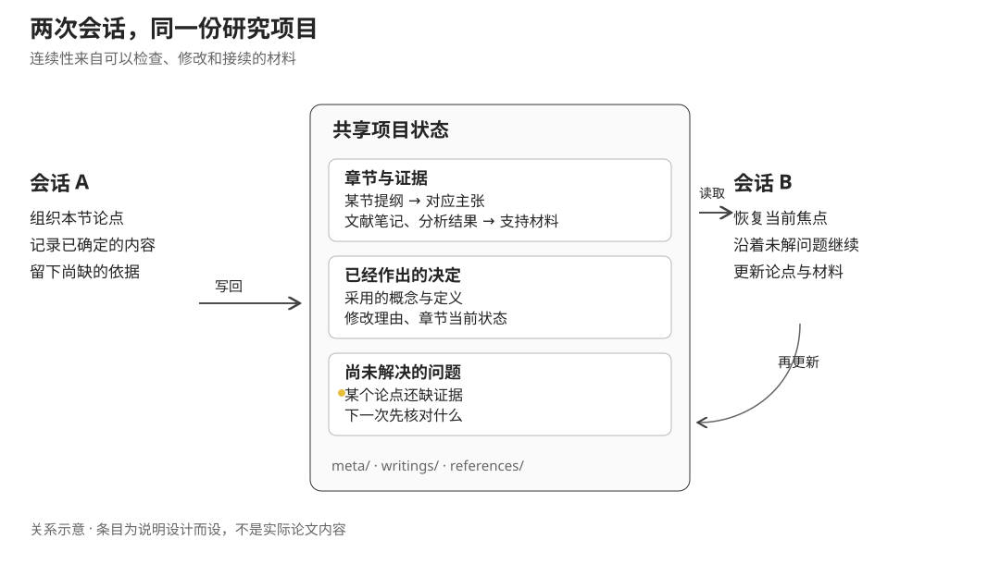

SuperPaper 把论文写作看作一个会持续变化的项目：研究问题会收窄，材料会补充，分析可能推翻原来的解释，章节也会在写作和审查之间反复修改。能够生成一段顺畅文字，只覆盖了其中很小的一部分。更难持续的是，几次会话之后仍知道哪些判断已经作出、论点依据在哪里、哪些地方还不能写成结论。

它是一套论文与学位论文的 agent skills，围绕三项工作组织：维护项目状态，准备研究与分析的交接材料，以及根据已有证据写作和修改。它没有把这些职责全部藏进一个“帮我写论文”的提示词，而是为各项工作规定输入、产物和下一步如何接续。

## 先接住已有的论文，再组织新工作

初始化分为新建与接管两种情况。新建项目会确定语言、题目、引用风格和章节结构；接管已有项目则先识别现有草稿、阅读笔记、代码结果和文献导出，提出映射，再让用户确认。接管的原则是不为了适配工具而擅自搬动或删除原有资料，必要时把实际路径记在项目说明中。

标准结构中，`meta/` 保存当前焦点、总体进度、里程碑、工作计划和风格约定；每章有提纲、材料索引、草稿、状态、图表和审查历史；`references/` 区分文献与分析结果。

这个区分对应不同的使用方式。一次会话开始时只需读取简短项目状态，再进入相关章节和材料；要核对论据时，则能沿章节索引找到原有文献或结果。项目记忆不必承载全文，章节也不必复制每一份材料。

## 材料进入项目时，要知道它将支持什么

`ingest` 负责处理文献导出、阅读笔记、原文摘录以及分析结果。文献按 citekey 建立条目，但条目内部仍分三类文件：`notes.md` 留给阅读笔记，`summary.md` 保存结构化摘要，`citations.md` 记录原文引句与页码。

摘要不仅包含主张、发现和方法，还要写这份材料与当前论文的关系、局限以及相连的研究。元数据不足时留待补充，不因已经拿到一条 BibTeX 就编出研究发现。条目可以供多个章节使用，各章通过 `resources.md` 指向它，并说明在该章中的用途。

分析结果采用另一种结构：保留交给分析工具的 `spec.md`、返回的图表、解释笔记和结果摘要。把最初的问题说明与产出放在一起，是为了之后写作时仍能检查“这张图回答的是哪一个问题”。原始数据和分析代码不因此自动变成写作项目的一部分；写作端主要组织可用于论证的输出及其来历。

## 外部研究和分析怎样交接回来

SuperPaper 的职责划分比较明确。需要更深入的文献检索时，它准备研究问题、中英文关键词、优先文献范围和预期返回字段；也可以提供手动检索材料。需要分析时，它准备数据位置、分析要求、预期图表和检查项，让适合执行代码的 agent 接手。这是带上下文的任务文档交接，并非已经自动连接所有外部服务。

探索性分析与正式分析分开。正式分析之前，要确认分析单位、变量操作化、控制变量和数据结构，而不是只拿一句“X 是否影响 Y”就直接生成回归结果。已有探索规格会被读取，避免每次重新询问同一份数据。

交接最终回到 `ingest`：返回的结果需要归档、解释，并关联到具体章节。这样，搜索或分析不会成为与写作脱节的一段聊天，论文也不能仅凭“已经让另一个 agent 做了”就假定证据已经到位。

## 提纲的单位是论点、证据和逻辑连接

`outline` 不从通用章节标题开始填空。它先读取本章可用材料，明确一句主论点，再拆出支持它的子论点。每节需要写清自己的 claim、对应证据、来源 citekey，以及本节如何使下一节的论证成立。

如果材料支持不了某个环节，提纲会留下证据缺口和未解问题，必要时退回研究环节。这种提纲可以检验：不是看目录是否完整，而是看每项主张是否有依据，几个小节是否真正连成了一个论证。

写作时，`draft` 按顺序读取提纲、章节材料、风格指南、文献和结果摘要，最后读取已有草稿。只处理明确的章节范围，并保留人已经写好的内容。正文中的空缺也分类型：待完成标记用于指出还未完成的内容，`[CITE]` 是尚缺支持的主张，`[DATA]` 是需要结果补入的位置。这些标记让结构可以先呈现出来，同时避免把缺少证据的位置写得像已经完成。

风格设置也有具体来源。`setup-style` 从提供的样文中提取句式、段落组织、论证习惯和限定表达，保存可修改的指南；双语项目分别处理中文和英文习惯。它给写作与审查一份共同参照，而不只是要求 agent “写得更学术”。

## 审查、导出与结束会话是不同动作

`review` 将当前草稿与原提纲、其他章节、风格指南和材料索引一起检查。意见按严重程度保存为有日期的记录：论证是否成立、引用是否缺失、跨章概念是否一致、结论强度是否与证据相称。审查之后回到修改，而不是把生成了第一稿当作完成。

全稿 `lint` 的范围又不同，它检查正文中的未完成标记与问题，不能把提纲里正常存在的规划待办都算成稿件错误。导出则区分导师审阅和正式提交：审阅稿可以保留未写章节的位置，提交稿需要明确哪些内容真正进入成稿。

这些接口在仓库的自测中也经历过修正。例如，草稿的 citekey 标记与导出读取的格式曾不一致，后来统一为方括号形式；规划文件中的待完成标记 也曾干扰稿件检查。这类问题说明，skills 之间不仅要有自然语言上的“下一步”，还需要一致的文件和格式约定。

会话结束时的 `memory-update` 不重新总结整篇论文，而是保存新决策、章节状态变化、未解决问题和下次第一步，同时更新已完成任务与里程碑。下一次 `checkin` 读取这些内容，再让用户选择本次重点。章节最终定稿仍由人决定；设计使用 Git 版本或标签保留定稿状态，避免另复制一份长期分叉的 `final.md`。

SuperPaper 的实现主要是这套可读、可修改的技能约定，而不是强制保证每一步正确执行的引擎。文献条目存在也不能证明某个引用确实支持当前句子，原文与方法判断仍需研究者核对。它想保留下来的，是写作过程中那些很容易散失、却决定论文能否继续推进的关系：什么主张基于什么材料，什么决定已经作出，什么问题还需要下一次工作回答。
