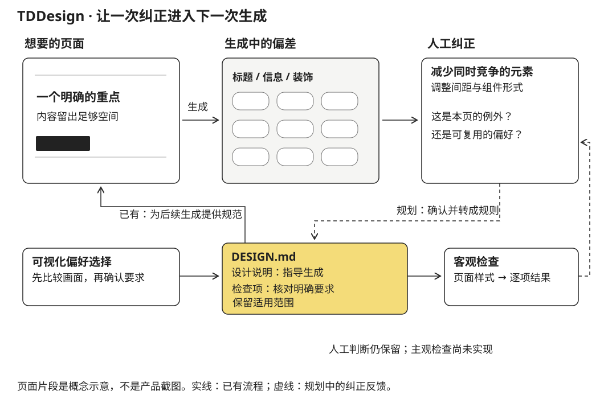

当时做 TDDesign，是因为 AI 生成的设计经常和我想象的不一样。我花了很多时间调整，过程很痛苦。把一个页面改到接近想要的样子，并不意味着下一次生成会记住这些判断。同样的问题还要重新解释，调整也很难积累。

TDDesign 想解决这件事：在生成之前，把想要的设计表达得更具体；在生成之后，把已经明确的要求拿回来检查；如果人工修改中出现值得重复采用的规则，再将它保存下来。这个想法借用了测试驱动开发的逻辑，但检查的对象从代码行为延伸到设计要求。

2026 年 4 月的探索并没有一开始就解决“如何评价审美”。它先把问题落在一个更小的范围：已经选定的颜色、间距、图标约束，下次是否还成立？更难的氛围、层级与整体感受，应当如何留在人可以判断的流程里？

## 从“描述风格”改成“看过之后选择”

“简洁”“有质感”“不要太普通”很难直接变成稳定的实现。即使词语一样，不同人想象的字体比例、内容密度与页面结构也可能完全不同。TDDesign 的第一个产品选择，是让用户在真实渲染的片段之间作比较，而不要求先写出一份设计语言完整的需求。

初始方案将偏好分成整体风格、配色、字体、组件、布局、细节和动效七个维度。从整体风格开始，是为了让后续选择发生在某种视觉语境中。颜色不只是三个 hex 值，圆角也不只是一个数字：它们与字体、内容和布局放在一起，才是用户真正选择的对象。

设计最初考虑从已有设计规范素材中抽取选项，自动标注维度，再根据兼容关系筛选。实际问卷原型先使用手工编排的选项，按 mood 标签分为推荐项和其他项，并没有硬性隐藏“不兼容”的组合。这是一个有意义的约束：系统可以提示某个组合较少见，但不能假定素材库已经穷尽了用户的偏好。

问卷完成后也不立即改动项目。用户先在 review 页检查各项选择，可以返回修改，最后明确提交，才将偏好写成项目内的 `preference_vector.json`。本地 HTTP 服务负责展示与收集，写入后即可退出；偏好文件成为可保留的结果，不需要一个持续在线的设计账户。

## 问卷本身，也经历了设计失败

这部分的版本变化很能说明 TDDesign 到底在处理什么。

最初的风格卡片用了相似的矩形结构，再换上不同的标签和颜色。反馈是看不出差异：用户面对的是同一种页面的几个变色版本，而不是不同风格的页面。4 月 15 日的 mockup 设计因此把差异放到结构里——居中的单一标题、偏左的衬线排版、大字块与粗线、代码与说明并排等，各自需要不同的页面轮廓。

随后又出现一个问题：第一步可以看见完整页面，后面的配色、字体、图标却重新变成孤立样品。用户刚刚选定的整体画面消失了，无法判断组合之后会怎样。下一版因此采用累计预览：从所选 mood 的默认样式开始，按固定顺序合并已经选过的参数，再将当前候选参数叠加上去。

实现上，页面模板带有颜色、字体、圆角、间距等插槽；客户端保存 `mood`、`picks` 和组合后的 `currentStyle`。当用户比较两种字体时，其他条件保持为已经选定的状态；返回改颜色，后续卡片也使用新的颜色。返回修改 mood 时不清空所有选择，让不协调的组合实际显示出来，而不是悄悄恢复默认值。这是为了让用户能判断自己的组合，而非只接受系统认为协调的组合。

另一次调整发生在页面类型。一个 landing page 的主标题与行动按钮，不能代表数据页面的密度和层级。因此，问卷在风格之前增加了页面类型选择：先选 landing 或 dashboard，再在对应骨架里比较风格。类型选择先使用中性外观，避免把“我想要数据页面”与“我喜欢某种配色”混在一起。

模板于是成为 `pageType × mood` 的二维结构。布局选项也从 padding 扩展到标题尺度、正文字号、元素间隔和对齐。页面样例需要有实际标题、正文和图形或数据区域，才足以让这些差异被看见。这里的产品原则逐渐明确：选项要能表达用户正在作出的那个决定，不能只给它一个名字。

## 偏好怎样变成检查，而不是另一份模糊说明

偏好记录为每个维度保存选项 id、参考来源和说明。问卷选项同时带有渲染参数和标准化的 `notesTemplate`：前者决定用户看见什么，后者让检查器能够从同一选择产生规则。例如，一组选色对应背景、正文和强调色的明确值；间距选项可写成“section padding 在 48–96 px 之间”。这些数值是规则示例，不是普遍适用的设计标准。

Composer 将偏好转成两类结果：人和 Agent 都能阅读的 `DESIGN.md`，以及结构化检查项。规范按主题、配色、字体、组件、布局等章节组织；相应章节下面附有 `Checks`，让“应该怎样做”与“怎样检查”留在一起。

检查项保留不同的判断方式：

| 类型 | 可以表达什么 | 结果应如何理解 |
|---|---|---|
| `exact` | 一个指定的颜色值 | 核对具体值，不评价配色整体是否合适 |
| `range` | 一个间距区间 | 核对范围，不能代替对页面节奏的判断 |
| `pattern` | 不使用某类装饰性字符 | 检查出现或缺失，不代表信息层级正确 |
| `subjective` | 克制、温暖、紧凑等整体要求 | 需要解释与人工判断，不能当作客观通过 |

这一区分避免把所有要求都强行量化。主观标准在完整设计中可以由代码分析与截图分析分别提供意见，但两种意见不合并成一个“设计质量分”。一个页面可能颜色和间距都符合规则，仍然缺乏清楚的重点；合成总分反而会掩盖这个问题。

## 为什么“看得见”与“检查得到”要分开

新增布局节奏时，设计曾准备把内部字段从 `layout_spacing` 改为 `layout_rhythm`。实施计划后来保留了原键：新字段当时只用于预览，检查器还不会分析标题大小、文字大小、gap 与 alignment，全面重命名会影响很多文件，却没有增加检查能力。

这不是一个仅关乎命名的细节。它揭示了两个不同的覆盖范围：用户已经可以在预览里比较某种布局变化，但输出检查仍主要处理已有 padding 规则。

在规范之后，Planner 根据当前任务选择相关检查。一个 hero 任务需要布局与字体规则；设置表单不应被迫满足 hero 专用的留白。原型先用确定性的任务关键词规则，而非再让模型临时决定所有检查；遇到未识别的任务则保留全部检查，避免默默遗漏。

Parser 从 HTML、支持的 Tailwind 类与内联样式中提取 `StyleFact`，Checker 将它们与检查计划比较，生成每条规则的结果。它目前分析的是代码中能解析的样式事实，不是浏览器实际渲染后的完整视觉效果。Agent 的 skill、命令和专用角色描述负责接入工作流，客观判断尽量交给确定性的 TypeScript 实现。

## 一次修改怎样成为下一次的约束

完整方案中的 `taste-refiner` 观察人工修改及其原因，提出规则变更，而不直接写回。比如多个区块的留白被统一增大，它可以询问是否应将新的范围加入规范。用户确认后，这条规则才进入后续检查。

需要确认的不是“代码有没有改过”，而是这次修改能否泛化。某一页为容纳更多数据而收紧间距，可能只是局部例外；也可能意味着用户确实希望这个项目一直更紧凑。两者应落在不同范围，不能因为一次 diff 就修改全局偏好。项目规范优先于全局 profile，也是为了保留这种局部选择。

因此，TDDesign 留下的核心产品设计并不是“AI 给 UI 打分”。它试图把表达偏好、生成实现、指出偏差和保存判断连接起来：先让用户看到足够具体的差异，再让机器检查那些已经表达清楚的要求，最后把是否长期保留一条修正的决定交还给用户。最初反复调整的痛苦，正是这个反馈环节缺失时的体验。
