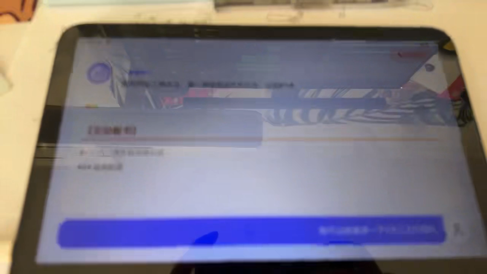

一段语音解释很难承载所有解题信息。学生可以听见老师在说什么，但公式、步骤和几何关系需要留在屏幕上，才能回看和比较。相反，如果只把完整解答铺成一页文字，学生又需要自己判断哪里没懂，再重新组织问题。

Zrobot 把这两种交互放在一起：学生可以拍下题目，听 AI 讲解并继续追问；屏幕则显示与讲解相关的板书。作业批改、题目记录和学习记录围绕同一个学生身份组织。它是一套 Android 学习平板应用与后端系统，设计从 2026 年 1 月展开。

## 从桌面上的题目进入学习

应用入口按学生当下要做的事情区分：写作业、题目答疑、作业检查和 AI 老师。拍题入口连接摄像头，经过取景与裁剪后将题目交给识别和解答流程；作业检查则面向整份作业，批改结果可以进入详情与记录。这样的区分让“我想问一道题”和“我想检查已经写完的作业”不必共用一套含糊的操作。

摄像头也不只是手机自拍摄像头的默认能力。移动端包含 USB 摄像头的发现、权限、预览与选择逻辑，为桌面学习设备的取景方式提供支持；音频端另有对外部采集与原生 RTC 接口的处理。让设备看清纸面、让声音从正确的输入进入系统，都是学习流程的一部分。

账户层区分家长与学生，通过绑定关系连接学习记录。图片和媒体文件由对象存储承接，后端组织作业、题目与会话。这些记录使一次拍题之后的解释有机会被找回，而不是结束语音后只留下一个已经消失的答案。

## 语音基础设施与教学判断分开

实时语音不只涉及语音识别、文本生成和语音合成三个接口。回声、弱网络、打断、声音播放以及会话结束的时机，都可能影响学生能否自然追问。Zrobot 的设计经历了自行串接语音服务、RTC 接入，再到接入 AIConversation 的调整。

后续架构将实时媒体处理交给语音基础设施，把教学上下文、模型回复、记忆和板书保留在自己的后端。服务通过兼容的模型入口请求流式回答，回答中的可说文本进入语音链路；平板另外接收板书事件。这样可以更换或调整教学逻辑，而不必同时重写整条音频传输链路。

会话使用临时身份把媒体侧任务和后端对话关联起来。一次语音通话与其中每一轮回答不是同一个层级：前者负责持续连接，后者需要自己的标识，以便知道某张板书对应哪一次提问，也便于在打断后区分仍然有效与已经过期的内容。

## 为什么板书不能全部等另一个 Agent 画完

早期设计考虑由教师模型发出绘图指令，再调用板书 Agent。这个分工清楚，但如果每一段讲解都必须等待第二次模型生成，语音的节奏就会被板书拖慢。后来的版本进一步区分了板书复杂度。

普通板书由主模型随讲解一起输出。流中使用专门标记区分要说的句子与要显示的内容，解析器把板书部分从语音文本中分离，再立即推送到客户端。步骤标题、重点、高亮、提示框与公式，不需要再调用一个模型“重新写一遍”。

对于 SVG 图形和 HTML 内容，主模型提供生成指令，由独立任务处理。这些任务可以晚于语音完成，不阻塞主要回答，并设置超时。这里接受了一个明确取舍：复杂图形与说话不必每个瞬间严格同步，但不能为了等图形，把整个讲解停住。

因此，系统不是给每个输出格式都配一个同等地位的 Agent，而是按生成成本和交互时效分工。简单板书尽量跟随主回答，复杂视觉内容异步生成，平板根据内容类型选择渲染方式。

## 板书需要可组织的内容，也需要轮次身份

发送到客户端的板书事件包含会话、轮次、段落、内容类型和追加或替换方式。普通板书与 SVG 可以追加到已有内容中，完整 HTML 内容可以替换对应区域。客户端据此展示带编号的步骤、不同层级的标题、重点文字、提示块、公式和图形，而不是把所有结果当成一张图片。

这样的结构有两个作用。首先，讲解可以逐段到达，学生不必等整份答案完成后才看见第一步。其次，视觉内容能够与对话状态对应：当学生打断当前讲解并提出新问题，系统有轮次标识可以标记旧回答过期，客户端也有依据区分旧板书与新回答。

对异步任务尤其如此。旧问题的图可能比新问题的文字更晚到达，如果只按到达顺序显示，屏幕就会倒退到已经结束的话题。架构中的轮次与取消机制，处理的正是这种“生成完成”和“现在仍然相关”之间的区别。它也是语音与视觉分流后必须补上的协调工作。

## 讲解、板书和记录共同构成一次学习

Zrobot 的前端使用 React Native 组织 Android 界面，原生模块承接摄像头与实时音频等设备能力；后端用 FastAPI 组织业务接口、对话和板书事件，数据库与缓存分别承担长期记录和实时状态。

这套拆分服务于一种具体的学习体验：题目先从纸面进入系统，讲解通过声音展开，关键推导留在屏幕上，学生可以随时追问。图片识别、语音传输、教学回答和板书渲染不需要使用同一种技术，但必须围绕同一道题、同一轮对话工作。

这里的设计重点也不是让屏幕尽可能丰富。需要留下的是帮助学生回看推导的内容，需要保持流畅的是可以继续追问的对话。当学生看着某一步说“这里为什么这样”，系统应有足够清楚的题目、会话与板书上下文，继续解释这一步。
